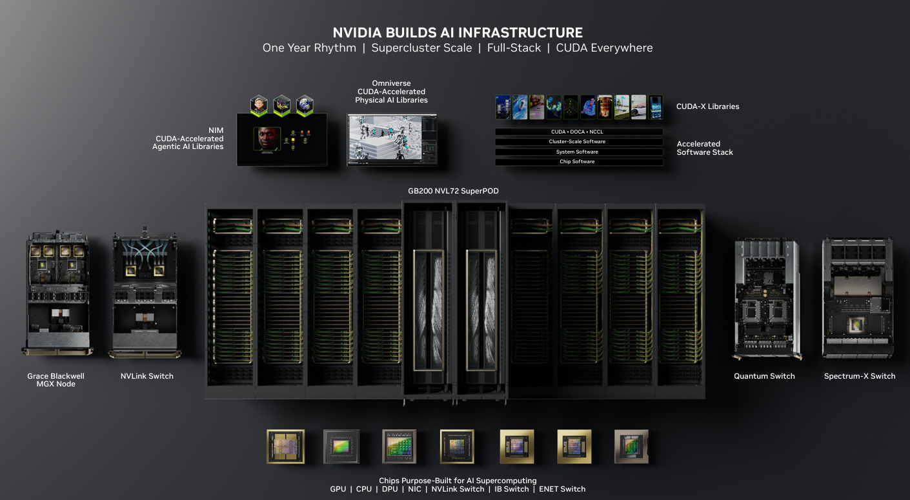

# Introduction

## What is Physical AI?

- **Physical AI** is AI that perceives, reasons about, and acts in the physical world, for example
by controlling robots and machines. The workshop walked through the full workflow:

- The title has three verbs: **Build, Simulate and Deploy**. Together they describe the full life of a robot's intelligence.

1. **Build**: Develop robot behaviors and AI models
2. **Simulate**: Test and validate them in simulation using NVIDIA Isaac Sim and Omniverse
3. **Deploy**: Move the results from simulation toward real world systems

|  | What it means? | Where it appears later in the deck? |
|------|---------------|------------------------------------|
| Build | Create the robot's brain: data, then training of foundation models | Synthetic Data Generation, Foundation Models |
| Simulate | Practice and test the brain in a virtual world before touching real hardware | Simulation and Robot Learning Frameworks (Isaac Sim, Isaac Lab, Newton) |
| Deploy | Run the finished brain on the robot itself, in real time | Robot Runtime (Isaac ROS, Jetson Thor) |

- The phrase **Open Stack** matters too. Many of the tools in this workshop (Isaac Sim, Isaac Lab, Newton, GR00T, Cosmos, OSMO) are published openly on GitHub and Hugging Face, so developers can inspect, modify and extend them.

## NVIDIA Infrastructure Stack Overview



### Layer 1: Chips purpose built for AI supercomputing

- The bottom row of the image shows seven different chips. NVIDIA does not make only GPUs. An AI supercomputer needs several kinds of silicon working together.

| Chip | Job |
|------|--------------------|
| GPU | Does the heavy parallel math of AI training and inference |
| CPU | General purpose control and data handling (NVIDIA's Arm based Grace CPU) |
| DPU | A data processing unit that offloads networking, storage and security work from the main processors (BlueField) |
| NIC | The network interface card that connects a server to the network |
| NVLink Switch | Connects many GPUs to each other at very high speed |
| IB Switch | InfiniBand switch for low latency cluster networking (Quantum) |
| ENET Switch | Ethernet switch tuned for AI traffic (Spectrum-X) |

### Layer 2: Systems built from those chips

1. **Grace Blackwell MGX Node.** A server building block that combines Grace CPUs and Blackwell GPUs in NVIDIA's modular MGX server design.
2. **NVLink Switch.** The component that lets GPUs across many trays act as one connected group.
3. **GB200 NVL72.** A liquid-cooled rack that connects 72 Blackwell GPUs and 36 Grace CPUs. Its 72 GPUs are linked through one NVLink domain, with about 130 TB/s of total GPU to GPU bandwidth inside the rack (roughly 1.8 TB/s per GPU). NVIDIA describes the rack as behaving like one very large GPU.
4. **SuperPOD.** The image labels the central picture a SuperPOD. A SuperPOD joins multiple racks like this into one larger AI factory using fast networking.
5. **Quantum and Spectrum-X switches.** These connect racks to each other across the data center. Quantum is NVIDIA's InfiniBand line, and Spectrum-X is its Ethernet line.

A useful mental model is **scale up versus scale out**:

```
SCALE UP (inside one rack)            SCALE OUT (between racks)
Technology: NVLink                    Technology: InfiniBand / Ethernet
                                      Switches: Quantum / Spectrum-X

  [GPU]=[GPU]=[GPU]=[GPU]               [Rack 1]----[Rack 2]
    ||     ||     ||     ||               |   \      /   |
  [GPU]=[GPU]=[GPU]=[GPU]               [Rack 3]----[Rack 4]
  72 GPUs act like one                  Many racks act like one cluster
```

### Layer 3: The accelerated software stack

- Hardware alone is not enough. The stacks four software layers on top of it.

| Layer | What it does |
|-------|--------------|
| Chip Software | Drivers and low level code that make each chip usable |
| System Software | Manages a whole server or rack |
| Cluster-Scale Software | Manages many systems working as one |
| CUDA, DOCA, NCCL | CUDA is the GPU programming platform. DOCA is the programming framework for DPUs. NCCL is the library that lets many GPUs exchange data efficiently |

### Layer 4: Libraries at the top, where physical AI lives

- This is the part that connects directly to the rest of the workshop. Three families of libraries sit above the stack:

1. **CUDA-X Libraries.** A large collection of GPU accelerated libraries for different domains.
2. **NIM (NVIDIA Inference Microservices) for agentic AI.** Packaged, ready to deploy AI model services.
3. **Omniverse for physical AI.** Libraries for building and simulating physical worlds. This is the bridge into robotics, because **Isaac Sim and Isaac Lab are built on Omniverse technology**.

## Feedback

Found an error or have a suggestion? Please open an issue or pull request on the GitHub repository.
