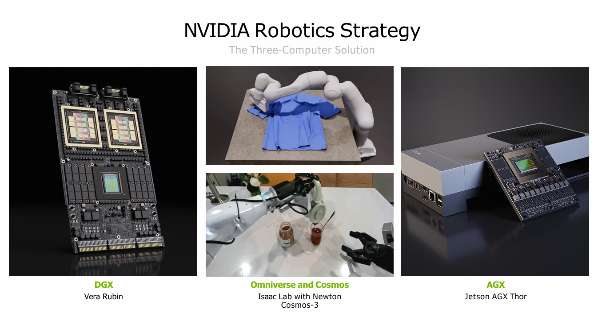
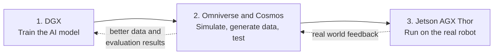

## Problem That Creates the Need

- A robot is not like a normal software product. 
- Its AI has to go through three very different stages, and each stage has different computing demands.

| Stage | Question | Why a normal computer is not enough? |
|-------|--------------|-------------------------------------|
| Learn | How does the robot's brain get trained? | Training uses huge datasets and enormous parallel math |
| Practice | How do we test and improve it safely? | Trying things on a real robot is slow, expensive and can break hardware or hurt people |
| Act | How does the brain run on the robot itself? | The robot must decide in real time, with limited power and space |

- No single machine is good at all three. So NVIDIA splits the work across three computers, one per stage.

## Three Computers at a Glance



| Computer | Stage | Platform | What it shows? |
|----------|-------|-----------------------|----------------------|
| First | Train | **DGX**, Vera Rubin | A data center board for training |
| Second | Simulate and generate data | **Omniverse and Cosmos**, Isaac Lab with Newton, Cosmos-3 | Robot arms folding cloth and stirring a drink |
| Third | Run on the robot | **AGX**, Jetson AGX Thor | A compact robot computer module |

## How the Three Computers Work Together"?

The key idea is that these are not three separate steps done once. They form a **loop**.



Reading the loop:

1. **Train on DGX.** A model learns from data.
2. **Test in simulation.** The model is placed in a virtual world to see how it behaves. Failures found here are cheap and safe.
3. **Generate more data.** Simulation and Cosmos create new training examples, including rare situations that are hard to capture with a real robot.
4. **Retrain.** The new data goes back to DGX, and the model improves.
5. **Deploy on Jetson Thor.** Once the model performs well, it runs on the robot itself.
6. **Learn from reality.** What the real robot experiences feeds back into the simulation and training stages.

This is why the workshop title says **Build, Simulate and Deploy**: it is the same loop.

## Computer 1: DGX, with Vera Rubin

**Role:** the training computer.

1. DGX is NVIDIA's line of AI supercomputers. The same family of hardware that trains large language models also trains robot foundation models.
2. Rubin is the generation after Blackwell, which fits NVIDIA's one year rhythm. It pairs the **Vera CPU** with the **Rubin GPU**.
3. The DGX Vera Rubin NVL72 rack holds 72 Rubin GPUs and 36 Vera CPUs. Treat exact numbers as subject to change.
4. For robotics, this computer trains models such as the GR00T robot foundation model and the Cosmos world models, both covered later in the workshop.

> **Why it matters:** a robot brain is a very large AI model. Training it is the most compute hungry step, so it happens in the data center, never on the robot.

## Computer 2: Omniverse and Cosmos

**Role:** the simulation and synthetic data computer. This is the busiest computer in the loop, and it is where most of the workshop's content lives.

The above image lists three items here.

| Item | What it is? | Job in the loop |
|------|-----------|-----------------|
| **Omniverse** | NVIDIA's platform for building physically accurate virtual worlds | The foundation for simulation |
| **Isaac Lab with Newton** | Isaac Lab is the framework for robot learning and policy training. Newton is an open source physics engine accelerated by NVIDIA Warp, developed with Disney Research and Google DeepMind, and hosted by the Linux Foundation | Lets thousands of virtual robots practice in parallel, with realistic physics |
| **Cosmos-3** | NVIDIA's family of world foundation models for physical AI | Generates realistic video and scenarios, creates synthetic data and helps evaluate robot policies |

Two ideas to hold on to:

1. **Classical simulation versus generative simulation.** Omniverse and Isaac use physics engines that calculate motion from the laws of physics. Cosmos uses AI models that have learned how the physical world looks and behaves. They complement each other.
2. **Tasks, not tools.** Folding cloth and stirring a drink are examples of hard, everyday manipulation tasks. They show that the simulation and models are meant for flexible objects and delicate actions, not only rigid factory parts.

## Computer 3: AGX, with Jetson AGX Thor

**Role:** the runtime computer that sits inside the robot.

1. **Jetson** is NVIDIA's line of compact computers for edge AI, meaning AI that runs on the device instead of in the cloud. **AGX** is its high performance tier.
2. **Jetson AGX Thor** is built on the **Blackwell** GPU architecture, the same architecture family as the data center systems.
3. Published specifications for the Thor developer kit include up to **2070 FP4 TFLOPS** of AI compute, **128 GB** of memory, and a power range of roughly 40 W to 130 W. The T5000 module is the top configuration.
4. NVIDIA positions it as roughly 7.5 times the AI performance of the previous generation Jetson AGX Orin.
5. It is designed to run several models at once on the robot: a vision model, a language model and the control policy.

> **Why on the robot and not in the cloud?** A walking humanoid cannot wait for a network round trip. Decisions must happen in milliseconds, work without a connection, and fit inside the robot's power budget.

## The Hidden Advantage: One Software Foundation

```
 DATA CENTER                 SIMULATION SERVER            ON THE ROBOT
 DGX Vera Rubin              RTX PRO + Omniverse          Jetson AGX Thor
 (Rubin GPU)                 (RTX GPU)                    (Blackwell GPU)
      |                            |                            |
      +----------------------------+----------------------------+
                                   |
                      Same CUDA software foundation
```

**CUDA Everywhere** 

- Because all three computers share the CUDA ecosystem, a model trained on the first computer, tested on the second and deployed on the third does not need to be rewritten for each environment.

## How This Maps to the Rest of the topics?

| Workshop section | Which computer it belongs to? |
|------------------|------------------------------|
| Synthetic Data Generation Pipelines | Computer 2 (Omniverse and Cosmos) |
| Simulation and Robot Learning Frameworks | Computer 2 (Isaac Sim, Isaac Lab, Newton), with training on Computer 1 |
| Foundation Models (GR00T, Cosmos) | Trained on Computer 1, tested on Computer 2 |
| Robot Runtime (Isaac ROS, Jetson Thor) | Computer 3 |

## Summary

1. Robots need three kinds of computing: train, simulate, run.
2. NVIDIA provides one computer for each: **DGX**, **Omniverse and Cosmos**, **Jetson AGX Thor**.
3. They form a loop, not a straight line: data and feedback flow back to improve the model.
4. The shared CUDA foundation lets models move between all three without being rebuilt.
5. This three-computer idea is the skeleton of the entire deck.

## References

1. [NVIDIA Blog, "What Is NVIDIA's Three-Computer Solution for Robotics?"](https://blogs.nvidia.com/blog/three-computers-robotics/)
2. [NVIDIA Isaac learning documentation, "Three Computer Solution"](https://docs.nvidia.com/learning/physical-ai/getting-started-with-isaac-ros/latest/an-introduction-to-ai-based-robot-development-with-isaac-ros/02-three-computer-solution.html)
3. [NVIDIA Jetson AGX Thor](https://developer.nvidia.com/embedded/jetson-agx-thor)
4. [NVIDIA DGX platform](https://www.nvidia.com/en-us/data-center/dgx-platform/)
5. [NVIDIA Isaac platform](https://developer.nvidia.com/isaac)