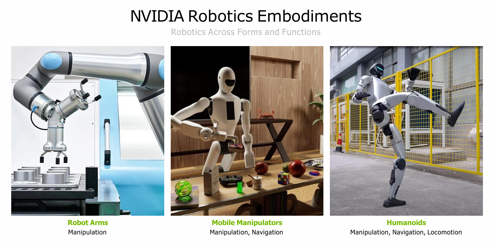
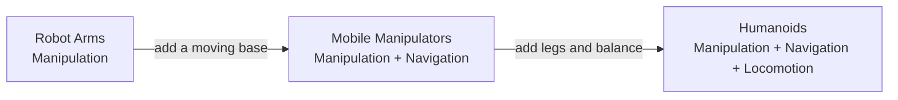

## What "Embodiment" Means?

- An **embodiment** is the physical form of a robot: its body, joints, sensors and the way it moves. - The same AI model idea can be placed into very different bodies, and each body changes the problem.

- A simple way to feel the difference:



1. A factory arm only has to reach and grasp.
2. A robot on wheels also has to find its way around a building.
3. A walking robot also has to keep its balance on two legs while doing everything above.

## Three Core Capabilities

The three capabilities under the robot types. They are the building blocks for everything else in the deck.

| Capability | Meaning | Example |
|------------|---------------|---------|
| **Manipulation** | Using arms and hands to handle objects | Picking a part, pouring a drink, folding cloth |
| **Navigation** | Moving through space to reach a goal while avoiding obstacles | Driving down a corridor, finding a shelf |
| **Locomotion** | Moving the body itself on legs, including balance and walking | Walking, stepping over an obstacle, climbing stairs |

## Three Embodiments

Each robot type on the image adds one more capability than the one before it.

| Embodiment | Manipulation | Navigation | Locomotion | Typical form |
|------------|:-----------:|:----------:|:----------:|--------------|
| **Robot Arms** | Yes | No | No | Fixed arm bolted to a table or workcell |
| **Mobile Manipulators** | Yes | Yes | No | Arm or arms mounted on a wheeled base |
| **Humanoids** | Yes | Yes | Yes | Two legs, a torso, two arms and hands |



### 1. Robot arms

- The simplest embodiment. The base never moves, so the world comes to the robot.
- The challenge is precision and dexterity: grasping many different objects reliably.
- Common in factories and labs. The photo shows an industrial arm with a gripper handling parts.

### 2. Mobile manipulators

- An arm placed on a mobile base, so the robot can travel to the work.
- It must now solve two problems together: 
    1. Where am I and Where do I go? (navigation)
    2. What do I do When I get there? (manipulation)
- Useful in warehouses, hospitals and homes, where objects are spread across a large space.

### 3. Humanoids

- A body shaped like a person, with legs for movement and two arms for work.
- It adds **locomotion**, which is the hardest of the three because the robot must stay balanced while moving and while carrying or pushing things.
- The reason people build them: the world is designed for human bodies (doors, stairs, tools, shelves), so a human shaped robot can in principle work in existing spaces without changing the environment.

> **Loco-manipulation** is the term NVIDIA uses for the hardest combination: moving the body (walking or rolling) while also acting on objects, treated as one coordinated whole body task. Humanoids are where this matters most.

## Complexity Grows With Each Step

```
  Fewer capabilities  ------------------------------>  More capabilities
  Simpler AI problem  ------------------------------>  Harder AI problem

  [ ROBOT ARM ]  ->  [ MOBILE MANIPULATOR ]  ->  [ HUMANOID ]
   Manipulation       Manipulation                Manipulation
                      Navigation                  Navigation
                                                  Locomotion
```

- More capabilities mean more joints to control, more sensors to process and more ways for things to go wrong. 
- That is why training data and simulation become more important as you move toward humanoids.

## How NVIDIA Supports Each Embodiment?

- NVIDIA describes Isaac as an open platform for building AMRs (autonomous mobile robots), robot arms and manipulators, and humanoids. 
- **one platform covers all three forms**. The tools differ in emphasis.

| Embodiment | Main NVIDIA building blocks (covered later in the deck) |
|------------|---------------------------------------------------------|
| Robot Arms | Isaac Manipulator and cuMotion for motion planning, FoundationPose for object pose, Isaac Sim and Isaac Lab for training |
| Mobile Manipulators | Isaac ROS, cuVSLAM and nvblox for mapping and localization, COMPASS and X-Mobility for navigation, plus the arm tools above |
| Humanoids | GR00T foundation models, whole-body control such as SONIC, Isaac Lab and Newton for training, Isaac Teleop for data, Jetson Thor for onboard compute |

- No need to memorize these now. The point is: when you meet a tool, ask which embodiment it serves.

## Why This Matters for Foundation Models?

- **Cross embodiment learning:** A single model trained on data from many robot types (humanoids, mobile manipulators, bimanual arms) can generalize better to new bodies. This is a core theme of the GR00T model that appears later in the workshop.

- **The idea in simple words:** If a model has seen many different bodies perform tasks, it learns what a task means separately from which robot is doing it. Then adapting to a new robot needs far less new data.

## Summary

1. Embodiment means the robot's physical form.
2. Three capabilities: manipulation, navigation, locomotion.
3. Three embodiments: arms (1 capability), mobile manipulators (2 capabilities), humanoids (3 capabilities).
4. More capabilities make the AI problem harder, which is why data and simulation matter so much.
5. NVIDIA Isaac aims to serve all embodiments with one open platform.

## References

1. [NVIDIA Isaac platform overview](https://developer.nvidia.com/isaac)
2. [NVIDIA Isaac documentation, "What Is NVIDIA Isaac?"](https://docs.nvidia.com/learning/physical-ai/getting-started-with-isaac-ros/latest/an-introduction-to-ai-based-robot-development-with-isaac-ros/01-nvidia-isaac.html)
3. [NVIDIA Technical Blog, Isaac Lab 2.3 whole-body control and teleoperation](https://developer.nvidia.com/blog/streamline-robot-learning-with-whole-body-control-and-enhanced-teleoperation-in-nvidia-isaac-lab-2-3/)
