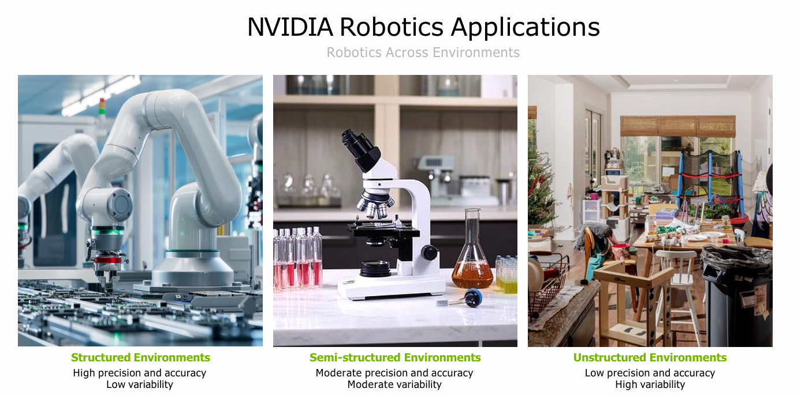

## Two Properties

| Property | Meaning |
|----------|---------------|
| **Variability** | How much the surroundings change from one moment or one task to the next: object positions, shapes, lighting, people moving around |
| **Precision and accuracy** | How exactly the robot can assume positions and motions, because the world is predictable enough to measure and repeat |

This two is move in **opposite directions**. 

- When the world is predictable, a robot can be extremely exact. 
- When the world is messy, the robot cannot rely on exact positions and must be flexible instead.

## Three Environments

- **Structured** : Everything is in a known place (e.g. a factory line).
- **Semi-structured** : A fixed layout, but some things move (e.g. a lab bench or warehouse).
- **Unstructured** : Anything can be anywhere, and things change daily (e.g. a home, outdoors, a hospital ward).

| Environment | Precision | Variability | Programming | Example |
|---|---|---|---|---|
| **Structured** | High | Low | Easy | Robot arm on an electronics assembly line |
| **Semi-structured** | Moderate | Moderate | Moderate | Lab bench with microscope, flasks, sample tubes |
| **Unstructured** | Low | High | Hard | Cluttered home kitchen and living area |

### 1. Structured environments

- The world is designed around the robot. Parts arrive in fixtures, lighting is controlled, and the same motion repeats thousands of times.
- Because positions are known in advance, the robot can be programmed to move to exact coordinates with very high repeatability.
- This is where traditional industrial robots have worked successfully for decades.

### 2. Semi-structured environments

- The overall layout is fixed, but some details change: where an object sits, which tube is next, whether a person has moved something.
- The robot needs some perception (cameras and sensors) to find and adapt to those changes, while still working in a mostly predictable space.
- Typical examples are laboratories, warehouses and logistics cells.

### 3. Unstructured environments

- Nothing is guaranteed. Objects come in endless shapes, clutter is random, and the arrangement changes every day.
- The robot cannot be given exact coordinates ahead of time. It must **understand the scene and decide on the spot**.
- Homes, offices, hospitals and outdoor sites fall here. The image messy kitchen photo makes the point visually.

## Why Difficulty Rises So Quickly?

The approach changes at each step.

| Environment | Typical way to build the robot's behavior |
|-------------|--------------------------------------------|
| Structured | Write explicit programs and fixed trajectories. Little or no learning needed |
| Semi-structured | Combine programming with vision, motion planning and some learned skills |
| Unstructured | Rely on **learned policies and foundation models** that generalize across many situations |

- In an unstructured world there are far too many possible situations to write rules for each one. The robot has to learn general skills from large amounts of experience. 
- That is exactly why we need a **synthetic data, simulation and foundation models**.

## How the Embodiments and Environments Fit Together?

Three bodies and Three Environments form a grid. This is a general tendency, not a strict rule.

| | Structured | Semi-structured | Unstructured |
|---|:---:|:---:|:---:|
| **Robot arms** | Very common | Growing | Hard, active research |
| **Mobile manipulators** | Common | Common | Emerging |
| **Humanoids** | Rare | Early pilots | The long term goal |

> **Why humanoids are linked to unstructured settings?**: The human world (homes, offices, stairs, tools) is exactly the messy, variable environment, and a human shaped robot is meant to operate there without the environment being redesigned.

## What This Means for NVIDIA's Platform?

The environment axis explains which parts of the NVIDIA stack matter most.

1. **Structured work** benefits from accurate simulation for validation and from fast motion planning (for example the Isaac Manipulator tools).
2. **Semi-structured work** adds perception and mapping libraries such as those in Isaac ROS.
3. **Unstructured work** depends on foundation models (GR00T, Cosmos), huge and diverse training data (synthetic data pipelines, Isaac Teleop, NuRec), and large scale simulation to test behavior before it meets the real world.

- The more variable the world, the more diverse the training experience must be. 
- Simulation is how you create diversity cheaply: change the lighting, move the objects, add clutter, and repeat millions of times.

## Summary

1. Two properties describe an environment: precision and variability, and they trade off.
2. Structured: high precision, low variability (factory lines).
3. Semi-structured: moderate on both (labs, warehouses).
4. Unstructured: low precision, high variability (homes and the open world).
5. The more unstructured the setting, the more the robot needs learned, general intelligence, which is why data, simulation and foundation models are the core of this workshop.

## References

1. [NVIDIA Isaac platform overview] (https://developer.nvidia.com/isaac)
2. [NVIDIA Blog, "What Is NVIDIA's Three-Computer Solution for Robotics?"] (https://blogs.nvidia.com/blog/three-computers-robotics/)
3. [NVIDIA Robotics use cases] (https://www.nvidia.com/en-us/use-cases/robotics/)

> **Note:** the structured, semi-structured and unstructured terms are standard robotics vocabulary used across academic and industry literature. so the explanations above follow the general robotics along with NVIDIA stack terminology.