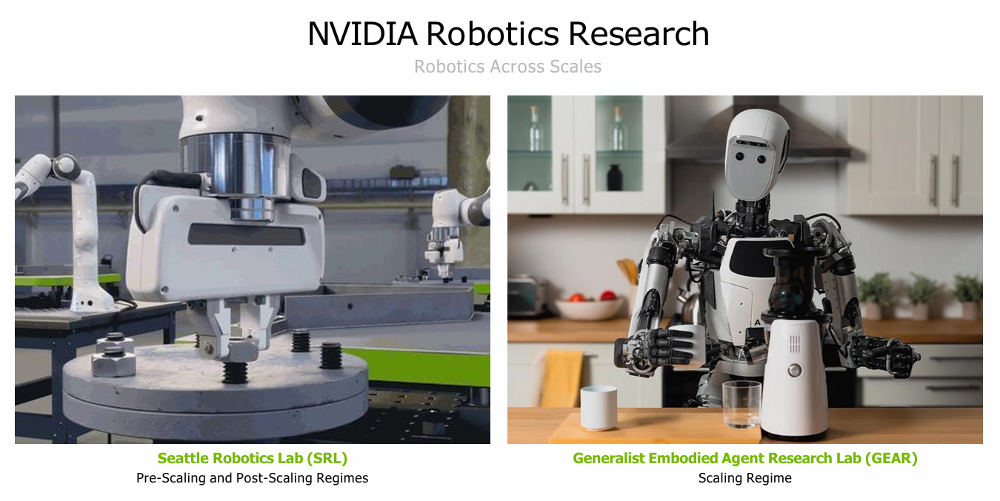
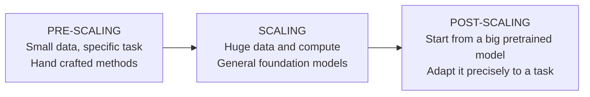

## Introduction

**How does NVIDIA itself do research on robot intelligence, and at what scale?** 

- This Questions introduces two research labs and a vocabulary of three "regimes" that will help to read the rest of the workshop.

## Two Labs



| Lab | What it does? | Regime|
|-----|--------------|---------------------|
| **Seattle Robotics Lab (SRL)** | Advances robot manipulation in human environments, focusing on dexterous control, perception and learning, for industries such as manufacturing, logistics and healthcare | Pre-Scaling and Post-Scaling |
| **Generalist Embodied Agent Research Lab (GEAR)** | Builds foundation models for embodied agents in both virtual and physical worlds. | Scaling |

- Both are listed on NVIDIA's robotics research page, alongside other groups such as the Spatial Intelligence Lab and the autonomous vehicle research groups.

Two photos match the labs' styles:

1. **SRL:** A robot arm working on a precision assembly task with nuts and bolts. This is careful, contact heavy manipulation.
2. **GEAR:** A humanoid in a kitchen working with everyday objects such as cups and a blender. This is general purpose, human world behavior.

## What "Scale" Means Here?

Title says "Robotics Across Scales". 

- In Machine learning, **scaling** means making a model better by increasing three things together:

    1. Amount of **data**.
    2. Amount of **compute**.
    3. Size of the **model**. 

- In language AI, scaling is what produced today's large language models.

- Robotics is now trying to follow the same path.

## Three Regimes



| Regime | Situation | Typical question |
|--------|-----------|------------------|
| **Pre-scaling** | Not enough data or compute for a general model, so researchers solve one task at a time with focused methods | How do we make a robot reliably do this one hard task? |
| **Scaling** | Large amounts of diverse data and compute are used to train broad models | What happens when we scale data, compute and model size for robots? |
| **Post-scaling** | Large pretrained models already exist, so the work becomes adapting, specializing and making them dependable | How do we turn a general model into a precise, reliable worker? |

### 1. Pre-scaling: solving specific problems well

- Before big general models exist, progress comes from understanding a problem deeply: physics, contact, sensing and control.
- Inserting a nut onto a bolt demands millimeter level care, which a general model will not get right without help.
- These methods stay valuable even later, because real products need exactly this kind of precision.

### 2. Scaling: building the general brain

- The goal is a **generalist** model that can work across many tasks, scenes and even robot bodies.
- This needs enormous and diverse data, which is why GEAR works on simulation infrastructure and synthetic data pipelines alongside its models.
- GEAR's published research agenda covers multimodal foundation models, general purpose robots, foundation agents and simulation with synthetic data. The Isaac GR00T humanoid foundation model, which appears later in the deck, belongs to this line of work.

### 3. Post-scaling: from general to dependable

- Once a big pretrained model exists, the hard part is the last mile: fine tuning on a specific robot and task, and making the result reliable enough for real use.
- This is where the workshop's later flow appears: pretrained model, then post-training with robot data, then policy training and evaluation in simulation.

## Why SRL Spans Two Regimes and GEAR Sits in One?

- SRL have both pre-scaling and post-scaling, while GEAR gets only scaling. This reads naturally:

1. **GEAR** pushes the frontier of scale, building the large models.
2. **SRL** works on both sides of that frontier. Before scale, it develops precise task level methods. After scale, it studies how to specialize and refine what large models produce.

- The two labs are therefore complementary, not competing. One builds the general engine, the other makes sure the engine works precisely on real hardware.

## Bigger Picture: Research Pipeline

```
PRE-SCALING               SCALING                POST-SCALING
(SRL)                     (GEAR)                   (SRL)

Precise methods       Big general models      Adapt and make reliable
for hard tasks        from huge data          for real robots

Small data             Massive data           Small, targeted data
Specific skill         Broad skill            Specific, dependable skill
```

- This is the same arc the NVIDIA platform supports for customers:

| Stage | NVIDIA tools you will meet later |
|-------|----------------------------------|
| Create large scale data | Cosmos, NuRec, Isaac Teleop, synthetic data pipelines |
| Build or start from a general model | GR00T, Cosmos 3 |
| Adapt and evaluate in simulation | Isaac Lab, Newton, Isaac Lab Arena |
| Run on the robot | Isaac ROS, Jetson Thor |

## Important Notes

- Unstructured environments are the reason scaling is needed: too much variety to program by hand
- "Scaling Robot Intelligence" Shows the same idea: more compute and data volume gives more robot capability

## Summary

1. NVIDIA researches robotics in several labs. This workshop highlights two: **SRL** and **GEAR**.
2. SRL focuses on dexterous manipulation, perception and learning in human environments.
3. GEAR builds foundation models for embodied agents in virtual and physical worlds.
4. Three regimes: 
    - **pre-scaling** (task specific) 
    - **scaling** (big general models) 
    - **post-scaling** (adapting big models to precise work).
5. SRL covers the two ends and GEAR the middle, so together they cover the full path from specific methods to general models to dependable robots.

## References

1. [NVIDIA Robotics Research](https://www.nvidia.com/en-us/research/robotics/)
2. [NVIDIA GEAR lab](https://research.nvidia.com/labs/gear)
3. [NVIDIA Isaac GR00T](https://developer.nvidia.com/isaac/gr00t)
