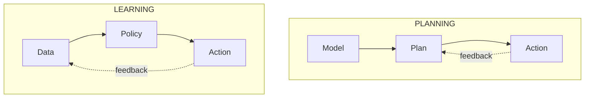

## Introduction

- We already understand bodies, environments and research scale.
- Now the deck turns to the three core questions: 

| Question | Topic it introduce |
|-------------------|------------------|
| How do we design intelligence for robots?| **AI for Robotics**  |
| How do we generate experience? |**Simulation for Robotics** |
| How do we close the loop between compute and physical AI? | **Compute for Robotics** |

- Think of them as three lenses on one problem:

    1. **Brain** (AI)
    2. **Practice ground** (Simulation)
    3. **Engine** (Compute)

- So In this section we start with the first of a set of three: **AI for Robotics**

## Two Ways to Build a Robot's Brain

1. **Planning** 
2. **Learning**

- Both end in the same place, an **Action**, but they get there differently.



## Approach One: Planning

**Chain: Model, then Plan, then Action.**

1. **Model.** Engineers write down how the world works: the robot's geometry, the physics, where obstacles are.
2. **Plan.** Using that model, the computer searches for a sequence of moves that reaches the goal, for example a collision free path for an arm.
3. **Action.** The robot carries out the plan.
4. **Feedback loop (action back to plan).** After acting, the robot checks what actually happened and **replans** if reality differs from the model.

**Strengths**

1. Predictable and explainable: you can inspect the model and the plan.
2. Works very well when the world is known and measured accurately.
3. Needs little or no training data.

**Weaknesses**

1. It is only as good as the model. If the real world differs from the model (a slippery object, a cluttered shelf), plans fail.
2. Writing an accurate model of a messy world by hand is extremely hard.

- This matches **structured environments**, where positions are known and repeatable.

## Approach Two: Learning

**Chain: Data, then Policy, then Action.**

1. **Data.** Examples of the task: human demonstrations, simulated experience, videos, robot logs.
2. **Policy.** A trained neural network that looks at what the robot sees and senses and directly decides what to do next. The word *policy* simply means the rule that maps observations to actions.
3. **Action.** The robot executes what the policy outputs.
4. **Feedback loop (action back to data).** What the robot experiences becomes new data. Collecting it, finding the useful parts and retraining makes the policy better over time. The database with a magnifying glass on the image represents this storing and searching of data.

**Two common ways a policy learns**

| Method | How it learns? | Everyday analogy |
|--------|---------------|------------------|
| **Imitation learning** | Copies demonstrations from humans (the robot is shown the right behavior) | Learning by watching a teacher |
| **Reinforcement learning (RL)** | Tries actions, receives rewards for good outcomes and improves by trial and error | Learning a video game by playing |

**Strengths**

1. Handles messy, variable situations because it learns patterns instead of relying on hand written rules.
2. Can improve continuously as more data arrives.

**Weaknesses**

1. Needs a lot of data, and robot data is hard to collect.
2. Behavior can be harder to explain or guarantee.

- This matches **unstructured environments**.

## Planning Vs Learning

| | Planning | Learning |
|---|----------|----------|
| Starting point | A hand built model of the world | A dataset of experience |
| Core component | Planner | Policy (neural network) |
| Feedback loop | Replan using the result | Collect new data and retrain |
| Best in | Predictable, structured settings | Variable, unstructured settings |
| Main bottleneck | Building an accurate model | Getting enough good data |

## Where Modern Foundation Models Fit?

- The learning approach has produced a new class of model called a **Vision-Language-Action (VLA) model**. 
- NVIDIA describes a VLA as a foundation model that takes visual input and language instructions and outputs actions for a robot. 
- It is usually trained first by imitation of robot demonstrations, and can optionally be refined with reinforcement learning.

- NVIDIA's **Isaac GR00T** is a VLA model for humanoid robots, and it appears later in the workshop. 
- Its design is a useful example of the two approaches blending: 

    - A reasoning module that works out what to do at a high level.
    - Combined with a fast action module that produces smooth motor commands.

## Real Answer Is Often "Both"

Real robots rarely use only one approach. A common split is:

```
  HIGH LEVEL (slow, 1 to 5 times per second)
      Understand instructions, reason about the scene, plan tasks
                         |
  MID LEVEL (about 30 times per second)
      Perception, motion planning, grasp planning
                         |
  LOW LEVEL (100 to 1000 times per second)
      Control policy or model predictive control, joint level control
```

- Planning style methods and learned policies each take the layers where they work best, and the trend is for learned components to take over more of the stack.

## Hidden Problem This Topic Sets Up

- Learning needs **data**. 
- That creates the next question: where does all that experience come from?
- Real robot data is slow, costly and limited.
- This is why next topic is **"How do we generate experience?"** and answers with simulation.

## Summary

1. The question: how do we design intelligence for robots?
2. **Planning:** model, plan, action, with replanning feedback. Strong when the world is known.
3. **Learning:** data, policy, action, with new experience feeding back into data. Strong when the world is variable.
4. Policies are learned mainly through imitation (copying) or reinforcement (trial and error).
5. Modern robots mix both, and foundation models such as GR00T push the balance toward learning.
6. Learning is limited by data, which leads directly to simulation.

## References

1. [NVIDIA learning course, Isaac GR00T Vision-Language-Action models](https://docs.nvidia.com/learning/physical-ai/sim-to-real-so-101/latest/10-groot.html)
2. [GR00T N1 research paper](https://arxiv.org/abs/2503.14734)
3. [NVIDIA Isaac GR00T](https://developer.nvidia.com/isaac/gr00t)
4. [NVIDIA Isaac Lab](https://developer.nvidia.com/isaac/lab)
