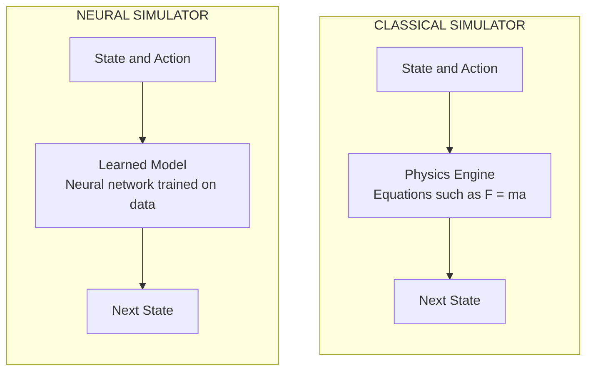
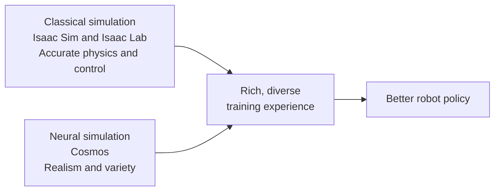

## Introduction

- Last topic ended with a problem: learning needs data, and real robot data is slow, costly and limited.

- So This is the second of the three quetion **How Do We Generate Experience?** This topic gives the answer in one word, **simulation**.

## Why Simulation Is Needed?

- A robot learns from experience, meaning many attempts at a task. 
- Getting that experience on a real robot has hard limits.

| Limit of real world practice | Why it hurts? |
|------------------------------|--------------|
| Slow | A real robot runs in real time, one attempt after another |
| Costly | Hardware, space, supervision and wear and tear |
| Risky | Early policies can crash, drop things or hurt people |
| Narrow | You only see the situations you can physically set up |

- A simulator removes these limits: thousands of virtual robots can practice in parallel, faster than real time, with no damage and any scenario you can describe.

## What a Simulator Actually Is?

```
   State & Action   --->   [ something in the middle ]   --->   Next State
```

- A simulator answers one question: **given the world's current state and an action, what will the next state be?** 
- Repeat that step again and again and you have generated experience.
- The only difference between the two simulators is **what sits in the middle**.



## Classical Simulator

**Physics engine.**

- The engine contains written down laws of physics: forces, mass, friction, collisions, joint limits. The image shows gear, spring and "F = ma" icons represent this.
- Given a state and an action, it **calculates** the next state by solving those equations.
- Everything is explicit: if you set the mass or friction, you can see exactly why an object moved the way it did.

**Strengths**

1. Physically principled and consistent. The same input gives the same output.
2. Precise for contact, forces and joint motion, which matters for control and safety.
3. Easy to read out exact quantities such as forces, positions and velocities.

**Weaknesses**

1. Needs a carefully built virtual world: 3D assets, correct physical properties, scene setup.
2. Real world details that are hard to model (soft cloth, liquids, worn surfaces) are approximated, which creates a **sim-to-real gap**.
3. Making scenes look photographically real takes effort.

**NVIDIA examples**

| Tool | Role |
|------|------|
| Omniverse | Platform for building physically accurate virtual worlds |
| Isaac Sim | Robotics simulation framework using PhysX and RTX rendering |
| Isaac Lab | Robot learning framework running many parallel simulations |
| Newton | Open source, GPU accelerated physics engine built for robot learning |

- Isaac Lab supports several physics engines, including PhysX, NVIDIA Warp, Newton and MuJoCo.

## Neural Simulator

**Learned model.**

- Instead of equations, the middle is a neural network that has **learned** how the world behaves by studying huge amounts of data such as video and robot actions.
- Given a state and an action, the model **predicts** the next state, for example the next camera frames after the robot moves its arm.
- A model like this is called a **world model** or **world foundation model**.

**Strengths**

1. Produces diverse, photorealistic scenes and situations without hand building each 3D asset.
2. Can imagine hard to model things, such as cloth or liquids, because it learned them from real examples.
3. Well suited to creating varied training data and to evaluating robot policies at scale.

**Weaknesses**

1. Physics is learned and approximate, so it can drift from reality, especially over long sequences.
2. Less transparent: you cannot easily inspect why it predicted what it did.
3. Not a replacement for an exact physics engine in safety critical control loops.

**NVIDIA example: Cosmos**

- **Cosmos** is NVIDIA's family of world foundation models for physical AI.
- **Cosmos 3** as one open model that combines physical reasoning, world generation and action generation.
- It can act as an **action conditioned world model**: it takes the robot's actions as input and predicts the resulting video. Early adopters such as Agile Robots describe testing it as a neural simulator to evaluate robot policies and stress test edge cases.
- Cosmos gets its own section later in the workshop, so treat this as a preview.

## Classical simulator Vs Neural simulator

| | Classical simulator | Neural simulator |
|---|---------------------|------------------|
| What is in the middle | Physics engine | Learned model |
| How the next state is found | Calculated from equations | Predicted from learned patterns |
| Needs hand built 3D scenes | Yes | Much less |
| Physical precision | High and consistent | Approximate |
| Visual and scene diversity | Limited by what you build | Very high |
| Main risk | Sim-to-real gap from modeling errors | Drift or unrealistic physics |
| NVIDIA examples | Isaac Sim, Isaac Lab, Newton, PhysX | Cosmos |

## They Work Together, Not Against Each Other



- A common pattern is to use the physics engine for correct motion and contact, then use a world model to add realism and variety, for example changing lighting, textures and scenes, or evaluating policies in generated worlds.

## Remaining Challenge: Sim-to-Real

- No simulator is the real world. 
- The difference between simulated and real behavior is called the **sim-to-real gap**. 
- A policy that works perfectly in simulation can still fail on a physical robot. 
- Much of the workshop is about shrinking that gap: more realistic physics, real world data brought into simulation (NuRec and Isaac Teleop), and diverse generated data.

## Summary

1. Learning needs experience, and simulation generates it faster, cheaper and more safely than real robots.
2. A simulator maps **state and action to next state**.
3. **Classical simulator:** a physics engine computes the next state from equations (Isaac Sim, Isaac Lab, Newton).
4. **Neural simulator:** a learned model predicts the next state from patterns it learned in data (Cosmos).
5. Classical gives precision, neural gives diversity and realism, and the best workflows combine them.
6. The sim-to-real gap is the main remaining challenge.

## References

1. [NVIDIA Isaac Sim](https://developer.nvidia.com/isaac/sim)
2. [NVIDIA Isaac Lab](https://developer.nvidia.com/isaac/lab)
3. [NVIDIA Cosmos](https://www.nvidia.com/en-us/ai/cosmos/)
4. [NVIDIA Technical Blog, "Develop Physical AI Reasoning, World and Action Models with NVIDIA Cosmos 3"](https://developer.nvidia.com/blog/develop-physical-ai-reasoning-world-and-action-models-with-nvidia-cosmos-3)
5. [NVIDIA perspectives, simulation frameworks for VLA training](https://perspectives.nvidia.com/isaac-lab/simulation-frameworks-vision-language-action-models-generalist-robot-policy/)
