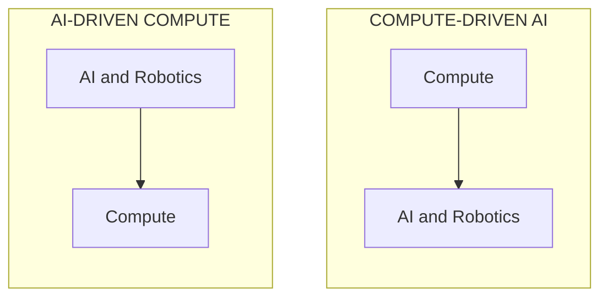
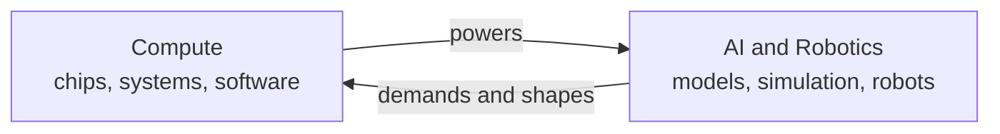

## Introduction

- This is the third and last quetion from our three core quetion series, Each one looked at robot intelligence through a different lens.
- So question is:  **How Do We Close the Loop Between Compute and Physical AI?** 
- The first two lenses describe the **brain** and the **practice ground**. This one describes the **engine** underneath both: the computing hardware and software that make learning, simulation and real time operation possible.

## Compute: Physical AI Feedback Loop

- This two small diagrams contain the same two boxes, but the arrow points in opposite directions.



- Putting the two arrows together gives a **loop**, and that loop is the whole message:



- Better compute makes better physical AI possible. Physical AI, in turn, creates new requirements that decide what compute gets built next. Each side keeps improving the other.

## Compute-Driven AI

**Compute leads, and AI and robotics benefit.**

- This is the more familiar direction. More and better computing unlocks capabilities that were not practical before.

1. **Training bigger robot models.** Foundation models for robots need large amounts of data and computation. Data center systems such as the GB200 and GB300 racks, and the newer Vera Rubin generation, make it possible to train them.
2. **Simulating at scale.** Thousands of parallel simulations, high fidelity rendering and generative world models all demand heavy GPU compute. This is what lets simulation produce experience faster than the real world.
3. **Running smarter models on the robot.** Faster onboard computers let robots run larger models in real time, instead of simple hand coded behaviors.
4. **A predictable upgrade path.** New hardware generations arrive regularly, so each year the same robotics software can reach further.

> **Simple way to remember it:** More compute lets researchers scale data, models and simulation, and scale. This is what identified as the route to general robot intelligence.

## AI-Driven Compute

**Robotics and AI lead, and compute is designed around their needs.**

- This is the less obvious direction. Robots are very different from a typical data center workload, so they push hardware in specific directions.

### What robots demand from compute?

| Robot requirement | Why it is demanding? |
|-------------------|---------------------|
| **Real time response** | A robot must act within milliseconds, so it cannot wait for a cloud connection |
| **Many sensors at once** | Cameras, depth sensors, IMUs and touch sensors produce continuous streams that must be fused together |
| **Several models at once** | Vision, language, planning and control models may all run together |
| **Tight power and size limits** | Compute must fit inside a robot body and run on a battery |
| **Mixed critical tasks** | Safety related control must stay predictable while heavy AI runs alongside |

### How NVIDIA's hardware reflects those demands?

- Jetson AGX Thor is the clearest example. NVIDIA describes it as a computer built for generative reasoning and multimodal, multi-sensor processing at the edge.
- Its design choices line up with the table above:

1. **Blackwell GPU with a Transformer Engine and native FP4.** Modern robot models are transformers, so the hardware is tuned for them. FP4 is a compact number format that lets large models run faster in less power.
2. **Multi-Instance GPU (MIG).** Splits the GPU into isolated slices so that time sensitive work can stay predictable beside heavy AI work. NVIDIA presents this for mixed criticality robotics applications.
3. **High throughput I/O and large memory.** Up to 128 GB of memory and fast networking let it take in dense sensor data and hold several models at once.
4. **A robot sized power envelope.** Roughly 40 W to 130 W, compared with the many kilowatts of a data center rack.

- Compare this with the Compute-Driven AI: the data center chips come from scale demands, and the Jetson chips come from robot demands. Both are shaped by what physical AI needs.

## Full Picture: Compute at Three Places

```
  DATA CENTER            SIMULATION SERVERS         THE ROBOT (EDGE)
  (DGX, Vera Rubin)      (RTX PRO, Omniverse)       (Jetson AGX Thor)

  Needs: scale           Needs: graphics and        Needs: low latency,
  Trains big models      physics at scale           low power, real time
        |                      |                           |
        +----------------------+---------------------------+
                               |
              CUDA software foundation connects all three
```

- Because the same CUDA software runs across all three, improvements travel along the whole chain. 
- That is how the loop on this stays closed in practice.

## Where the Loop Is Already Visible in This Workshop?

| Evidence | Which?|
|----------|-------------|
| Data center systems growing with each generation, used to train GR00T and Cosmos | Compute drives AI |
| Cosmos world models shortening training and evaluation cycles | Compute drives AI |
| Jetson Thor designed around transformer models and multi-sensor input | AI drives compute |
| Agent skills for hardware optimization and Jetson Linux customization | AI starts to help design and tune compute itself |

- The last row is a preview : AI agents helping with infrastructure tasks (OSMO orchestration, Jetson agent skills). 
- That closes the loop even further: AI is not only a consumer of compute, it helps manage and optimize it.

## Why NVIDIA Frames It This Way?

- NVIDIA sells compute, so this loop is also a strategic statement. 
- The company argues that it can run the loop end to end because it builds the chips, the systems, the simulation platform and the models together (the "full stack" idea). 
- A company building robots does not need to coordinate these pieces itself.
- For our own study, the useful takeaway is technical, not commercial: **improving physical AI is not only an algorithm problem, it is a co-design problem between algorithms and hardware.**

## Summary

1. The question: how do we close the loop between compute and physical AI?
2. **Compute-driven AI:** more computing power unlocks bigger models, richer simulation and smarter on-robot intelligence.
3. **AI-driven compute:** robots need real time, multi-sensor, low power computing, so hardware is designed around those needs (for example Jetson Thor).
4. Together they form a flywheel: each side improves the other.
5. Progress in physical AI depends on hardware and algorithms being designed together.

## References

1. [NVIDIA Technical Blog, "Introducing NVIDIA Jetson Thor, the Ultimate Platform for Physical AI"](https://developer.nvidia.com/blog/introducing-nvidia-jetson-thor-the-ultimate-platform-for-physical-ai/)
2. [NVIDIA Blog, "NVIDIA Jetson Thor Unlocks Real-Time Reasoning for General Robotics and Physical AI"](https://blogs.nvidia.com/blog/jetson-thor-physical-ai-edge)
3. [NVIDIA Blog, "What Is NVIDIA's Three-Computer Solution for Robotics?"](https://blogs.nvidia.com/blog/three-computers-robotics/)
4. [NVIDIA Jetson AGX Thor](https://developer.nvidia.com/embedded/jetson-agx-thor)