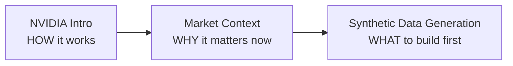
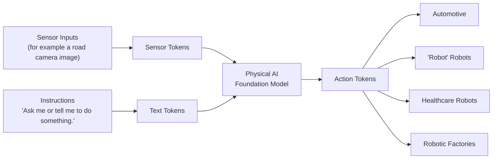

- This topic states how big the opportunity is, and it shows, in a single diagram, **how one kind of AI model can serve all of those industries**.

## What Just Finished?

- The first section, **NVIDIA Intro**, answered the question **how**.

**What they covered?**

- The AI infrastructure NVIDIA builds, from chips to software.
- The mission: help any company become a robotics company.
- The three-computer solution: train, simulate, run.
- Robot bodies: arms, mobile manipulators, humanoids.
- Environments: structured, semi-structured, unstructured.
- Research at different scales: SRL and GEAR.
- Three lenses on robot intelligence: AI, simulation and compute.
- By now you have the technical vocabulary. You know what the pieces are and how they relate.

## What This Section Adds?

**Market Context** answers a different question: **why now, and why does it matter?**



- The section is short, and it prepares you to see the technical sections that follow as answers to real commercial demand.

## What Is Physical AI?

- **Physical AI** is AI that does not stay on a screen.
- It senses the real world, understands it, and acts on it through a machine such as a car, a robot or a factory system.

| | Digital AI (for example a chatbot) | Physical AI |
|---|------------------------------------|-------------|
| Input | Text, images | Camera and other sensor data, plus instructions |
| Output | Text, images, code | Actions that move a machine |
| Where mistakes show up | On a screen | In the real world, where they can break things or hurt people |
| Hard parts | Knowledge and language | Physics, timing, safety and variability |

- Everything you have seen so far (three computers, simulation, foundation models) exists to make this kind of AI practical.

## General Physical AI System



### Stage 1: Two kinds of input

1. **Sensor inputs.** What the machine perceives. The example is a camera image of a highway, but this can also be depth, lidar, touch or joint positions.
2. **Instructions.** What a person wants. for example: "Ask me or tell me to do something." That wording matters: you can **ask** (a question the machine should answer or reason about) or **tell** (a command the machine should carry out).

### Stage 2: Everything becomes tokens

- A **token** is a small unit of data that an AI model processes.
- Language models turn words into text tokens. Physical AI models do the same trick for the physical world:

| Token type | Comes from | Role |
|------------|-----------|------|
| Sensor tokens | Camera images and other sensors | Describe what the machine sees |
| Text tokens | The person's instruction | Describe what is wanted |
| Action tokens | The model's output | Describe what the machine should do |

- Turning very different data into one shared format is what allows a **single model** to handle them together.

### Stage 3: The physical AI foundation model

- The block in the center takes sensor tokens and text tokens and produces action tokens.
- A **foundation model** is a large model trained on broad data so that it can be adapted to many tasks, instead of being built for one narrow job.

- You have already met two NVIDIA examples of this idea:

1. **GR00T** is a vision-language-action model. NVIDIA's research paper describes it as taking image observations and language instructions and generating motor actions.
2. **Cosmos 3** is shown later in the deck as an omnimodel that handles text, image, video, audio and action, both as input and output.

> **A useful nuance:** "action tokens" is a simplified picture. In GR00T, the action module is built with a diffusion transformer that generates smooth, high frequency motor commands, rather than predicting actions one word at a time. The tokens idea describes the overall flow, not every internal detail.

### Stage 4: Actions drive many kinds of machines

- The action tokens are decoded into real commands, and the same overall design serves four very different areas shown on the right:

| Domain | What it means? | Related NVIDIA pieces |
|---------------------|---------------|------------------------|
| **Automotive** | Autonomous and assisted driving. The sensor input in the diagram is itself a road scene | DRIVE Hyperion  |
| **"Robot" Robots** | General robots such as arms, mobile manipulators and humanoids. The quotation marks suggest "robots in the classic sense" | Isaac, GR00T, Jetson Thor |
| **Healthcare robots** | Surgical and clinical assistance robots | Isaac for Healthcare, Holoscan |
| **Robotic factories** | Whole factories and warehouses run as coordinated robotic systems | Omniverse digital twins, including the Mega blueprint for testing robot fleets virtually before deployment |

## Big Idea: One Recipe, Many Industries

- The most important message is not any single box. It is that **the same recipe works everywhere**:

```
   Perceive (sensor tokens)  +  Understand the goal (text tokens)
                          |
                          v
                Physical AI Foundation Model
                          |
                          v
                 Act (action tokens)
```

- Before foundation models, a self-driving system, a factory arm and a surgical robot would each need a separately engineered software stack. 
- The vision of this topic is a **shared model design** that can be trained on large data, then adapted to each machine.
- That is the same shift that happened in language AI, where one model family replaced many specialized tools.
- A foundation model is only as good as the data and compute behind it.

## Summary

1. Physical AI senses, understands and acts in the real world.
2. A foundation model takes **sensor tokens** and **text tokens** and produces **action tokens**.
3. You can **ask** or **tell** the system, so it can reason as well as act.
4. One design serves automotive, general robots, healthcare robots and robotic factories.

## References

1. [NVIDIA Glossary, Generative Physical AI](https://www.nvidia.com/en-us/glossary/generative-physical-ai/)
2. [GR00T N1 research paper](https://arxiv.org/abs/2503.14734)
3. [NVIDIA Blog, "What Is NVIDIA's Three-Computer Solution for Robotics?"](https://blogs.nvidia.com/blog/three-computers-robotics/)
4. [NVIDIA Omniverse and Cosmos for physical AI](https://www.nvidia.com/en-us/omniverse/)