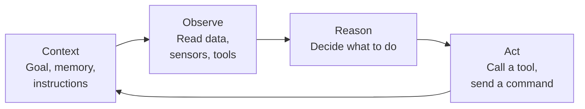
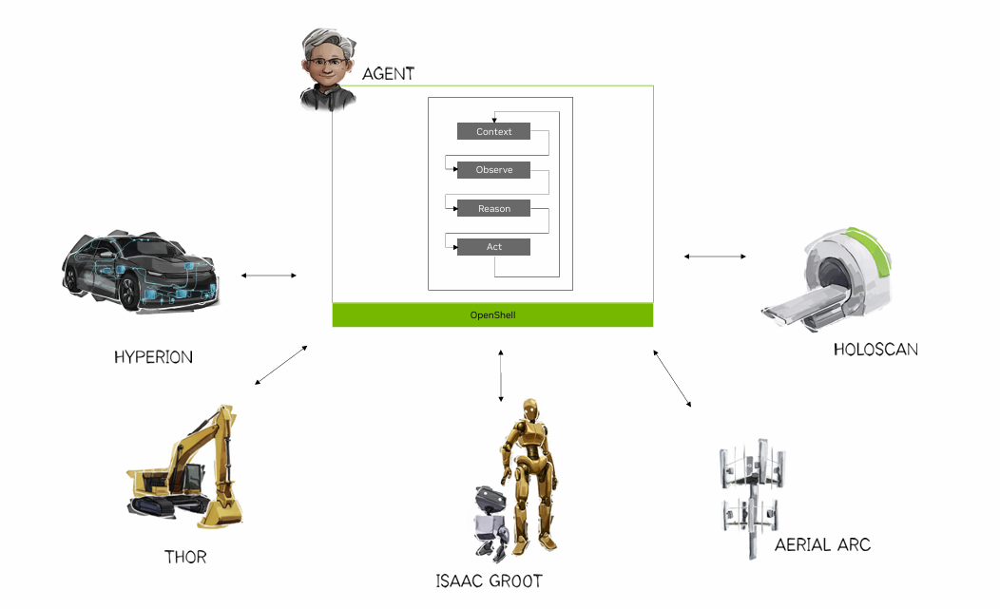
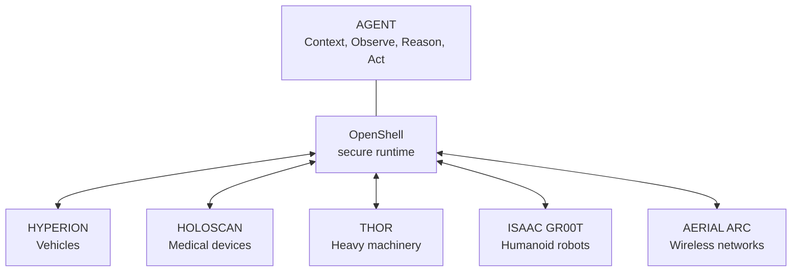

## Introduction

- Last topic showed a physical AI model that turns sensor and text tokens into actions. 
- This topic adds a different layer on top: **AI agents** that can plan and coordinate work across many physical systems. 
- The message is that agents, which until now mostly lived in software, are now being connected to real machines.

## What Is an AI Agent?

- An **AI agent** is an AI system that does not just answer a question once. 
- It works toward a goal by repeating a cycle: look at the situation, think, take a step, look again. 
- It can use tools and call other systems to get things done.

| Step | What happens?| Example |
|------|--------------|----------------|
| **Context** | The agent holds the goal, background knowledge and what it has done so far | "Keep this production line running without stoppages" |
| **Observe** | It gathers fresh information from systems and sensors | Reads an alert that a machine is running hot |
| **Reason** | A language or reasoning model decides the next step | Concludes the machine should slow down and a technician should be notified |
| **Act** | It performs the step, usually by calling a tool or sending a command | Reduces the machine's speed and files a maintenance request |

- The arrow from Act back to Context is the key detail: the result of each action becomes part of the next round of thinking. 
- That is what makes it a loop and not a one shot answer.

## Physical AI Model Vs AI Agent

| | Physical AI foundation model | AI Agent |
|---|------------------------------------------|------------------|
| Main job | Turn sensor input and instructions directly into actions | Plan, coordinate and call tools across systems |
| Typical speed | Fast, close to real time control | Slower, deliberate steps |
| Where it sits | Inside the machine or its control stack | Above machines, coordinating them |
| Example | A humanoid's GR00T model producing arm movements | A system that manages a fleet of robots, a vehicle program or a hospital workflow |

- They are **complementary**. Slow high level reasoning layer sits above fast perception and control layers. 
- Here the idea is stretched across many machines.

## One agent design sit above five Physical systems

- Two-way arrows connect the agent to five systems.
- The arrows go both directions because the agent both **sends commands** and **receives data**.

|  | What it is? | Application |
|---------------|------------|---------------------|
| **Hyperion** | NVIDIA DRIVE Hyperion, NVIDIA's reference platform for autonomous vehicles | Car with sensors and electronics |
| **Holoscan** | NVIDIA's platform for real-time sensor processing, used with medical devices and other sensor heavy systems | A medical scanner (MRI style) |
| **Thor** | Jetson Thor, the on-robot computer.| An excavator |
| **Isaac GR00T** | NVIDIA's robot foundation model for humanoids | A humanoid robot and a small companion robot |
| **Aerial ARC** | NVIDIA Aerial RAN Computer, a platform for AI-powered 5G and 6G radio networks | A cell tower |

- Look at the variety: a car, a medical scanner, a digger, a humanoid and a telecom tower. 
- Point is that **one agent design can sit above all of them**. 
- These systems are very different, but each one has sensors to read and controls to act on, which is exactly what the Observe and Act steps need.

## OpenShell

- In diagram box under the agent is labeled **OpenShell**, and it matters a lot.

### Problem it solves

- An agent that can act is also an agent that can make mistakes. 
- If it can read files, run commands, access the network and use credentials, a bad decision can do real damage. 
- When the agent controls physical systems, the stakes rise further.

### What OpenShell is?

- NVIDIA's NemoClaw documentation describes OpenShell as a runtime, part of the **NVIDIA Agent Toolkit**, that provides a secure environment for running autonomous agents.

| Protection | Meaning |
|------------|---------|
| **Sandboxing** | The agent runs in an isolated environment, using Linux security features such as Landlock, seccomp and network namespaces |
| **Filesystem limits** | The agent cannot read or write outside allowed folders |
| **Network policy** | Outbound connections are denied by default except for endpoints you explicitly allow |
| **Credential custody** | Secrets are kept outside the sandbox, so the agent cannot simply copy them |
| **Managed inference** | Requests to AI models are routed through a controlled path |

- **NemoClaw** is NVIDIA's open source reference stack that runs supported agents (such as OpenClaw, Hermes and LangChain Deep Agents) inside OpenShell. 
- Think of OpenShell as the **safe room** and NemoClaw as one ready made way to set it up.

>
- As describe above OpenShell as security for the **agent software**: what it can touch and reach.
- Safety of the physical machine itself (for example, a robot's motion limits or a car's functional safety) is a separate matter handled in the machine's own control and safety systems.
- OpenShell as the controlled gateway between the agent and the physical systems.

## Why Agents matter for NVIDIA Physical AI deck?

- This agent picture returns later in the deck, with the same Context, Observe, Reason, Act loop and the same OpenShell bar.

| Where agents appear? | How agents appear? |
|-------------|--------------------|
| Open Source Agent Tools and Skills for Physical AI | An agent harness (tools such as coding agents) uses new physical AI skills for hardware optimization, neural reconstruction and video augmentation |
| NVIDIA OSMO | Turns coding agents, such as Claude Code and Codex, into physical AI infrastructure experts by giving them real time insight into pipelines, workflows and GPU capacity |
| Jetson | Jetson gets agent skills and open model support so agents can run on and manage robot hardware |

- So agents are not only a market story.
- They are also becoming part of **how developers build** physical AI: an agent can help set up simulations, run workflows and optimize hardware, which saves human time.

## Summary

1. An **agent** works in a loop: **Context, Observe, Reason, Act**, then feeds results back into context.
2. It differs from a physical AI model: the model acts directly, the agent plans and coordinates across systems.
3. One agent to five systems: Hyperion (vehicles), Holoscan (medical sensors), Thor (heavy machinery, my reading), Isaac GR00T (humanoids) and Aerial ARC (wireless).
4. **OpenShell** is the secure runtime layer, providing sandboxing, network policy and credential protection for agents.
5. The same agent picture reappears later as a way to build and manage physical AI.

## References

1. [NVIDIA NemoClaw documentation (OpenShell sandboxes for agents)](https://docs.nvidia.com/nemoclaw/latest/)
2. [NVIDIA NemoClaw on GitHub](https://github.com/NVIDIA/NemoClaw)
3. [NVIDIA AI Aerial documentation](https://docs.nvidia.com/aerial/)
4. [NVIDIA Holoscan](https://developer.nvidia.com/holoscan-sdk)
5. [NVIDIA DRIVE Hyperion](https://developer.nvidia.com/drive/hyperion)
6. [NVIDIA Isaac GR00T](https://developer.nvidia.com/isaac/gr00t)

> **Note on sources:** I verified OpenShell and NemoClaw from NVIDIA's NemoClaw repository and documentation, and Aerial ARC from NVIDIA's Aerial documentation. I did not find a page that describes this exact idea of one agent coordinating all five systems. Holoscan and Hyperion descriptions follow NVIDIA's general product descriptions.
