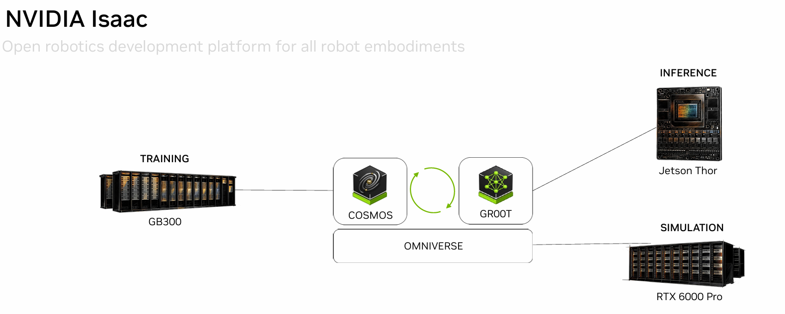
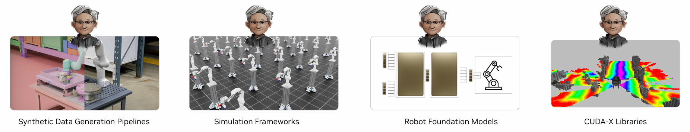

## Inntroduction

- NVIDIA Isaac is the Open Robotics Development Platform for All Robot Embodiments
- NVIDIA Isaac is the **hub of the whole workshop**. Everything before it explained why and how in general terms.
- Everything after it is a closer look at one piece of this platform.
- If you want to keep only one map of NVIDIA robotics developement deck for revision, keep this one.

## What Isaac Is?

- NVIDIA describes **Isaac** as an open robotics development platform made of simulation and robot learning frameworks, CUDA-accelerated libraries, AI models and reference workflows. 
- It is meant for building autonomous mobile robots, robot arms and manipulators, and humanoids.



- Diagram shows the three computer solution which we discuss earlier, now filled in with specific hardware and software.

| Computer | Task of this computer| Hardware shown | Software shown |
|--------------|----------------|----------------|----------------|
| First computer, DGX | **Training** | GB300 | Cosmos and GR00T models are trained here |
| Second computer, Omniverse and Cosmos | **Simulation** | RTX 6000 Pro | Omniverse, which Isaac Sim and Isaac Lab build on |
| Third computer, AGX | **Inference** | Jetson Thor | The trained model runs on the robot |

### Three points worth understanding

1. **Cosmos and GR00T with a circular arrow between them.**

    - The two are shown feeding each other. 
    - Cosmos world models generate synthetic data and reasoning that improve GR00T, and GR00T policies can be tested inside worlds that Cosmos generates.
    - Later in the deck you will see that the GR00T 1.7 model uses a Cosmos model for reasoning.

2. **Omniverse sits underneath both.**

    - It is the base layer that provides physically accurate virtual worlds, so both the classical simulation and the generated worlds rest on it.

3. **GB300 Vs Vera Rubin.**

    - Newest DGX platform (Vera Rubin) and GB300 is a Blackwell Ultra generation system. 
    - Both are the training computer, and the platform family is what matters.

> **Note:** The diagram shows "RTX 6000 Pro". NVIDIA's product name is usually written RTX PRO 6000. They refer to the same class of GPU.

## Four Pillars



- The row of four pictures is the **table of contents for the rest of the workshop**.

| Pillar | What it is? | What you will see later? |
|--------|-----------|-------------------------|
| **Synthetic Data Generation Pipelines** | Creating training data without relying only on real robots | The next section: Cosmos, data factory blueprint, NuRec, Isaac Teleop, SOMA |
| **Simulation Frameworks** | Virtual worlds for training and testing robot behavior | Isaac Sim, Isaac Lab, Isaac Lab-Arena, OSMO, Newton |
| **Robot Foundation Models** | Pretrained brains that can be adapted to many robots | GR00T, the Unitree H2 Plus reference design, SONIC |
| **CUDA-X Libraries** | GPU accelerated building blocks for perception, mapping and navigation | The Robot Runtime section: Nvblox, cuVSLAM, Isaac ROS and more |

## Isaac Workflow in One Line

- NVIDIA's Isaac page summarizes the flow this way: generate synthetic data with Isaac Sim and Cosmos Transfer, train and post-train models in Isaac Lab, and deploy on Jetson Orin or Jetson Thor.

```
  GENERATE DATA            TRAIN                  DEPLOY
  Isaac Sim +        ->    Isaac Lab        ->    Jetson Thor
  Cosmos Transfer          (and GR00T models)     (or Jetson Orin)
```

- This same flow expanded in the later topic "How Robots Become Robots" and the "GR00T end-to-end workflow".

## Components of Isaac

Isaac as consisting of several elements:

| Component | Role |
|-----------|------|
| **Isaac Sim** | Physically accurate robotics simulation platform built on Omniverse |
| **Isaac Lab** | Open source, modular framework for training robot policies at scale using reinforcement and imitation learning. NVIDIA describes it as the foundational robot learning framework for Isaac ROS and GR00T |
| **Isaac ROS** | CUDA-accelerated packages and AI models built on the open source ROS 2 for perception and navigation |
| **Isaac GR00T** | Open robot foundation models and data pipelines, aimed first at humanoids |
| **Newton** | Open source, GPU accelerated physics engine managed by the Linux Foundation, usable with Isaac Lab |

## Summary

1. **Isaac** is NVIDIA's open platform for building robots: simulation, learning frameworks, models, libraries and workflows.
2. Three-computer solution: **Training** on GB300, **Simulation** on RTX PRO 6000 with Omniverse, **Inference** on Jetson Thor.
3. **Cosmos and GR00T** work together: world models and robot models improve each other.
4. Four pillars drive the rest of the workshop: **synthetic data**, **simulation frameworks**, **robot foundation models**, **CUDA-X libraries**.
5. Typical flow: generate data (Isaac Sim, Cosmos Transfer), train (Isaac Lab), deploy (Jetson Thor).

## References

1. [NVIDIA Isaac platform](https://developer.nvidia.com/isaac)
2. [NVIDIA Isaac GR00T](https://developer.nvidia.com/isaac/gr00t)
3. [NVIDIA Isaac Sim](https://developer.nvidia.com/isaac/sim)
4. [NVIDIA Isaac Lab](https://developer.nvidia.com/isaac/lab)
5. [NVIDIA Isaac ROS](https://developer.nvidia.com/isaac/ros)
6. [NVIDIA Cosmos](https://www.nvidia.com/en-us/ai/cosmos/)
