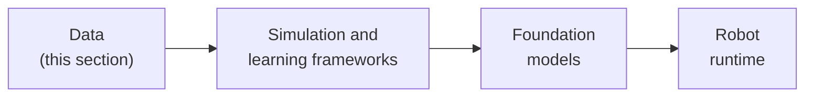

## Introduction

- Synthetic data Generation topic opens the first technical section of the workshop.
- NVIDIA Issac topic introduced four pillars of the Isaac platform. 
- The first one, **Synthetic Data Generation Pipelines**, is where building a robot begins, because a robot brain cannot be trained without data.



## What Synthetic Data Is?

- **Synthetic data** is training data that is created by computer instead of collected from the real world. 
- NVIDIA describes it as data produced through simulation or AI that tackles data scarcity by providing text, video and 2D or 3D images, used alongside real data to train physical AI models. 
- It saves time and reduces cost.

**Real data Vs Synthetic data**

| | Real data | Synthetic data |
|---|-----------|----------------|
| Source | Real robots, cameras, human demonstrations | Simulators and generative AI models |
| Cost and speed | Slow and expensive to collect | Can be generated at large scale and speed |
| Rare or dangerous cases | Hard or unsafe to capture | Can be created on demand |
| Labels (what is in the image) | Often added by hand | Can come with accurate labels automatically |
| Risk | Limited quantity and variety | May not perfectly match reality (sim-to-real gap) |

- The key phrase is **alongside real data**. Synthetic data is meant to multiply and diversify real data, not to replace it completely.

## Two Ways to Generate Synthetic Data

| Method | How data is made? | NVIDIA examples |
|--------|------------------|-----------------|
| **Simulation based** | Build a 3D world, run physics and rendering, record what happens | Isaac Sim, Isaac Lab |
| **Generative AI based** | A world model creates new video and scenarios from learned patterns | Cosmos |

1. **Isaac GR00T-Mimic** takes a handful of human demonstrations and expands them into a large number of synthetic motion trajectories.
2. **Isaac GR00T-Dreams** uses Cosmos to create entirely new trajectory data from a single image plus a language instruction, covering new tasks and environments.

```
   Few real demonstrations         One image + a text prompt
            |                               |
            v                               v
      GR00T-Mimic                     GR00T-Dreams
   (expand what exists)         (imagine what does not exist yet)
            |                               |
            +---------------+---------------+
                            v
              Large, diverse training dataset
```

---

## Summary

1. opens the first technical section: **Synthetic Data Generation**.
2. Data is the first and hardest link in the learning chain.
3. Synthetic data is computer generated data, used alongside real data, to cover scarcity, rare cases and cost.
4. It can come from **simulation** (Isaac Sim, Isaac Lab) or **generative AI** (Cosmos).

## References

1. [NVIDIA, Synthetic Data Generation for Physical AI](https://www.nvidia.com/en-us/use-cases/synthetic-data/)
2. [NVIDIA Technical Blog, "Enhance Robot Learning With Synthetic Trajectory Data Generated by World Foundation Models"](https://developer.nvidia.com/blog/enhance-robot-learning-with-synthetic-trajectory-data-generated-by-world-foundation-models)
3. [NVIDIA Cosmos](https://www.nvidia.com/en-us/ai/cosmos/)
4. [NVIDIA Isaac Sim](https://developer.nvidia.com/isaac/sim)
