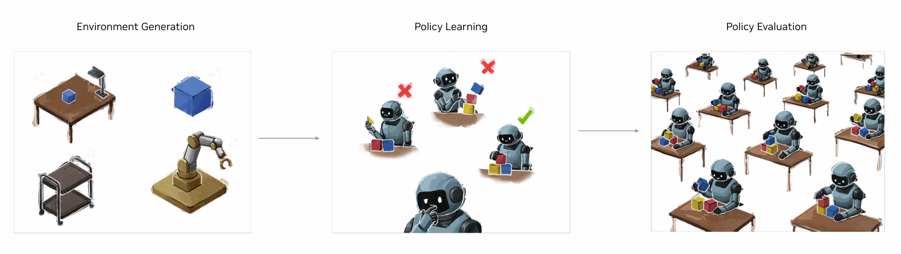

## Introduction

- This topic states the problem that the whole section exists to solve, and it breaks that problem into three connected stages:

  1. Environment Generation
  2. Policy Learning
  3. Policy Evaluation

## Why Data Is the Hard Part?

- Robot learning approach follows the chain **Data, Policy, Action**.
- The chain only works if there is enough good data, and robots have a special difficulty here.

| | Language AI | Robot AI |
|---|-------------|----------|
| Where data comes from | Huge existing collections of text on the internet | Robots must physically do things, and no comparable collection of robot actions exists |
| Cost of one example | Almost nothing | A real robot, a real scene, and a human often needed to guide it |
| Speed | Data already exists | Limited by real time, one attempt at a time |
| Cost of a mistake | A wrong sentence | A dropped object, a damaged robot, or a safety incident |

- A robot brain needs experience, and experience in the physical world is slow, costly and risky to collect.

## Three Stages



All three stages need data and experience: 

- Data to build worlds
- Data to learn from
- Data to test with.

## Stage One: Environment Generation

**Picture:** For Environment Generation stage in above picture shows four small items: a table with a cube and a camera on a stand, a blue cube, a cart, and a robot arm on a base.

**What it represents? :** The **ingredients of a training world**. Before a robot can practice, someone has to build the place where it practices:

| Picture | Ingredient |
|---------|------------|
| Table with cube and camera | A scene: surfaces, objects and sensors in a layout |
| Blue cube | Objects to manipulate |
| Cart | Furniture and obstacles in the space |
| Robot arm | The robot's own body (its embodiment) |

**Why it is hard?**

1. Every object needs a 3D model with correct physical properties such as shape, weight and friction.
2. Scenes must be **diverse**. A policy trained in one tidy scene will fail in a different one.
3. NVIDIA's Isaac Lab Arena documentation notes that going from asset preparation to a working environment and large-scale evaluation often needs a lot of manual effort, leading to fragmented setups with high overhead.

**How NVIDIA addresses it?**

1. **SimReady assets** in OpenUSD, ready to drop into simulation.
2. **NuRec** to rebuild real places as simulation environments (real to sim).
3. **Cosmos** to create scenarios with generative world models.
4. **Agentic environment generation** in Isaac Lab-Arena, where an AI agent turns a description of the task into an editable specification, fetches SimReady assets and builds the environment.

## Stage Two: Policy Learning

**The picture:** For Policy Learning stage in above picture shows several small robots playing with colored blocks. Some have a red cross, one has a green check mark, and one in the front is thinking with a hand on its chin.

**What it represents? :** **Learning from outcomes.** A policy (the robot's decision rule) tries a task, then succeeds or fails, and it improves based on the result.

| Symbol | Meaning |
|--------|---------|
| Red cross | A failed attempt, such as a stack that collapses or a block that is dropped |
| Green check | A successful attempt |
| Thinking robot | The learning step: working out what to do differently |

**Where the data comes from?**

1. **Human demonstrations** for imitation learning (collected with tools like Isaac Teleop).
2. **Trial and error in simulation** for reinforcement learning (Isaac Lab).
3. **Synthetic expansion** of a few demonstrations into many (such as GR00T-Mimic).

**Why it is hard? :** a good policy needs many attempts across many variations, and real robots cannot afford that many. Simulation lets thousands of robots practice in parallel.

## Stage Three: Policy Evaluation

**The picture:** For Policy Evaluation stage in above picture shows a large grid of robots, each at its own table with blocks.

**What it represents? :** **Testing one policy across many situations at the same time.** Training tells you the robot can learn. Evaluation tells you whether it is **reliable**.

**Why evaluation is its own challenge?**

1. A policy that works in the training scene may break when a lighting, object or position changes. Evaluation must try those changes on purpose.
2. Testing on a real robot is slow and cannot cover thousands of variations.
3. Results must be repeatable so that two policies can be compared fairly.

## Loop, Not a Line

- Stages diagrams shows arrows from left to right, but in practice the stages form a loop.

```
   Environments  ---->  Learning  ---->  Evaluation
        ^                                    |
        |                                    |
        +-------- failures reveal what ------+
                  new worlds and data
                  are needed
```

## What Is Hard at Each Stage, and What Helps?

| Stage | Main difficulty | Kind of help|
|-------|-----------------|------------------------------|
| Environment generation | Building many diverse, physically accurate worlds by hand | SimReady assets, NuRec, Cosmos, agentic generation |
| Policy learning | Not enough demonstrations and experience | Isaac Teleop, Isaac Lab, synthetic expansion of demonstrations |
| Policy evaluation | Testing at scale, repeatably | Isaac Lab-Arena, parallel simulation, Cosmos as a world simulator |

## Summary

1. Data is the grand challenge because robots cannot learn from existing internet scale data and real experience is slow, costly and risky.
2. Three stages: **Environment Generation** (build diverse worlds), **Policy Learning** (practice and improve) and **Policy Evaluation** (test at scale).
3. All three stages are data hungry, not only learning.
4. The stages form a loop: evaluation results reveal what new environments and training are needed.

## References

1. [NVIDIA Isaac Lab-Arena documentation](https://isaac-sim.github.io/IsaacLab-Arena/)
2. [NVIDIA Technical Blog, "Simplify Generalist Robot Policy Evaluation in Simulation with NVIDIA Isaac Lab-Arena"](https://developer.nvidia.com/blog/simplify-generalist-robot-policy-evaluation-in-simulation-with-nvidia-isaac-lab-arena)
3. [Isaac Lab research paper (policy evaluation and benchmarks section)](https://arxiv.org/abs/2511.04831)
4. [NVIDIA Synthetic Data Generation for Physical AI](https://www.nvidia.com/en-us/use-cases/synthetic-data/)
