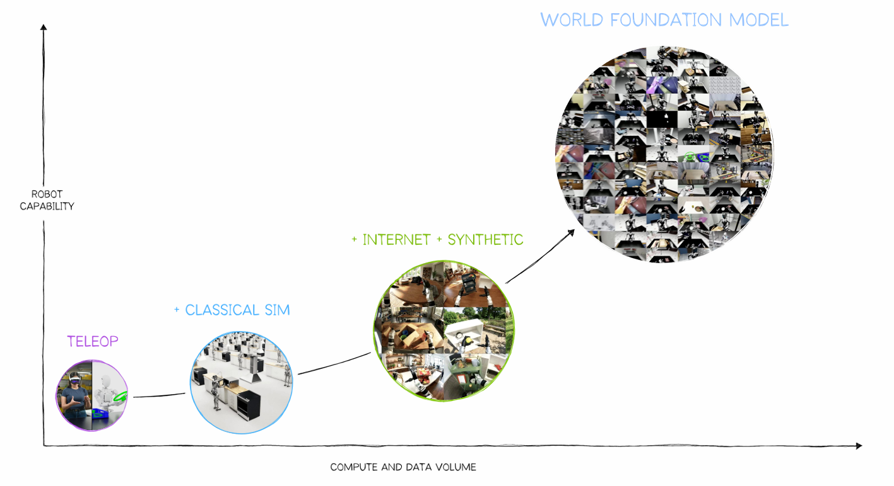
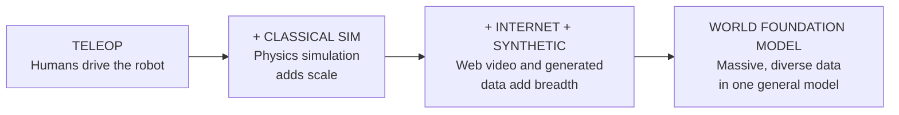

- Last topic said data is the grand challenge. This topic shows **what happens as you solve it**: a chart that traces how robot capability grows as you add more and richer sources of data and compute.

## Robot Capability Vs Compute and Data Volume



| Element | Meaning |
|---------|---------|
| **Vertical axis: Robot Capability** | How much a robot can do, and how well and how generally |
| **Horizontal axis: Compute and Data Volume** | How much computing power and training data went into building the robot's intelligence |
| **Circle size** | Each circle gets bigger to show the growing volume of data |
| **"+" labels** | Each stage **adds** to what came before. The stages stack up, they do not replace each other |
| **Rising arrows** | Capability grows as you move right, and the last jump is the steepest |

## Four Stages



### Stage 1: Teleoperation (Teleop)

- A human operates the robot, often with a VR headset or motion capture, and the robot's movements are recorded as demonstrations.
- The data is **high quality and truly robot specific**, because it comes from the real robot doing the real task.
- It is also **the least scalable**. One hour of demonstration takes one hour of human time, so the volume is tiny.
- On the chart this is the smallest circle, at the lowest capability.

### Stage 2: Classical Simulation

- Physics simulators such as Isaac Sim and Isaac Lab let thousands of virtual robots practice in parallel, faster than real time.
- This adds large volumes of experience and a safe place to try risky things.
- Its limit is the sim-to-real gap: physics engines only approximate reality, and building varied scenes by hand takes effort.

### Stage 3: Internet and Synthetic Data

- **Internet data** means large amounts of existing video and text. Videos of people handling objects teach general ideas about how the physical world works.
- **Synthetic data** means newly generated data, such as videos and trajectories created by generative world models like Cosmos.
- Together they add many more scenes, objects and situations than a lab could ever record.
- The catch is that this data does not come with the robot's motor commands. NVIDIA's GR00T N1 paper explains the workaround: it uses a latent action codebook and an inverse dynamics model to infer the actions behind the video, so the model can learn from action-less sources.

### Stage 4: World Foundation Model

- With massive and diverse data, the result is a **world foundation model**: a large model that has learned broadly how the physical world looks and behaves.
- This is the stage where Cosmos belongs, and it is also what GR00T builds on. The world model is both a **product** of massive data and a **source** of more data.

## What Each Stage Gives and Costs?

| Stage | Main data source | What it adds? | Main limit |
|-------|------------------|--------------|------------|
| Teleop | Human demonstrations on real robots | Accurate, task specific, real | Tiny volume, slow and expensive |
| + Classical sim | Physics simulation | Large scale, safe, parallel | Sim-to-real gap, manual scene building |
| + Internet + synthetic | Web video, generated data | Breadth and diversity | No action labels, may not match real physics exactly |
| World foundation model | All of the above, combined | General understanding of the physical world | Needs enormous compute and careful quality control |

> A good way to remember it: **quality goes down as you scale, and the trick is to combine them**, using small amounts of high quality real data to ground large amounts of broad data.

## GR00T Data Pyramid

NVIDIA's GR00T N1 work expresses this combination as a **data pyramid**.

| Layer | Content | Quantity | Embodiment specificity |
|-------|---------|----------|------------------------|
| **Base** | Internet scale web data and human videos | Largest | Lowest |
| **Middle** | Synthetic data from simulation and generative models | Large | Medium |
| **Peak** | Real robot data collected through teleoperation | Smallest | Highest |

```
              /\
             /  \    REAL ROBOT DATA (teleop)
            /----\   least data, most robot specific
           /      \
          / SYNTHE-\  SYNTHETIC DATA
         /  TIC     \ simulation and generated
        /------------\
       /              \ WEB DATA AND HUMAN VIDEOS
      /                \ most data, least robot specific
     /------------------\
```

**How the two charts relate?**

- First chart is ordered by **scale** (small to huge), while the pyramid is ordered by **specificity** (general to robot specific).
- They contain the same ingredients: teleop, simulation, internet data and synthetic data.
- The message of both is the same: the lower layers give broad knowledge, and the top layer grounds the model in real robot behavior.

## Numbers Worth Knowing

These come from NVIDIA's GR00T material, and they are vendor reported results.

1. **40 percent improvement.** NVIDIA reports that combining synthetic data with real data improved GR00T N1's performance by 40 percent compared with using only real data.
2. **Speed of synthetic generation.** At GTC 2025, NVIDIA described its GR00T-Mimic blueprint generating around 780,000 synthetic trajectories in about 11 hours, which it compared to roughly 6,500 hours of human demonstration.
3. **36 hours versus about three months.** For GR00T N1.5, NVIDIA reported generating the needed synthetic data with GR00T-Dreams in 36 hours, against an estimated nearly three months of manual collection.

## Caution About the Curve

- The chart rises smoothly, which can make progress look automatic. A few things to keep in mind:

1. **More data is not enough by itself.** Quality, diversity and relevance matter. Poor synthetic data can teach a model wrong physics.
2. **Robotics scaling is still being established.** In language AI, capability has followed data and compute fairly predictably. Whether robotics follows a similar pattern is an active research question, and this chart expresses NVIDIA's view of the direction.
3. **Real data stays essential.** Even at the top of the chart, real robot data grounds the model, which is why the pyramid keeps a real data peak.

## Summary

1. Robot capability grows as compute and data volume grow, and stages stack on each other.
2. Four stages: **teleop**, **plus classical sim**, **plus internet and synthetic data**, **world foundation model**.
3. Each stage trades quality for scale, so the best approach **combines** them.
4. The GR00T **data pyramid** shows the same idea: web and human video at the base, synthetic in the middle, real robot teleop at the peak.
5. NVIDIA reports large gains from mixing synthetic and real data, though those numbers are vendor reported.

## References

1. [NVIDIA Technical Blog, "Accelerate Generalist Humanoid Robot Development with NVIDIA Isaac GR00T N1"](https://developer.nvidia.com/blog/accelerate-generalist-humanoid-robot-development-with-nvidia-isaac-gr00t-n1)
2. [GR00T N1 research paper (data pyramid)](https://arxiv.org/abs/2503.14734)
3. [NVIDIA Technical Blog, "Enhance Robot Learning With Synthetic Trajectory Data Generated by World Foundation Models"](https://developer.nvidia.com/blog/enhance-robot-learning-with-synthetic-trajectory-data-generated-by-world-foundation-models)
4. [NVIDIA Isaac GR00T](https://developer.nvidia.com/isaac/gr00t)
