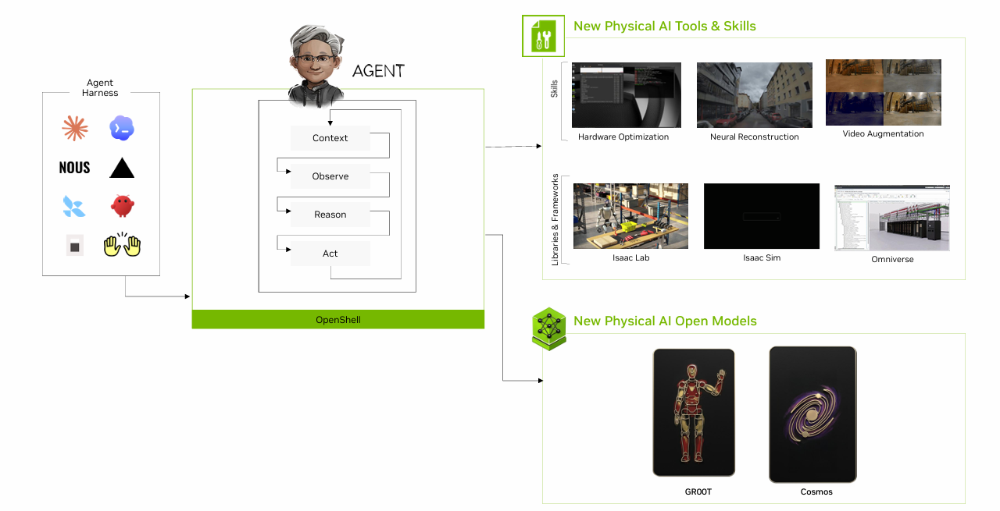
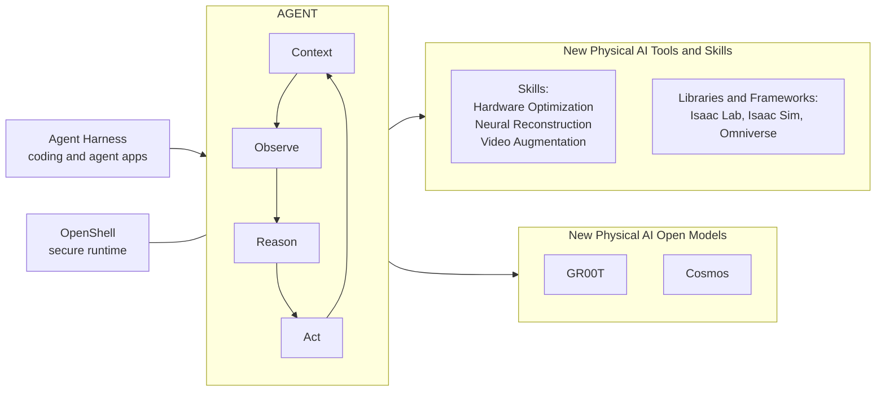
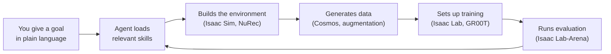

## Problem while building Physical AI



- Building physical AI involves long, fiddly workflows: launching simulators, converting robot files, building scenes, collecting data, setting up training, running evaluations, tuning performance. 
- Each step has its own commands, settings and pitfalls, and much of that knowledge sits in the heads of expert engineers.

- we can package that knowledge so an AI agent can follow it.

| Without skills | With skills |
|----------------|-------------|
| The agent guesses at tool commands and often gets them wrong | The agent follows tested, written procedures |
| Each developer repeats the same setup work | Repeatable workflows run on demand |
| Expert knowledge stays with a few people | Expert knowledge is shared openly |

## What is Harness, tool and skill?

| Term | Meaning | In picture |
|------|---------|--------------|
| **Agent harness** | The agent application that wraps an AI model with a loop, memory and the ability to use tools | Claude Code, OpenAI Codex, Hermes Agent (Nous Research), Vercel, OpenClaw, OpenCode |
| **Tool** | Something the agent can call to get a result: a library, framework, command or model | Isaac Lab, Isaac Sim, Omniverse, GR00T and Cosmos |
| **Skill** | A written, reusable instruction set that teaches the agent **how to use?** tools for a specific task | Hardware Optimization, Neural Reconstruction, Video Augmentation |

- A helpful comparison: a **tool** is like a machine in a workshop, and a **skill** is the instruction manual and safety checklist that tells a new worker how to run it properly.

- NVIDIA's describes agent skills as version controlled workflow guides that teach coding agents (such as Cursor, Claude Code and Codex) how to perform tasks?, for example importing robots, configuring physics and generating synthetic data. In practice a skill is a `SKILL.md` file with instructions, plus any supporting scripts.

## Understand the working with AI agents



### 1. Agent harness

- Different agent applications that can host the agent loop.
- The point is that these skills are **not tied to one product**. NVIDIA states they are available for use with any coding agent, and its skills repository lists support for Claude Code, Codex, Cursor and others.

### 2. Agent loop and OpenShell

- The agent works inside the secure runtime, which limits what it can touch while it reaches out to the tools on the right.

### 3. Physical AI Tools and Skills

**Skills (three examples)**

| Skill | What it plausibly covers? | Related NVIDIA material |
|--------------------|--------------------------|-------------------------|
| **Hardware Optimization** | Tuning code and models to run efficiently on NVIDIA hardware | Isaac Sim ships a skill for profiling and optimizing; Jetson agent skills|
| **Neural Reconstruction** | Rebuilding real scenes as 3D simulation environments | Connects to NuRec|
| **Video Augmentation** | Generating varied versions of video data, for example different weather or lighting | Connects to Cosmos and to NVIDIA's Metropolis skills for synthetic scenarios and data augmentation |

> **Libraries and Frameworks:** Isaac Lab, Isaac Sim and Omniverse, the simulation and learning stack. NVIDIA says agents can use these to launch simulation sessions, author scenes, control simulation, capture data and validate environments in Isaac Sim, and to set up reinforcement learning, training and evaluation in Isaac Lab.

### 4. NVIDIA Physical AI Open Models

- **GR00T** (robot foundation model) and **Cosmos** (world foundation models). 
- Agents can call these as part of a workflow, for example asking Cosmos to augment video and then feeding the result into training.

## What an Agent Can Now Do, End to End?

- Putting the pieces together, here is a plausible workflow that links this to that we already discuss



- NVIDIA describes the aim as letting agents speed the data generation, simulation, training, evaluation and deployment pipelines behind robots, autonomous vehicles, factories and laboratories.

## Why Skills Need Safeguards?

- An agent that follows instructions from a downloaded file is only as safe as that file. Two NVIDIA measures address this:

1. **OpenShell.** The agent runs in a sandbox with limited filesystem and network access.
2. **Verified skills.** NVIDIA's skills repository describes official, NVIDIA-verified skills, with documentation on scanning and signing skills, under the theme of capability governance for agents.

The practical lesson: treat skills like code you install. Prefer verified sources.

## How This Looks in Practice?

- NVIDIA's public skills repository gives a simple install pattern through the `skills` command line tool:

```
npx skills add nvidia/skills
```

- The CLI asks you to choose a skill and where to install it. 
- You can also target a particular agent with an `--agent` option, such as `claude-code` or `codex`.
- Once installed, the skill is available the next time your agent loads skills and meets a relevant task.

**Where it is published?:** 

- NVIDIA says the physical AI agent tools and skills are openly available on GitHub and skills.sh
- NVIDIA announced them in 2026 (around GTC Taipei and Computex). They are part of the NVIDIA Agent Toolkit, the same toolkit that includes OpenShell.

## Summary

1. **Agents plus skills plus tools** make physical AI development faster and more repeatable.
2. **Harness** hosts the agent, **tools** do the work, **skills** teach the agent how to use the tools.
3. The agent loop (Context, Observe, Reason, Act) runs inside **OpenShell**.
4. Example skills: Hardware Optimization, Neural Reconstruction, Video Augmentation.
5. Tools include Isaac Lab, Isaac Sim and Omniverse. Open models include GR00T and Cosmos.
6. Everything is open source and available on GitHub and skills.sh, working with any coding agent.

## References

1. [NVIDIA Newsroom, "NVIDIA Releases Major Collection of Open Source Agent Tools and Skills for Physical AI"](https://nvidianews.nvidia.com/news/nvidia-releases-major-collection-of-open-source-agent-tools-and-skills-for-physical-ai)
2. [NVIDIA Blog, physical AI agent skills for autonomous vehicles, robotics and vision AI](https://blogs.nvidia.com/blog/cvpr-physical-ai-research-agent-skills/)
3. [NVIDIA Agent Skills repository](https://github.com/NVIDIA/skills)
4. [NVIDIA skills documentation](https://docs.nvidia.com/skills)
5. [Isaac Sim documentation, Agent Skills](https://docs.isaacsim.omniverse.nvidia.com/latest/development_tools/agent_skills.html)
