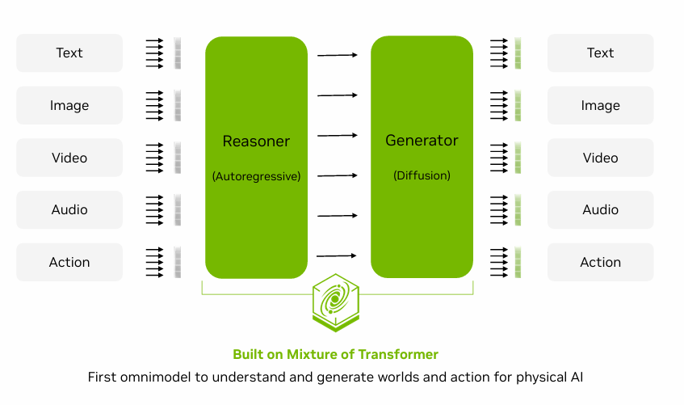
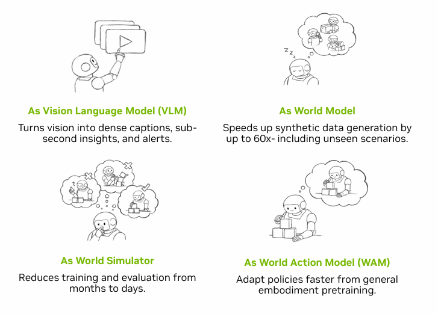
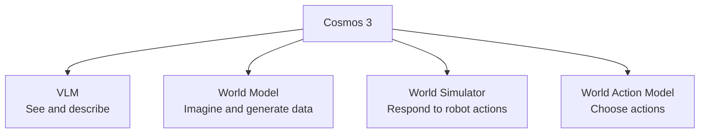

## Introduction

- Cosmos 3 is **The frontier foundation model for Physical AI: breakthrough architecture, more accurate across capabilities**
- We have met Cosmos several times already: as the neural simulator, as the partner of GR00T, and as the world foundation model. 
- This section finally opens it up. It shows **what is inside Cosmos 3?** and **what you can use it for?**.

## What Cosmos 3 Is?

- NVIDIA's developer blog describes Cosmos 3 as a frontier foundation model for physical AI that combines **physical reasoning, world generation and action generation** in a single open model.
- It was published on May 31, 2026.
- The important change from earlier releases is **unification**.
- NVIDIA's blog explains that previous Cosmos releases separated world generation, physical understanding and controlled scene generation into different models and workflows.
- Cosmos 3 brings these capabilities together, which removes the need to orchestrate several models and inference pipelines.

| Before (earlier Cosmos releases) | Now (Cosmos 3) |
|----------------------------------|----------------|
| Separate models for generating worlds, understanding physics and controlling scenes | One model that reasons, generates and produces actions |
| Developers connect the models themselves | One architecture handles the combined task |

## Architecture of COSMOS 3

### Five modalities in and five out

- A **modality** is a type of data. 
- The architecture lists the same five on both sides: **text, image, video, audio and action**. 
- Having actions on both sides is what makes this a model for physical AI. 
- It can read robot actions as input (to predict what happens next) and write them as output (to decide what to do).
- Cosmos 3 the first **omnimodel** to understand and generate worlds and action for physical AI. 
- An omnimodel is a model that handles many data types in and out within one system. 

### Reasoner and Generator

- COSMOS 3 architecture is a **Mixture of Transformers** (MoT) built around two functionality Reasoner and Generator.

| Functionality | Technique | Role |
|-------|-----------|------|
| **Reasoner** | Autoregressive | It is a vision-language model. Interprets images, video and text, and understands motion, object interactions and physical context. It the brain that reasons about the world before any generation happens |
| **Generator** | Diffusion | Generates future observations and action sequences, producing physics aware video and actions conditioned on what the reasoner understood |

Two Technique:

1. **Autoregressive**:

    - Means producing output one piece at a time, each piece depending on what came before.
    - This is how language models write text, and it suits reasoning and answering questions.

2. **Diffusion**:

    - Means starting from noise and refining it step by step into a clean result. 
    - This is a common approach for generating high quality video and smooth motion.

How they work together?

- Information flows **one way**, from the reasoner into the generator. The generator is guided by the reasoner's understanding, which keeps its output coherent.
- The reasoner can be called **on its own** (for example, to answer a question about a video).
- The generator always activates reasoner, because it relies on the reasoner for guidance.

## Capabilities of Cosmos 3

- The same model can play four different roles depending on what you give it and what you ask for.

| Role | Action | Input to output |
|-------------------|-----------------------------|----------------------------------|
| **Vision Language Model (VLM)** | Turns vision into dense captions, insights and alerts | Text, image or video in, **text** out. This is the reasoning mode |
| **World Model** | Speeds up synthetic data generation, including unseen scenarios | Text and video in, **video** out (rare edge case data). Text and image in, **video** out (prediction) |
| **World Simulator** | Reduces training and evaluation time | Action, video and text in, **video** out. This is an action conditioned world model |
| **World Action Model (WAM)** | Adapts policies faster from general embodiment pretraining | Video and text in, **video and action** out. NVIDIA lists this as a world action model, video action model, vision language action model or policy model |

## Two Sizes: Nano and Super

| | Cosmos 3 Nano | Cosmos 3 Super |
|---|---------------|----------------|
| Size | 16 billion parameters | 64 billion parameters |
| Aim | Efficient inference | Maximum quality and capability |
| Where it runs? | Workstation class compute, such as the NVIDIA RTX PRO 6000 GPU | Data center, on NVIDIA Hopper and Blackwell GPUs |
| Good for | Real-time robotics inference and physical AI applications | Large scale synthetic data generation and advanced physical reasoning |

- A parameter is a learned number inside the model.
- More parameters generally means more capacity but also more compute needed.

---

## Availability of COSMOS 3 model

| Where? | What it means? |
|------------|---------------|
| **build.nvidia.com, NVIDIA NIM** | Hosted trials and packaged microservices for deployment |
| **Hugging Face, GitHub** | Open model checkpoints, training code and examples |
| **Coming soon: Microsoft Azure, CoreWeave, Baseten, DeepInfra, Verda** | Cloud and inference providers listed as upcoming. |

- NVIDIA's blogs also says it is open sourcing the models, training scripts, deployment tools and datasets, with open recipes for post-training: 
    - **Supervised fine-tuning** on your own data 
    - **Action post-training** for forward dynamics (predict what happens)
    - Inverse dynamics (infer the action behind a demonstration) 
    - Policy generation.

> **Note:** Even though the models, scripts, tools and datasets are all open source, please check the workstation requirements before trying to run these models. They will not work on normal workstations or laptops.

> **!WARNING**: It requires high end GPU hardware. Check the official requirements first.

## Summary

1. **Cosmos 3** unifies physical reasoning, world generation and action generation in one open model.
2. Architecture: **Mixture of Transformers** with a **Reasoner** (autoregressive, understands) and a **Generator** (diffusion, creates), guided one way from reasoner to generator.
3. Five modalities in and out: **text, image, video, audio, action**.
4. Four roles: **VLM**, **World Model**, **World Simulator**, **World Action Model**.
5. Two sizes: **Nano** (16B, workstation) and **Super** (64B, data center).
6. Open on Hugging Face and GitHub, with NIM microservices. Check NIM status for the Generator.

## References

1. [NVIDIA Technical Blog, "Develop Physical AI Reasoning, World, and Action Models with NVIDIA Cosmos 3"](https://developer.nvidia.com/blog/develop-physical-ai-reasoning-world-and-action-models-with-nvidia-cosmos-3/)
2. [NVIDIA Cosmos](https://www.nvidia.com/en-us/ai/cosmos/)
3. [Cosmos 3 model collection on Hugging Face](https://huggingface.co/collections/nvidia/cosmos3)
4. [Cosmos GitHub repository](https://github.com/nvidia/Cosmos)
5. [Cosmos 3 technical report](https://research.nvidia.com/labs/cosmos-lab/cosmos3/technical-report.pdf)
6. [Try Cosmos 3 Nano Reasoner](https://build.nvidia.com/nvidia/cosmos3-nano-reasoner)
