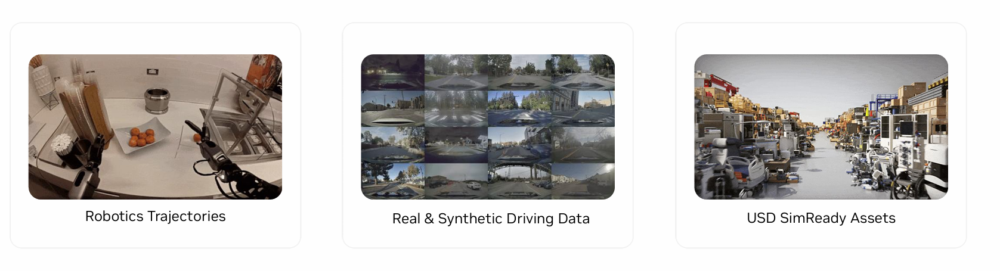
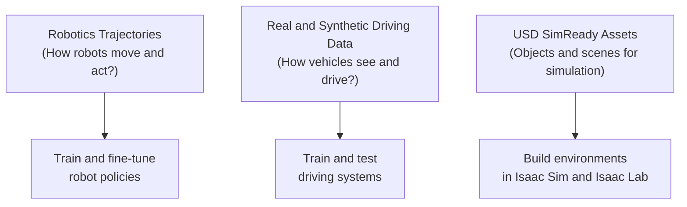

## Introduction

- **NVIDIA have largest open dataset for training, fine-tuning, and evaluating physical AI**
- The datasets are published openly on **Hugging Face**, a popular platform for sharing AI models and datasets.
- The first release came at GTC 2025, and the Hugging Face announcement described it as 15 terabytes of data with more than 320,000 trajectories for robotics training, plus up to 1,000 OpenUSD assets including a SimReady collection. The family has grown a lot since then.
- This datasets is useful for **training**, **fine-tuning** and **evaluating**.

## Some Datasets Family



|**Robotics Trajectories**|**Real and Synthetic Driving Data**|**USD SimReady Assets**|
|-----------|---------------|-------------|
|Recorded sequences of robot observations and actions across many tasks and robot bodies|Multi-sensor driving recordings plus generated driving scenes|3D objects and scenes in OpenUSD, prepared for simulators|



## Dataset type 1: Robotics Trajectories

### What a trajectory is?

- A **trajectory** (also called an **episode** or **demonstration**) is one complete attempt at a task, recorded step by step: what the robot saw, what it sensed, and what action it took at each moment. 
- A policy learns by studying many of these.

### GR00T-X Embodiment Sim dataset

- The **GR00T-X Embodiment Sim**. Its Hugging Face name is `PhysicalAI-Robotics-GR00T-X-Embodiment-Sim`.

| Parameter | Detail |
|------|--------|
| What it is? | Simulated robot trajectories across different embodiments (robot bodies) and tasks |
| Why "X"? | The X cross-embodiment, the idea is that one model should learn across many bodies |
| Included tasks | Includes cross-embodied bimanual (two-arm) manipulation sets, for example tasks such as threading, lifting a tray and three-piece assembly, with about 1,000 trajectories per task in those sets |
| Purpose | Used for post-training GR00T N1 models |

- Other robotics datasets in the same family include simulated humanoid teleoperation data (Fourier GR1), evaluation data for GR00T, locomanipulation data, and healthcare robotics data.

## Dataset type 2:  Real and Synthetic Driving Data

| Dataset | What it is? |
|----------------|------------|
| **PhysicalAI Autonomous Vehicles** | NVIDIA describes it as one of the largest and most geographically diverse collections of multi-sensor data for building end-to-end driving systems. The dataset card cites about 1,700 hours of driving. A Python devkit, `physical_ai_av`, is published on GitHub |
| **Autonomous Vehicles NuRec** | 3D reconstructed driving scenes that can be replayed in simulation|
| **Cosmos Drive Dreams and Cosmos Synthetic** | Synthetic driving data generated with Cosmos world models |

**Why real and synthetic together:** real driving data shows what actually happens, and synthetic data adds rare and dangerous situations that are hard to capture safely. This is the same mix idea as the data pyramid.

> **Access note:** The AV dataset requires a Hugging Face account and agreement to the NVIDIA Autonomous Vehicle Dataset License before you can download it. Datasets are not all licensed the same way, so always read the license on each dataset card.

## Dataset type 3: USD SimReady Assets

### What USD means?

- **USD** stands for **Universal Scene Description**, now called **OpenUSD**. 
- It is an open format for describing 3D scenes: objects, materials, lighting and their arrangement. 
- It is the common language across Omniverse and Isaac Sim, which is why NVIDIA builds on it.

### What SimReady means?

- A **SimReady** asset is a 3D object prepared so that a simulator can use it directly, with properties such as physical behavior and labels, instead of just a pretty model. 
- In other words, it is ready to drop into a simulation and behave sensibly.

### Examples from the family

| Dataset | Content |
|---------|---------|
| `PhysicalAI-SimReady-Warehouse-01` | 753 USD assets for building warehouse scenes in Isaac Sim, according to the dataset listing |
| `PhysicalAI-DigitalCousin-Assets` | Assets for tabletop scenes used with GR1 humanoid tasks |

**Why this matters?:** Earlier we discuss **environment generation** as the first hard stage. Ready-made assets save weeks of manual 3D work and make it easier to build the many varied scenes that robots need.

## More in the Family 

- The three dataset family are examples. NVIDIA's Physical AI collection on Hugging Face holds dozens of datasets. A few more you may meet:

| Dataset | Content |
|---------|---------|
| Cosmos 3 synthetic datasets| Embodied robot scenes, physical interaction scenes, digital human scenes, autonomous driving scenarios and warehouse operation scenes |
| `PhysicalAI-Robotics-Open-H-Embodiment` | Healthcare and surgical robotics data, per a catalog listing |
| `PhysicalAI-SmartSpaces` | Data for smart space and camera analytics |
| `PhysicalAI-Traffic-Anomaly-Reasoning` and `PhysicalAI-VANTAGE-Bench` | Benchmarks for reasoning on traffic and fixed-camera footage |

## How to Use These Datasets in Practice?

- A typical download looks like this, using the Hugging Face command line tool:

```
hf download nvidia/PhysicalAI-Robotics-GR00T-X-Embodiment-Sim --repo-type dataset
```

Practical tips:

1. **Check the size first.** These datasets can be hundreds of gigabytes or terabytes. Download only the subset you need.
2. **Read the license on each card.** Some are permissive, and some (like the AV dataset) need you to accept a license agreement.
3. **Match the data to the model.** For example, GR00T datasets are formatted for the GR00T training code on GitHub.
4. **Pair with your own data.** Open datasets give a strong start, and fine-tuning on your own robot's data closes the gap.

## Summary

1. NVIDIA publishes a large family of **open, commercial-grade physical AI datasets** on Hugging Face.
2. Three datasets/card types: **robotics trajectories**, **real and synthetic driving data**, and **USD SimReady assets**.
3. **GR00T-X Embodiment Sim** is the flagship robotics dataset: simulated cross-embodiment trajectories, used to post-train GR00T.
4. **SimReady** assets are simulation-ready 3D objects in **OpenUSD**.
5. Always check each dataset's license and size before downloading.

## References

1. NVIDIA Physical AI collection on Hugging Face: https://huggingface.co/collections/nvidia/physical-ai
2. GR00T-X Embodiment Sim dataset: https://huggingface.co/datasets/nvidia/PhysicalAI-Robotics-GR00T-X-Embodiment-Sim
3. NVIDIA Physical AI Autonomous Vehicles dataset: https://huggingface.co/datasets/nvidia/PhysicalAI-Autonomous-Vehicles
4. Autonomous Vehicles devkit on GitHub: https://github.com/NVlabs/physical_ai_av
5. Hugging Face blog, NVIDIA Physical AI release at GTC 2025: https://github.com/huggingface/blog/blob/main/nvidia-physical-ai.md
6. NVIDIA Developer Forums, 10 million downloads announcement: https://forums.developer.nvidia.com/t/physical-ai-dataset-just-crossed-10-million-downloads-on-hugging-face/368486
7. NVIDIA Technical Blog, Cosmos 3 (open datasets section): https://developer.nvidia.com/blog/develop-physical-ai-reasoning-world-and-action-models-with-nvidia-cosmos-3/
