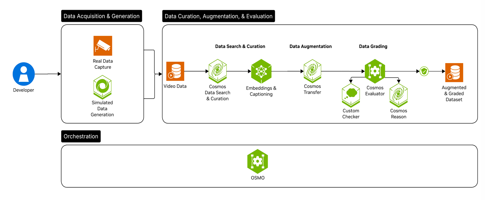

## Introduction

- This is **Open reference architecture for data curation, augmentation, and evaluation**
- We see ready-made open datasets. But most teams also have their own raw footage and simulation output, and that raw material is messy, repetitive and unevenly useful. 
- This architecture shows NVIDIA's answer: a **factory** that takes raw data in and produces a **clean, expanded, quality-checked training dataset** out.

## Factory Idea

- A factory turns raw material into finished goods through a series of stations. The blueprint does the same for data.

| Factory step | Data Factory equivalent | NVIDIA component |
|--------------|-------------------------|------------------|
| Collect raw material | Capture or generate video data | Real data capture and simulated data generation |
| Sort and clean | Search, filter, remove duplicates, annotate | **Cosmos Curator** |
| Multiply and vary | Create many variations of good data | **Cosmos Transfer** |
| Quality control | Score, verify and filter the results | **Cosmos Evaluator** |
| Finished product | A dataset ready for training | Augmented and graded dataset |
| Run the production line | Schedule and manage the work across machines | **OSMO** |

- NVIDIA announced the blueprint at GTC in March 2026 as an open reference architecture that unifies and automates how training data is generated, augmented and evaluated, with the goal of reducing the cost, time and complexity of training physical AI systems at scale.

**What "reference architecture" and "blueprint" mean:** a tested design you can copy and adapt, not a single finished product. It shows which pieces to use and how to connect them.

## Data Factory Architecture



- The Architecture have four zones: **acquire, curate, augment and grade**, with **orchestration** along the bottom.

## Zone 1: Data Acquisition and Generation

- The developer starts by feeding in data from two sources.

| Source | Meaning |
|--------|---------|
| **Real data capture** | Footage and sensor recordings from real robots, vehicles or cameras |
| **Simulated data generation** | Video produced in simulators such as Omniverse and Isaac Sim |

- Both flow in as **video data**. This is the real plus synthetic mix from the data pyramid.

## Zone 2: Data Search and Curation

- Raw footage is huge and full of repeats and low-value clips. Curation makes it usable.
- **Cosmos Curator** processes, refines and annotates large scale real and synthetic datasets. NVIDIA's repository describes it as distributed data curation covering processing, annotation, filtering and deduplication (removing near-identical copies).
- **Embeddings and captioning.** 
    - An **embedding** is a list of numbers that captures the meaning of a clip, so clips can be compared and searched by similarity. 
    - A **caption** is a text description of what happens in the clip. Together they let you search a huge video library with a sentence such as "forklift stops near a pedestrian".
- **Cosmos Dataset Search** (named on NVIDIA's Cosmos page) is the search capability built on these.

## Zone 3: Data Augmentation

- Once you have a good core set, you multiply it.

- **Cosmos Transfer** expands and diversifies curated data. NVIDIA describes it as multiplying real and simulated inputs to capture rare and long-tail scenarios across different environments and lighting conditions.
- In practice, it applies multi-control style transfer. For example, it can take a physics-based video from a simulator and change the lighting, weather or setting to make it look like a different real world scene, while keeping the underlying motion.

**Why augment:** one recorded clip of a robot picking up a box becomes dozens, such as day and night, sunny and rainy, bright and dim warehouse. A policy trained on all of them handles variety far better.

## Zone 4: Data Grading

- Generated data can contain mistakes: objects that float, motions that break physics, details that do not match the prompt. Grading catches these.

| Component | Role |
|-----------|------|
| **Cosmos Evaluator** | Automatically scores, verifies and filters generated data for physical accuracy and training readiness. NVIDIA says it is powered by Cosmos Reason and available on GitHub |
| **Cosmos Reason** | The reasoning model that critiques and annotates synthetic data. It can also generate new, varied text prompts from a starting video |
| **Custom Checker** | Your own tests for your own needs, such as "the gripper must be visible" or "no people in the frame".|

- Only data that passes grading goes into the final **augmented and graded dataset**.

## Common Zone: Orchestration with OSMO

- **OSMO** manages the whole production line: it schedules each stage across the available GPUs, whether on premises or in the cloud.
- We will covers OSMO in detail. For now, remember that it is the control layer that keeps the factory running.

## Important Takeways

- **Built using our expertise in AV, robotics, and Metropolis development.**
    - The design draws on NVIDIA's work in autonomous vehicles, robotics, and **Metropolis**, its platform for vision AI. 
    - NVIDIA's announcement says the blueprint supports robotics, vision AI agents and autonomous vehicles

- **Unified architecture enabling data curation, augmentation, and evaluation at cloud scale**
    - One connected design instead of separate tools, able to run on large cloud infrastructure

- **Orchestrate with OSMO and iterate with top coding agents**
    - OSMO connects with coding agents. 
    - NVIDIA's announcement says OSMO integrates with agents such as Claude Code, OpenAI Codex and Cursor to manage workflows across compute environments

- **Modular and extensible for seamless integration**
    - You can swap, add or remove stages, such as plugging in the custom checker

## Whole Data Factory as a Loop

```
  Capture and simulate  ->  Curate  ->  Augment  ->  Grade  ->  Train model
          ^                                                         |
          |                                                         v
          +------------- weaknesses found while testing ------------+
                      tell you what data to make next
```

- The loop closes when you evaluate a trained policy and discover where it fails.
- Those failures tell the factory what new data to curate or generate next.

## Cloud Partners: Microsoft Azure and Nebius

- The two cloud providers that bring the blueprint to customers.

| Partner | What NVIDIA says they do |
|---------|--------------------------|
| **Microsoft Azure** | Integrates the blueprint into an open physical AI toolchain on GitHub, with connections to Azure IoT Operations, Microsoft Fabric, Real-Time Intelligence, Microsoft Foundry and GitHub Copilot |
| **Nebius** | Integrates OSMO into its AI Cloud, pairing the blueprint with NVIDIA RTX PRO 6000 Blackwell Server Edition GPUs, object storage and managed inference |

- NVIDIA's announcement lists developers using the blueprint, including FieldAI, Hexagon Robotics, Linker Vision, Milestone Systems, RoboForce, Skild AI, Teradyne Robotics and Uber.

## Summary

1. The **Physical AI Data Factory Blueprint** is an open reference architecture that turns raw video into a curated, augmented and graded training dataset.
2. Stages: **acquire** (real and simulated), **curate** (Cosmos Curator, embeddings, captions), **augment** (Cosmos Transfer), **grade** (Cosmos Evaluator, Cosmos Reason, custom checker).
3. **OSMO** orchestrates the pipeline and works with coding agents.
4. It is modular, so you can add your own checks and stages.
5. **Microsoft Azure** and **Nebius** offer it on their clouds.

## References

1. NVIDIA Newsroom, "NVIDIA Announces Open Physical AI Data Factory Blueprint to Accelerate Robotics, Vision AI Agents and Autonomous Vehicle Development": https://nvidianews.nvidia.com/news/nvidia-announces-open-physical-ai-data-factory-blueprint-to-accelerate-robotics-vision-ai-agents-and-autonomous-vehicle-development
2. NVIDIA Cosmos platform: https://www.nvidia.com/en-us/ai/cosmos/
3. NVIDIA Cosmos on GitHub (Curator, Evaluator, Framework): https://github.com/nvidia/cosmos
4. HPCwire, GTC 2026 physical AI coverage: https://www.hpcwire.com/2026/03/16/nvidia-maps-its-physical-ai-strategy-across-engineering-robotics-and-space/
