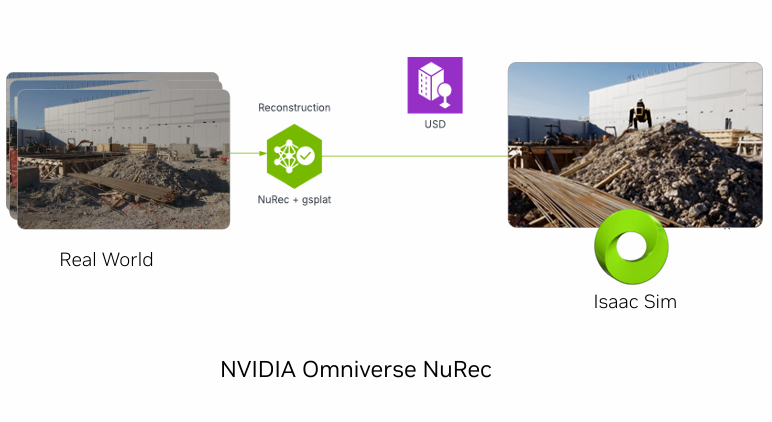
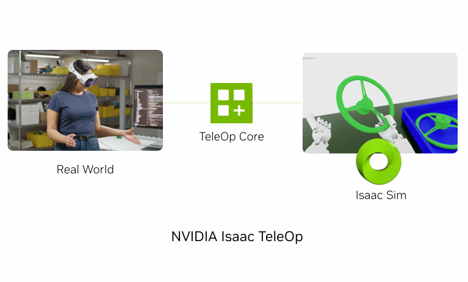
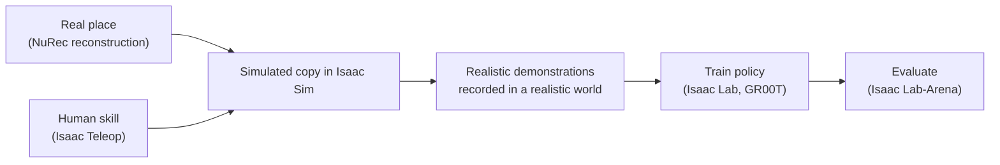

## Introduction

- This is the **Open frameworks and libraries to bring real world data into interactive simulation**
- We dealt with datasets and a factory for processing data. 
- This topic opens a new theme: **real-to-sim**, which means taking something from the real world and bringing it **into simulation**. 

## Why Bring the Real World Into Simulation?

Recall two problems from earlier topics:

1. **The sim-to-real gap**: hand-built virtual worlds never look or behave exactly like reality.
2. **Data scarcity**: real robot demonstrations are slow and expensive to collect.

Real-to-sim attacks both by bringing two real things into the virtual world:

| What you bring in | Tool | 
|-------------------|------|
| **The place** (a real scene) | **Omniverse NuRec** |
| **The skill** (a real human's movements) | **Isaac Teleop** |

- A simple way to remember it: **NuRec captures where, and Teleop captures how.**

## Omniverse NuRec (Bring in the Place)

- **NuRec** is short for **Neural Reconstruction**. 
- Omniverse NuRec as a set of accelerated 3D Gaussian splatting libraries that take real sensor data and reconstruct and render it as interactive simulation in OpenUSD.

| Step | What happens? |
|------|--------------|
| **Real World** |Example: Pictures or sensor data of a real place, such as the construction site shown |
| **Reconstruction (NuRec + gsplat)** | An AI process rebuilds the place as a 3D scene. **gsplat** is the open source, CUDA accelerated Gaussian splatting library that NuRec uses for rendering |
| **USD** | The result is saved as a standard scene file. NVIDIA's NuRec documentation says the output is a USDZ package containing the scene definition, the trained reconstruction data and the capture trajectory, with an optional road map for driving cases |
| **Isaac Sim** | You load the scene into the simulator, add a robot, and the robot can now operate in a photorealistic copy of the real place |

### What is 3D Gaussian splatting?

- Instead of building a scene from triangles (a mesh), the scene is represented as a huge collection of small, soft, semi-transparent blobs called Gaussians.
- Together they reproduce how the place looks from any angle, and the scene can be drawn in real time. 
- NVIDIA NuRec reconstructions can be rendered in Isaac Sim, and the library is also integrated with the CARLA driving simulator and NVIDIA AlpaSim.

### Why it matters?

- **Realism.** The simulated place looks like the real place, which narrows the sim-to-real gap.
- **Speed.** A real site becomes a simulation environment without an artist modeling every object.
- This is a fast way to do **environment generation**.

## Isaac Teleop (Bring in the Skill)

- **Teleoperation** means a human remotely controls a robot. 
- The human's movements become demonstrations that a robot can learn from (imitation learning).

| Step | What happens? |
|------|--------------|
| **Real World** |Example: A person wearing an extended reality (XR) headset moves their head and hands |
| **TeleOp Core** | It reads the person's device inputs and converts them into robot commands |
| **Isaac Sim** | A simulated robot mirrors the person's motions to perform a task, such as handling the green steering wheel shaped object|

### What Teleop Core does?

- Isaac Teleop as the unified framework for high-fidelity egocentric and robotics data collection. Its main parts are:

| Part | Role |
|------|------|
| **Session manager** | Manages teleoperation sessions and data pipelines |
| **Device input and schema** | Standard interfaces for XR headsets, controllers, hand tracking, gloves, foot pedals and body trackers |
| **Retargeting engine** | Maps human motion onto the robot's body, which is the key step, because a person's arm and a robot's arm are shaped differently |
| **Plugins** | Add new devices or use cases |

**Retargeting**: if you move your hand to the left, the software works out what joint angles the robot needs so that its gripper moves the matching way.

### Why it matters?

- **Same setup for sim and real.** NVIDIA describes a unified stack for simulation and real teleoperation, so a team uses one workflow for both.
- **High quality data.** These human demonstrations are the **peak of the data pyramid**: small in volume but accurate and robot specific.
- **Learning stage.** It produces demonstrations for policy learning.

> Note: NVIDIA's release notes show Isaac Teleop reached its first stable 1.0 release in March 2026, and it is designed to work alongside Isaac Lab.

## Two Halves, One Pipeline

NuRec and Teleop are most powerful together.

| | NuRec | Isaac Teleop |
|---|-------|--------------|
| Brings in | A real place | A human's movements |
| Input | Camera and sensor captures | XR headset, gloves and other devices |
| Output | A simulation ready 3D scene (USD) | Recorded robot demonstrations |
| Helps with | Environment generation | Policy learning |
| Data layer | Bridges real and synthetic | Real robot data at the peak |

> **A realistic example**: reconstruct a real warehouse corner with NuRec, then teleoperate a simulated robot inside it with Teleop. You get demonstrations that happen in a world that looks and feels like the real one.

## Summary

1. **Real-to-sim** means bringing real world data into simulation.
2. **NuRec** brings in the **place**: it reconstructs real scenes with 3D Gaussian splatting and outputs USD for Isaac Sim.
3. **Isaac Teleop** brings in the **skill**: a human with an XR device drives a robot, and the retargeting engine maps human motion to the robot.
4. NuRec helps **environment generation**, and Teleop helps **policy learning**.
5. Together they give realistic demonstrations in realistic worlds.

## References

1. NVIDIA Omniverse NuRec: https://developer.nvidia.com/omniverse/nurec
2. NuRec documentation: https://docs.nvidia.com/nurec/index.html
3. Isaac Sim documentation on NuRec assets: https://docs.isaacsim.omniverse.nvidia.com/latest/assets/usdimagess_nurec.html
4. Isaac Teleop on GitHub: https://github.com/NVIDIA/IsaacTeleop
5. Isaac Teleop documentation: https://nvidia.github.io/IsaacTeleop/main/index.html
6. NVIDIA Technical Blog, importing real-world scenes into Isaac Sim with NuRec: https://developer.nvidia.com/blog/developers-build-fast-and-reliable-robot-simulations-with-nvidia-omniverse-libraries
