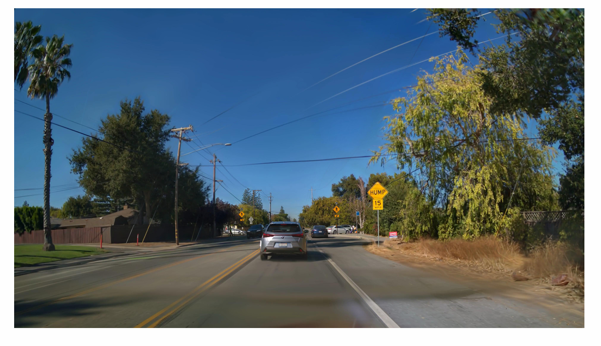
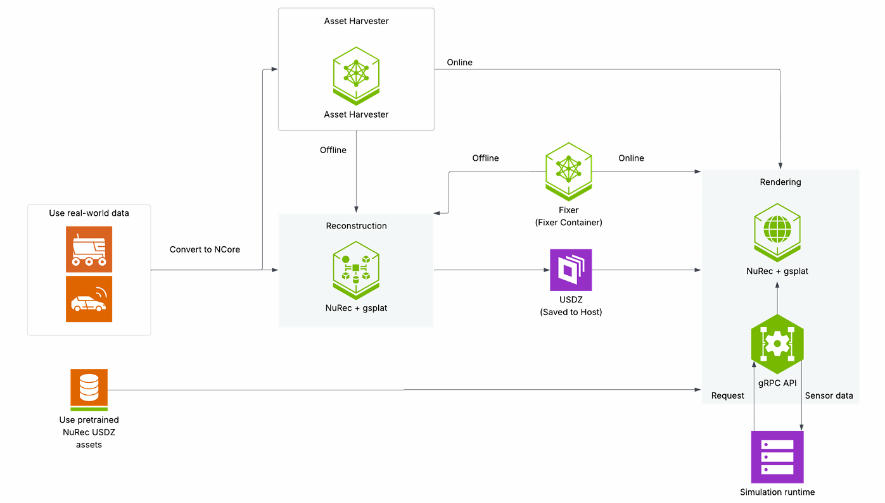

## Introduction

- NVIDIA Omniverse NuRec Libraries is **3D Gaussian based reconstruction and rendering for high fidelity simulation**
- Last topic gave the big picture: NuRec brings a real **place** into simulation. 
- This topic opens the box. It shows the **pipeline inside NuRec**, the components that make up the diagram, and four reasons to use it.

## NuRec Introduction

- NVIDIA's NuRec models and services take real-world **camera and lidar data** and turn it into a **simulated 3D environment**. 
- Those environments can be used to train and test physical AI agents, including robots and autonomous driving systems.

> **The example of the output**: a road scene with palm trees, cars and a speed bump sign, rendered from a reconstructed model. NuRec began with a strong autonomous vehicle focus, and robotics support (through Isaac Sim) is a growing part of it.

- There are two big jobs, and the architecture diagram is organized around them:

| Job | Question it answers?|
|-----|---------------------|
| **Reconstruction** | How do I turn real recordings into a 3D scene? |
| **Rendering** | How does a simulator get camera images of that scene while a robot or car moves through it? |

## NuRec Architecture

### Step 1: Use real-world data and convert it to NCore

- The input is recordings from real sensors. NVIDIA's docs describe camera and lidar data, and the NCore tooling accepts cameras, lidar, radar, IMU, depth and stereo.
- **NCore** is NVIDIA's open data standard for representing sensor data in reconstruction workflows. Think of it as a common format so that data from different cars or robots can be fed into the same pipeline.
- A catalog of NuRec agent skills on GitHub shows NCore V4 is the version the reconstruction engine currently reads.

### Step 2: Reconstruction (NuRec + gsplat)

- NuRec trains a **3D Gaussian** model of the scene from the converted data. NVIDIA's documentation refers to 3DGUT, a Gaussian method that handles real camera effects.
- **gsplat** is the open source, CUDA accelerated Gaussian splatting library. it is part of both reconstruction and rendering.

### Step 3: Generative helpers, offline and online

- Two generative AI components sit above and below the main flow. 
- Each has an **offline** arrow (into reconstruction) and an **online** arrow (into rendering).

| Component | What it does? | Offline use | Online use |
|-----------|--------------|-------------|------------|
| **Asset Harvester** | Extracts individual 3D objects, such as cars and pedestrians, from driving recordings so they can be removed, replaced or reused elsewhere | Clean or edit the scene while it is being built | Insert or swap objects while the simulation is running |
| **Fixer** | A generative model built on NVIDIA Cosmos that repairs artifacts and blur in reconstructed scenes | Clean up rendered views during reconstruction, then fold the improvement back into the 3D model | Correct frames as they are rendered |

### Step 4: USDZ saved to host

- The reconstruction is written as a **USDZ** package.
- NVIDIA's documentation says it contains the USD scene definition, a checkpoint with the trained reconstruction data, and a JSON file with the capture trajectory. 
- A road map file can optionally be included for driving simulation.

### Step 5: Rendering and the gRPC API

- **Rendering** draws the scene from whatever viewpoint the simulator asks for.
- The **gRPC API** is the messenger between the simulation runtime and the NuRec container. The simulator sends a **request** (where is the camera, what sensor), and NuRec returns **sensor data** (the rendered image).
- In Isaac Sim, rendering is built into Omniverse, so you can load a compatible scene directly.

### Shortcut: pretrained USDZ assets

- We can use pretrained NuRec USDZ assets and skips reconstruction entirely.
- NVIDIA publishes a growing set of ready-made reconstructed scenes in the NuRec-trained Physical AI dataset on Hugging Face. This is the fastest way to start.

## Value addition by NuRec

- **Accelerate Rendering**
- **Scale with agents**
- **Open Foundation**: Built on the open-source, CUDA-accelerated gsplat rendering library.
- **Enhance Reconstructions**: Generative models improve quality and enable asset deletion and insertion.

## Use cases: Robotics and Autonomous Driving

- NVIDIA's documentation has separate quickstarts, which shows how the same technology serves different users.

| Path | Starting point | Where the scene runs?|
|------|----------------|----------------------|
| **Robotics developers** | Capture with a mono or stereo camera, reconstruct, then use the generated asset | Isaac Sim |
| **AV developers** | Use pre-reconstructed driving scenes, or reconstruct from driving logs | CARLA, AlpaSim and other platforms with a NuRec integration |
| **Simulation platform developers** | Integrate the NuRec gRPC API into their own simulator | Their own platform |

- A simple robotics recipe from NVIDIA's technical blog: capture the real scene, build a sparse reconstruction with COLMAP, train with 3DGUT, export as USD and load it in Isaac Sim.

## Why Gaussian Splatting Fits Simulation?

| Property | Why it helps?|
|----------|--------------|
| Real-time rendering after training | Simulators need images many times per second. Training is heavy but rendering is quick |
| Photorealistic | Reduces the visual part of the sim-to-real gap |
| Standard USD output | Flows into existing Isaac Sim and Omniverse workflows |
| Editable | With Asset Harvester you can add or remove cars and pedestrians |

> A limit to remember: a reconstruction captures **how a place looked when it was recorded**. Objects that were not captured, or views far from the recorded path, are less reliable, which is exactly why the generative fixers exist.

## Summary

1. **NuRec** turns real camera and lidar data into photorealistic, interactive 3D scenes for simulation.
2. Pipeline: **real data, NCore, reconstruction (NuRec + gsplat), USDZ, rendering, gRPC API, simulator**.
3. **Asset Harvester** extracts objects for removal and insertion. **Fixer** (now Harmonizer in the docs) repairs artifacts. Both work offline and online.
4. You can skip reconstruction by using **pretrained USDZ scenes**.
5. Built on open source **gsplat**. Works with Isaac Sim, CARLA and AlpaSim.

## References

1. NVIDIA Omniverse NuRec: https://developer.nvidia.com/omniverse/nurec
2. NuRec documentation: https://docs.nvidia.com/nurec/index.html
3. Scaling Neural Reconstruction (NuRec best practices): https://docs.nvidia.com/nurec/best-practices/scaling-neural-reconstruction.html
4. NCore data standard: https://github.com/NVIDIA/ncore
5. Asset Harvester: https://github.com/NVIDIA/asset-harvester
6. Harmonizer: https://github.com/NVIDIA/harmonizer
7. NuRec agent skills: https://github.com/NVIDIA/nurec-skills
8. NuRec container on NGC: https://catalog.ngc.nvidia.com/orgs/nvidia/teams/nre/containers/nre-ga
