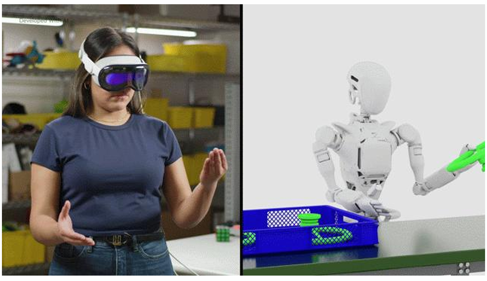
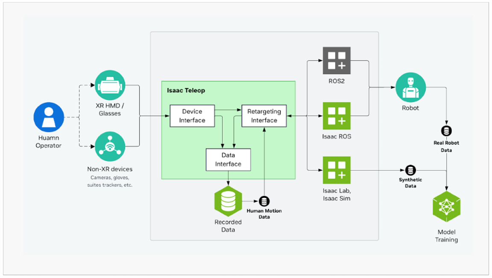
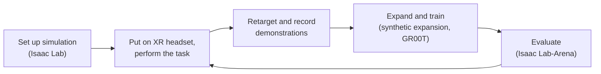

## Introduction

- This is the **Open workflow for collecting data to train and test the robotics stack**
- We see the overview: NuRec brings in the **place**, and Isaac Teleop brings in the **skill**.
- Then we opened up NuRec. Now this topic opens up Teleop: how a human's movements become robot training data.

## Problem Teleop Solves

- Robots learn from demonstrations (imitation learning). 
- But a demonstration needs someone to show the robot what to do, and there is a catch: a human body and a robot body are built differently. 
- A person has two arms with five-fingered hands. A robot may have two arms, a different shoulder layout, a three-fingered gripper, and wheels or legs.
- **Teleoperation** solves this by letting a person *drive* the robot: you move, and the robot moves in a matching way. The robot's sensors record what it sees and does, which becomes training data. 
- On the data pyramid this is the **peak**: the smallest amount of data, but the highest quality and most specific to the robot.

> Below photo shows a person in an XR headset next to a humanoid robot in simulation moving a green object into a blue bin.

## Isaac Teleop Architecture Diagram

### Input: the human operator and devices

| Device group | Examples | Role |
|--------------|-----------------------|------|
| **XR headset or glasses** | A VR style headset | Tracks the operator's head and hands. XR stands for extended reality (virtual, augmented and mixed reality) |
| **Non-XR devices** | Cameras, gloves, suit trackers and so on | Other ways to capture motion, such as data gloves for fine finger movement or body trackers |

- NVIDIA's documentation lists standard interfaces for XR headsets, gloves, foot pedals and body trackers.
- Isaac Lab's documentation says Isaac Teleop supports multiple XR headsets and tracking peripherals, with options such as a native visionOS app for Apple headsets.

### Inside Isaac Teleop: three interfaces

| Interface | Meaning | NVIDIA Reccomendation |
|-----------|---------------|-----------------|
| **Device Interface** | A uniform way to read any supported device, so that the rest of the system does not care which headset or glove you use | NVIDIA describes a standardized device interface and a plugin system for adding new devices |
| **Retargeting Interface** | Converts human motion into robot commands | NVIDIA describes a graph-based retargeting pipeline. Data flows from source nodes (head pose, hand tracking with 26 joints per hand, full body pose) through retargeters, and the results are combined into a single action |
| **Data Interface** | Records and replays the data | NVIDIA's release notes mention a record and replay data pipeline |

#### Key step: Retargeting

| Human input | Robot output |
|-------------|--------------|
| Wrist pose from hand or controller tracking | Position and orientation of the robot's end effector (the hand or gripper) |
| Full hand tracking, 26 joints per hand | Joint angles of the robot's own hand, found through optimization (using the dex-retargeting library) |
| Foot pedal input | A movement command for the robot's base: forward and sideways speed, turning speed and hip height |
| Head pose and full body pose | Head orientation and posture targets |

> So retargeting answers: *"If the person moves like this, what joint angles should the robot use so that its hand ends up in the matching place?"*

### Recorded data and human motion data

- The Data Interface saves what happened into **recorded data**.
- Stored **human motion data** can be **replayed** through the same retargeting pipeline, for example to drive a different robot body later.

### Output: robot targets

The retargeted commands go to three kinds of destination:

| Target | Meaning |
|--------|---------|
| **ROS 2** | The standard robot software framework, for real robots |
| **Isaac ROS** | NVIDIA's accelerated ROS 2 packages |
| **Isaac Lab and Isaac Sim** | Simulation, for virtual robots|

- Isaac Teleop is a unified stack for simulation and real teleoperation across ROS 2, Isaac Sim and Isaac Lab, and that it replaces the older native XR teleoperation stack inside Isaac Lab.

### Two data streams, one goal

| Stream | Source |  |
|--------|--------|----------------|
| Robot connected through ROS 2 or Isaac ROS | Real hardware | **Real Robot Data** |
| Isaac Lab or Isaac Sim | Simulation | **Synthetic Data** |

- Both flow to **Model Training**. This is the real plus synthetic mix, collected with one workflow.

## Three Value Cards

| Card | Meaning | How NVIDIAs helps for this? |
|------|---------------------|------------------------|
| **Whole Body Controls** | Supports mapping head, hand, and wrist poses to humanoid policies | Consistent with NVIDIA's documentation (head, hand and wrist tracking, and full body sources). An Isaac ROS tutorial shows whole-body XR teleoperation of a Unitree G1 humanoid combining walking, two-arm inverse kinematics and finger control, all from an XR headset |
| **Zero-Shot Transfer** | Use the same teleop setup across sim and real without code changes | The unified stack supports this idea. In the Isaac ROS G1 tutorial, you switch between simulation (MuJoCo) and real hardware by changing a launch parameter, so a small configuration change is still needed |
| **Environment Interaction** | Interact with procedural environments to test policy robustness | It fits the Isaac Lab and Lab-Arena idea of varied environments |

**A terminology warning:**

- In machine learning, **zero-shot transfer** normally means a trained model works in a new setting with no extra training. 
- In Isaac teleop **zero-shot transfer** uses the phrase for something different: the same **teleoperation setup** works in sim and real.

## How a Team Would Use It?

- This is the first half of the GR00T end-to-end workflow : 
    - Isaac Lab for setup.
    - **Isaac Teleop for data creation**.
    - GR00T models for training.
    -Isaac Lab-Arena for evaluation.

**Practical notes**

1. **Works alongside Isaac Lab.** NVIDIA's repository says Isaac Teleop is designed to work side by side with Isaac Lab, starting with the Isaac Lab 3.0 beta, and uses CloudXR to stream to headsets.
2. **Release history.** The first stable release (1.0) was on March 16, 2026, and later releases added more devices, dexterous hand retargeting, ROS 2 integration and a visualization stack. NVIDIA's release notes mention support for Sharpa Wave hands and MANUS data gloves, among others.
3. **No headset needed for simple setups.** Isaac Lab's documentation notes that keyboard and SpaceMouse teleoperation still use an older stack, so Isaac Teleop is mainly the XR route.
4. **Open source.** The code is on GitHub.

## Summary

1. **Isaac Teleop** turns a human's movements into robot demonstrations.
2. Three interfaces: **Device** (read any headset or glove), **Retargeting** (map human motion to robot commands), **Data** (record and replay).
3. Outputs go to **ROS 2, Isaac ROS, Isaac Lab and Isaac Sim**, producing **real robot data** and **synthetic data** for model training.
4. Highlights: whole-body control from head, hand and wrist poses, one setup for sim and real, and testing in varied environments.
5. Open source, designed to work with Isaac Lab.
6. "Zero-shot transfer" means the same teleop setup, not the usual machine learning meaning.

## References

1. Isaac Teleop on GitHub: https://github.com/NVIDIA/IsaacTeleop
2. Isaac Teleop documentation: https://nvidia.github.io/IsaacTeleop/main/index.html
3. Retargeting reference: https://nvidia.github.io/IsaacTeleop/main/references/retargeting.html
4. Isaac Lab documentation, Isaac Teleop feature page: https://isaac-sim.github.io/IsaacLab/develop/source/features/isaac_teleop.html
5. Isaac ROS tutorial, Unitree G1 XR teleoperation: https://nvidia-isaac-ros.github.io/v/release-4.5/repositories_and_packages/isaac_ros_physical_ai/isaac_ros_unitree_g1_teleop_bringup/index.html
6. Isaac Teleop 1.0 release notes: https://github.com/NVIDIA/IsaacTeleop/releases/tag/v1.0.191
