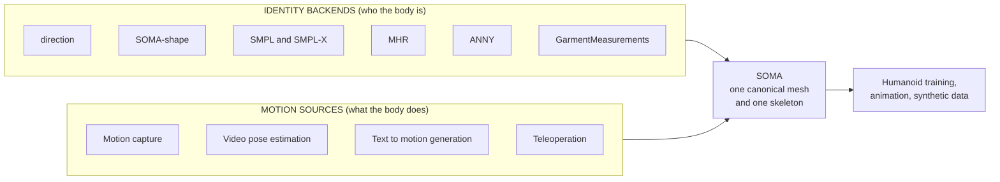
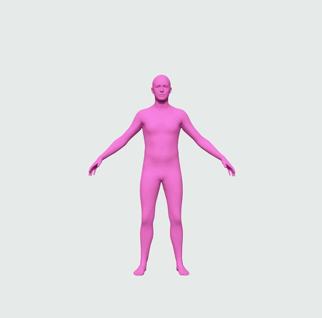

## Introduction

- This is **Standardized open body framework for robotics**
- It is about a different kind of data from everything so far: **human body motion**.
- We learned how a person's movements are captured for robot demonstrations. 
- SOMA answers a quieter but important question: **in what common language should all that human motion be written down?**

## Problem: Many Body Models, No Common Language

- To work with human motion on a computer, you need a **body model**: a mathematical description of a human body that can be posed and reshaped.
- Many research groups and companies have built their own, and each uses its own skeleton and mesh layout.

| Term | Meaning |
|------|---------------|
| **Parametric body model** | A body described by a small set of numbers. Some numbers control the **shape** (tall, short, broad), and others control the **pose** (arm raised, knee bent) |
| **Skeleton** | The set of joints (shoulders, elbows, finger joints and so on) that the body bends around |
| **Mesh topology** | How the surface of the body is built from points and triangles |
| **Identity** | Who the body is, meaning its shape and proportions, separate from what it is doing |
| **Pose** | What the body is doing right now |
| **Skinning** | Deforming the surface mesh as the skeleton moves. The common method is linear blend skinning |

- The problem NVIDIA's SOMA documentation points out:
    - Different body models use different skeletons and topologies, so mixing their strengths needs a custom adapter for every pair of models.
    - For example, combining one model's control over age range with another model's large motion data collection takes custom engineering. That slows everything down.

## What SOMA Is?

- NVIDIA's repository describes SOMA as **a canonical body topology and rig that acts as a universal pivot** for all supported parametric human body models.
- Instead of replacing the existing models, it maps each one onto a single shared representation.

- **The key design idea: separate identity from pose.** Because the pose is expressed on one shared skeleton, you can take a motion recorded on one body and apply it to any other supported body, or swap the body shape without redoing the motion.
- This lets you mix and match identity sources and pose data at inference time without extra engineering.

- **NCore** standardizes how **sensor data** is written, and **SOMA** standardizes how **human bodies** are written. Both exist so that many different sources can feed one pipeline.

## Neutral body mesh: SOMA skeleton

Below is a neutral body mesh in a standing, arms-out pose, the typical rest shape used for body models.

| Fact | Detail |
|------|--------------------------------------|
| Supported identity backends | Six: SOMA-shape, SMPL, SMPL-X, MHR, ANNY and GarmentMeasurements |
| Full skeleton | 77 joints, covering the full body including hands |
| Simplified skeleton | A 30 joint SOMA skeleton is used by some motion generation models |
| Hands | A dedicated hand model with its own identity options |
| Pose format | Axis-angle joint rotations (a standard way to store how much each joint is turned) |
| Speed | Built on **NVIDIA Warp**, GPU accelerated and differentiable. The model card lists skeleton fitting under 1.7 milliseconds for a single body |
| Install | `pip install py-soma-x`. Assets download from Hugging Face on first use |
| Released | March 2026 (GitHub and Hugging Face) |

> **Differentiable** means a learning algorithm can pass gradients through the model, so the body model can sit inside a training loop. This is why it is useful for AI, not just for animation.

## Key Takways

- **Most comprehensive model for human motion.** 
    - Covers full body and detailed hands under one standard. 
    - The 77-joint body and hand skeleton and six backends.
- **Open source with commercial use rights.** 
    - We can use it in products.
- **Open, optimized toolchain for accelerated processing.** 
    - Fast, GPU based tools. Warp acceleration, with a Python package and documentation.
- **Standard for the largest open dataset in the industry.**
    - A big open motion dataset is stored in SOMA format.
    - BONES-SEED, a human and humanoid motion dataset in SOMA format.
- **Supported by AI models and robotics workflows.** 
    - Other NVIDIA tools already use it.

### Licensing catch

- "Open source with commercial use rights" needs care. 
- NVIDIA's SOMA package lists the **SMPL, SMPL-H and SMPL-X backends as requiring user-supplied licensed model files**, because those models come from other groups with their own terms. 
- MHR, ANNY and other components also keep their own terms. 
- And NVIDIA's released models built on SOMA (such as GEM-X and Kimodo) use the NVIDIA Open Model License for their weights. 
- So the right reading is: **SOMA's own parts are open, but each backend and model you combine with it has its own license, so check each one before commercial use.**

## What Already Uses SOMA?

NVIDIA's package page lists tools in the SOMA ecosystem:

| Tool | What it does? |
|------|--------------|
| **GEM-X** | Estimates 77-joint SOMA body pose, including hands, from ordinary video taken with one camera. It also recovers global movement through space |
| **Kimodo** | Generates controllable human motion from text descriptions, using a diffusion transformer. Variants are trained on the SOMA skeleton and on the open BONES-SEED dataset, and one variant is retargeted to the 34 joint Unitree G1 humanoid skeleton |
| **ARDY** | An autoregressive diffusion model for interactive motion generation |
| **MotionBricks** | A real-time motion in-betweener, which fills in motion between key poses |
| **BONES-SEED** | Human and humanoid motion dataset in SOMA format |
| **GR00T Whole-Body Control** | A whole-body controller for humanoids |

> A typical use: record a person on ordinary video, convert the video into SOMA motion with GEM-X, retarget that motion to a humanoid robot (retargeting), and use it to train or evaluate a whole-body policy. Or skip the person entirely and write "walk and wave" as text for Kimodo to generate.

## Why This Matters for Robots?

- **Data pyramid base.** Human videos and motion records are the broad base of robot knowledge. A shared format makes it practical to pool them.
- **Humanoid training.** Humanoids move like people, so human motion data teaches natural movement.
- **Teleop and synthetic data.** Teleoperation produces human motion data, and text-to-motion models create more of it. SOMA is the common container.
- **No more custom adapters.** Teams can combine datasets and models from different sources without writing conversion code for each pair.

## Summary

1. **SOMA** is a canonical body topology and skeleton that unifies many parametric human body models.
2. It **separates identity (shape) from pose**, so any motion can be applied to any supported body.
3. Full skeleton has **77 joints** including hands, and the software is GPU accelerated with NVIDIA Warp.
4. The ecosystem includes **GEM-X** (video to motion), **Kimodo** (text to motion), **ARDY**, **MotionBricks**, **BONES-SEED** and **GR00T Whole-Body Control**.
5. Licensing varies by backend and model, so check each before commercial use.
6. "Most comprehensive" and "largest open dataset".

## References

1. SOMA-X on GitHub: https://github.com/NVlabs/SOMA-X
2. SOMA-X on Hugging Face: https://huggingface.co/nvidia/SOMA-X
3. SOMA-X model card: https://nvlabs.github.io/SOMA-X/stable/model_card.html
4. SOMA-X Python package: https://pypi.org/project/py-soma-x/
5. GEM-X on Hugging Face: https://huggingface.co/nvidia/GEM-X
6. Kimodo on Hugging Face: https://huggingface.co/nvidia/Kimodo-SOMA-RP-v1.1
