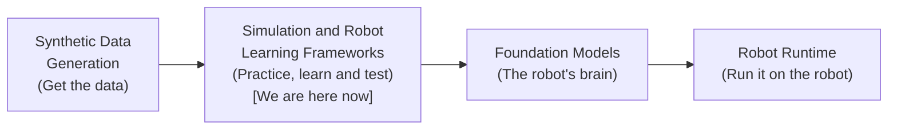

## Introduction

- The Synthetic data  generation section was about **where data comes from**.
- This one is about **where robots use that data to practice and learn**.
- It maps to the second computer (Omniverse and Cosmos) and to the Simulation Frameworks pillar.



## Meaning

| Word | Meaning |
|------|---------|
| **Simulation framework** | Software that builds a virtual world with physics, sensors and robots, so you can test and generate data. This is **Isaac Sim** |
| **Robot learning framework** | Software that runs many simulated robots at once so that policies can be trained with reinforcement learning or imitation learning. This is **Isaac Lab** |

- A simple way to separate them: **Isaac Sim is the world, and Isaac Lab is the gym where robots train inside that world.**
- Isaac Lab is built on top of Isaac Sim.
- NVIDIA's Isaac Lab repository describes it as a GPU accelerated, open source framework that unifies workflows such as reinforcement learning, imitation learning and motion planning, built on Isaac Sim.

## Layers

The section covers five main tools. They sit in layers.

```
   ORCHESTRATION        OSMO             run and manage all the jobs at scale
                         |
   EVALUATION           Isaac Lab-Arena  test policies across many scenarios
                         |
   LEARNING             Isaac Lab        train policies in parallel simulations
                         |
   SIMULATION           Isaac Sim        virtual world, sensors, synthetic data,
                         |               software and hardware in loop testing
   PHYSICS ENGINE       Newton, PhysX    compute how things move and collide
```

| Layer | Tool | Role |
|-------|------|------|
| Physics engine | **Newton** (and PhysX) | Calculates motion, contact and forces. This is the classical simulator. |
| Simulation | **Isaac Sim** | The reference framework for robot simulation, rendering and sensors |
| Learning | **Isaac Lab** | Trains policies at scale |
| Evaluation | **Isaac Lab-Arena** | Tests trained policies at scale.|
| Orchestration | **OSMO** | Schedules and runs the workflows across compute |

## What to expect from this section?

- How Robots Become Robots? The full pipeline: internet scale pretraining, post-training data, policy training and evaluation, with a feedback loop.
- NVIDIA Isaac Sim: The agent friendly reference framework for robot simulation.
- Physically-based Simulation for Real World Robotics (Isaac Sim): Features and capabilities, with a "Launch Isaac Sim on Brev" option.
- Isaac Sim for Software-in-Loop Testing: Testing full robot software against simulation, with ROS 2 integration |
- NVIDIA Isaac Lab: The agent friendly framework for robot learning and policy training.
- Physically-based Simulation for Real World Robotics (Isaac Lab): Features and capabilities, with a "Launch Isaac Lab on Brev" option.
- Use Cases: Policy training for manipulators, quadrupeds and humanoids.
- Isaac Lab-Arena: Open source framework for large scale policy evaluation.
- NVIDIA OSMO: Open source agentic orchestrator for physical AI workflows.
- Newton: Open source, GPU accelerated physics engine built for robot learning.

## Context to Keep in Mind

This section's tools are changing fast:

1. **Isaac Sim 6.0** became generally available on June 8, 2026. NVIDIA's announcement says it added support for multiple physics backends including PhysX and Newton, Newton based software-in-the-loop workflows, teleoperation through Isaac Teleop, and AI assisted development through Isaac Sim MCP and agent skills.
2. **Isaac Sim 6.1** followed as a general availability release in September 2026, with an updated (still experimental) Newton integration. NVIDIA's release notes list Newton 1.5.0 support.
3. **Isaac Lab 3.0** is in early access, built for Isaac Sim 6.1 and the Newton physics engine. NVIDIA's release notes say general availability is targeted toward the end of October 2026.
4. Isaac Lab 3.0 lets many workflows run without installing Isaac Sim, using Newton directly, and installs the full Isaac Sim stack only when you need capabilities such as XR teleoperation, PhysX or RTX rendering.

So treat feature lists as a guide and check the release notes for what you install or using.

## Way to Read This Section

1. **Which job is it doing?** Build the world, train the robot, test the robot, or run the jobs?
2. **What does it need from the previous layer?** For example, Isaac Lab needs a simulated world from Isaac Sim, and a physics engine inside it.
3. **What comes out?** A trained policy, a score, or generated data?

## Summary

1. This topic opens the section on **Simulation and Robot Learning Frameworks**.
2. **Isaac Sim** is the virtual world. **Isaac Lab** is the training gym built on it. **Isaac Lab-Arena** tests policies. **OSMO** runs the jobs. **Newton** is the physics engine underneath.
3. Isaac Sim 6.x is generally available (6.1 as of September 2026), and Isaac Lab 3.0 is in early access, so details are moving.

## References

1. NVIDIA Isaac Sim: https://developer.nvidia.com/isaac/sim
2. NVIDIA Isaac Lab: https://developer.nvidia.com/isaac/lab
3. Isaac Sim 6.0 general availability announcement: https://forums.developer.nvidia.com/t/isaac-sim-6-0-general-availability/372621
4. Isaac Sim 6.1 release notes: https://docs.isaacsim.omniverse.nvidia.com/6.1.0/overview/release_notes.html
5. Isaac Lab on GitHub: https://github.com/isaac-sim/IsaacLab
6. Isaac Lab-Arena documentation: https://isaac-sim.github.io/IsaacLab-Arena/
7. Newton physics engine: https://github.com/newton-physics/newton
