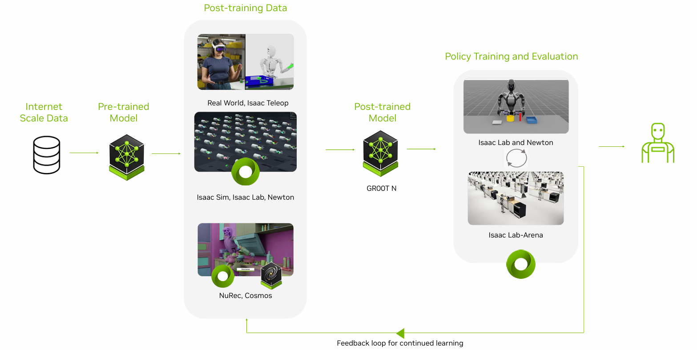

## Introduction

- This is the **master pipeline** of the workshop. It takes everything from the data section and shows how it flows into a trained robot policy.
- If you only remember one diagram from the whole deck, make it this one.

## Robots Are Educated in Stages

| Human analogy | Robot stage |
|---------------|--------------------------|
| General education: reading, observing the world | **Pre-trained model** from internet scale data |
| Job specific training: apprenticeship, practice demonstrations | **Post-training data**, producing a **post-trained model** |
| Practice and exams on the job | **Policy training and evaluation** |
| Working in the real world | **The robot**, deployed |
| Learning from experience at work | **Feedback loop for continued learning** |

## End to end Pipeline

## Stage 1: Internet scale data, then a pre-trained model

- The starting point is a **foundation model** trained on very large and broad data, such as web scale video, images and text, plus existing robot data. This is the **base of the data pyramid**.
- The result knows a lot in general: what objects are, how people use them, how scenes look. It is a **generalist**, and it does not yet know how to operate your particular robot.
- For humanoids, NVIDIA's open model here is **Isaac GR00T**. 
    - The current open release, GR00T N1.7, is a 3 billion parameter vision-language-action model that combines a vision-language backbone with a diffusion transformer head that produces continuous actions. 
    - NVIDIA's repository says it is trained on a diverse mixture of robot data (bimanual, semi-humanoid and humanoid) and pretrained on 20,000 hours of human video data, and that it is commercially usable. 
    - The repository describes the code as Apache 2.0, while the model weights are listed under the NVIDIA Open Model License, so read both licenses before using it in a product.

## Stage 2: Post-training data (three sources)

- A generalist model must be **adapted** to a specific robot body, task and environment. That needs specific data, and the pipeline shows three places it comes from. Each maps to something we already studied.

| Source | What it provides? |
|---------------------|------------------|
| **Real world, Isaac Teleop** | High quality human demonstrations on real or simulated robots |
| **Isaac Sim, Isaac Lab, Newton** | Simulated experience and demonstrations, generated at scale with accurate physics |
| **NuRec, Cosmos** | Real places rebuilt as simulation (NuRec), and generated scenes and variations (Cosmos) |

- Together these are the **middle and top layers of the data pyramid**: synthetic data and real robot data.

## Stage 3: Post-trained model

- The pre-trained model is fine-tuned on the data above and becomes a **post-trained model**.
- It labeled **GR00T N** on pipeline. The "N" refers to the numbered GR00T N generations (N1.5, N1.6, N1.7).

- What post-training looks like in practice, based on NVIDIA's Isaac GR00T repository and learning course:

1. Collect demonstrations, for example with Isaac Teleop in simulation.
2. Convert them to a standard dataset format called **LeRobot**.
3. Run a fine-tuning script that starts from the base model checkpoint and adapts it to your robot, using an **embodiment tag** that tells the model which robot body it is learning.

> In NVIDIA's example, the language part of the model is kept frozen, while the visual backbone, a projector and the diffusion action head are tuned. NVIDIA notes that post-training a 3 billion parameter policy is expensive and recommends a multi-GPU setup for best quality.

## Stage 4: Policy training and evaluation

- This has two tools with circular arrows between them, which means they work in a loop.

| Tool | Job |
|------|-----|
| **Isaac Lab and Newton** | Train and refine the policy in massively parallel simulation, with reinforcement learning and imitation learning. Newton supplies the physics |
| **Isaac Lab-Arena** | Evaluate the policy across many scenarios. Arena can run the model through a server-client setup, where the model is hosted separately and the simulation queries it |

> - NVIDIA examples show that **reinforcement learning can follow supervised fine-tuning**. 
    - For instance, a healthcare robotics workflow trains GR00T policies on curated datasets and then applies online reinforcement learning post-training for precision tasks. 
    - So the pattern is: imitate demonstrations first, then improve through trial and error in simulation, checking progress in Arena.

## Stage 5: The robot

- The validated policy is deployed on the robot's computer, for example Jetson Thor.

## Feedback loop for continued learning

- Feedback loop runs from the evaluation panel back to the post-training data. It means **what you learn from evaluation goes back into data creation**:

1. Evaluation finds situations where the policy fails.
2. You collect or generate more data for those situations (more demonstrations, new scenes, new variations).
3. You post-train again, and evaluate again.

- It also continues after deployment: what the real robot experiences can feed back as new data.

## Why Two Kinds of Training Matter?

A common question: why not train one model on everything at once?

| | Pre-training | Post-training |
|---|--------------|----------------|
| Data | Huge, broad, mixed quality | Small, specific, high quality |
| Cost | Very high, done once by a few organizations | Much lower, done by each developer |
| Result | General knowledge | Skill on a specific robot and task |
| Who does it? | Model providers such as NVIDIA | You |

- This is why NVIDIA releases **open pretrained models**: it lets any company skip the expensive first stage and do only the second.

## Summary

1. A robot becomes useful in stages: **pretrain, post-train, train and evaluate in simulation, deploy, and keep learning**.
2. Pre-training uses **internet scale data** to build a generalist model.
3. Post-training data comes from three places: **Isaac Teleop** (real world), **Isaac Sim, Isaac Lab and Newton** (simulation), and **NuRec and Cosmos** (reconstructed and generated worlds).
4. The post-trained model (**GR00T N**) is then refined and tested with **Isaac Lab, Newton and Isaac Lab-Arena**.
5. The **feedback loop** returns evaluation findings to the data stage.

## References

1. NVIDIA Isaac GR00T on GitHub: https://github.com/NVIDIA/Isaac-GR00T
2. NVIDIA learning course, "How to Develop and Deploy Humanoid Robots End-to-End with NVIDIA Isaac GR00T and Unitree G1": https://docs.nvidia.com/learning/physical-ai/gr00t-e2e-workflow/latest/simulation-workflow/sim-overview.html
3. Isaac Lab-Arena documentation, policy post-training workflow: https://isaac-sim.github.io/IsaacLab-Arena/main/pages/example_workflows/static_apple/step_3_policy_training.html
4. GR00T N1 research paper: https://arxiv.org/abs/2503.14734
5. NVIDIA Isaac platform: https://developer.nvidia.com/isaac
