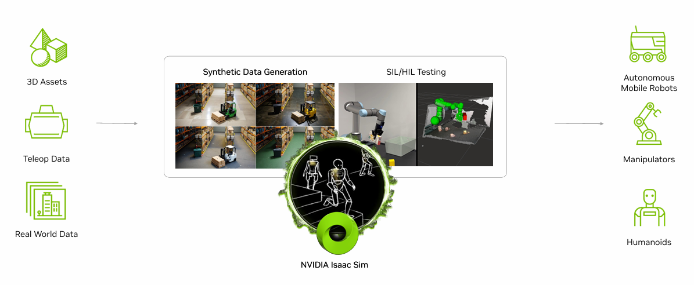

## Introduction

- NVIDIA Isaac Sim is a **Agent-friendly reference framework for robotics simulation**
- In last topic we see end to end pipeline. 
- This topic zooms into the first simulation tool in it: **Isaac Sim**, the virtual world where robots are built, tested and used to generate data.

## What Isaac Sim Is?

- Isaac Sim is NVIDIA's robotics simulation framework. 
- It is built on **Omniverse** technology and **OpenUSD** (the scene format), and it combines two kinds of realism:

| Kind of realism | Technology | Why it matters? |
|-----------------|------------|----------------|
| **Physical** | PhysX, with Newton as a second physics backend | Robots move, collide and grip objects in believable ways |
| **Visual and sensor** | RTX ray traced rendering | Simulated cameras and lidars produce images and data that resemble real sensors |

- This is the **classical simulator**: a physics engine in the middle, now wrapped in a full robotics workbench. 
- The code is open and published on GitHub.

## What "Agent-Friendly" Means?

- The subtitle calls Isaac Sim an **agent-friendly** framework.
- This links to NVIDIA's Isaac Sim 6.0 announcement lists two concrete features:

| Feature | What it does? |
|---------|--------------|
| **Isaac Sim MCP** | A deployable Model Context Protocol server that exposes Isaac Sim extensions, APIs and documentation to AI coding assistants such as Claude Code and Cursor. MCP is a standard way for AI assistants to connect to tools |
| **Isaac Sim Skills** | A skill that lets a user launch Isaac Sim and connect to a live running instance directly from Claude Code. Once connected, the user can run code, modify the USD scene, run simulations, interact with UI elements and build new natural language skills |

- The Warehouse Creator extension also gained headless execution (running without a visible window) for agentic warehouse creation workflows.

> In simple words: you can tell an agent "build a warehouse with forty shelves and a forklift, then record camera images", and it can drive Isaac Sim to do that.

## Input, Output and capabilities of Issac Sim

### Three inputs

| Input | Meaning |
|-------|---------|
| **3D Assets** | Models of robots, objects and environments, such as SimReady assets in OpenUSD. NVIDIA says the URDF and MJCF robot importers in Isaac Sim 6.0 produce assets that can switch between physics backends |
| **Teleop Data** | Human demonstrations. Isaac Sim 6.0 adds support for teleoperation workflows using Isaac Teleop |
| **Real World Data** | Captured scenes and recordings, for example NuRec reconstructions brought into simulation |

### Two capabilities

- **Synthetic Data Generation (SDG).** 
    - The picture shows in diagram is four views of a warehouse with a forklift under different conditions. 
    - Isaac Sim's tool for this is **Replicator**, which creates varied scenes and labeled data automatically by randomizing things such as lighting, object positions and appearance. 
    - NVIDIA reports Replicator can now also randomize physics properties such as mass, friction and bounciness across scene objects. A new canonical workflow chains Replicator calls to randomize warehouse assets.

- **SIL and HIL Testing.** The picture shows in diagram is a simulated robot arm beside a visualization of its perception. These two terms are central:

| Term | Meaning | Simple picture |
|------|---------|----------------|
| **SIL** (software in the loop) | Your real robot software runs on a computer and talks to the simulated robot instead of a physical one | Real brain, virtual body |
| **HIL** (hardware in the loop) | The real onboard computer (for example a Jetson) is connected to the simulator, which feeds it simulated sensor data and receives its commands | Real brain on its real chip, virtual body |

- The point of both is to test the **whole robot stack** safely before it touches a real machine.

### Three robot types

- Autonomous mobile robots, manipulators and humanoids.
- Isaac Sim does not target one body type, which matches the "all robot embodiments".

## What Isaac Sim Is Not?

A frequent confusion, worth fixing early:

| | Isaac Sim | Isaac Lab |
|---|-----------|-----------|
| Main job | Build and run the virtual world, sensors and robots, generate data, test software | Train policies with many parallel simulated robots |
| Analogy | The world | The gym inside the world |
| Typical output | Images, sensor data, test results | A trained policy |

- They work together: Isaac Lab is built on Isaac Sim, and NVIDIA has been making assets, actuators and physics settings consistent across the two so that behavior in training matches behavior in testing.

## Notes on Versions

- Isaac Sim moves quickly, so here is where things stood in October 2026 according to NVIDIA's release information.

| Version | Date | Highlights |
|---------|------|-----------|
| **6.0 GA** | June 8, 2026 | Newton authoring and software-in-the-loop workflows, Isaac Sim MCP and agent skills, Isaac Teleop support, unified actuators with Isaac Lab, new sensors (acoustic, structured light), independent sensor update rates, a browser based streaming client, native Windows ROS 2 support |
| **6.1 GA** | September 2026 | Newton 1.5.0 integration with more solvers and hydroelastic contacts, improved parity between PhysX and Newton, new robot assets, new synthetic data examples |

> - Two cautions from NVIDIA's own notes: 
    1. Newton support in Isaac Sim is still labeled **experimental**, and not every example has been tested on Newton. 
    2. Isaac Sim needs an NVIDIA RTX class GPU with ray tracing cores, so data center GPUs without them are not supported.

## Summary

1. **Isaac Sim** is NVIDIA's open, OpenUSD based robotics simulator with PhysX and Newton physics and RTX rendering.
2. **Agent-friendly** means it offers an MCP server and skills so coding agents such as Claude Code can drive it with natural language.
3. Inputs: **3D assets, teleop data, real world data**.
4. Two core capabilities: **synthetic data generation** (Replicator) and **SIL and HIL testing**.
5. Serves **AMRs, manipulators and humanoids**.
6. Isaac Sim is the **world**. Isaac Lab, built on it, is the **gym** for training.
7. Isaac Sim 6.0 (June 2026) and 6.1 (September 2026) are generally available, with Newton still experimental.

## References

1. NVIDIA Isaac Sim: https://developer.nvidia.com/isaac/sim
2. Isaac Sim on GitHub: https://github.com/isaac-sim/IsaacSim
3. Isaac Sim 6.0 general availability announcement: https://forums.developer.nvidia.com/t/isaac-sim-6-0-general-availability/372621
4. Isaac Sim 6.1 release notes: https://docs.isaacsim.omniverse.nvidia.com/6.1.0/overview/release_notes.html
5. Isaac Sim documentation, Agent Skills: https://docs.isaacsim.omniverse.nvidia.com/latest/development_tools/agent_skills.html
