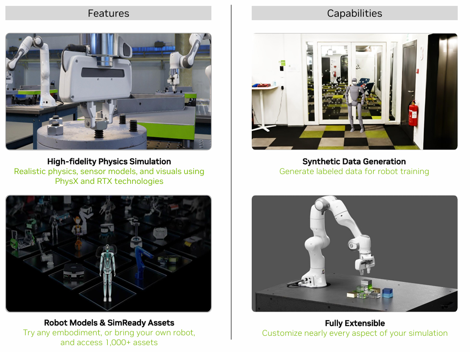
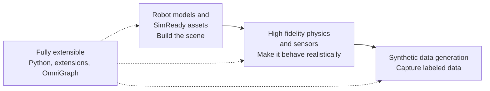

## Introduction

- Last topic introduced Isaac Sim at a high level.
- In this section we will learn about its **feature sheet**.
    - **Features** : What is built into the tool?
    - **Capabilities** : What you can do with it?

## Features and Capabilitiesof Issac Sim



Read it as a story:

- **make the world believable** (physics and sensors), 
- **fill it** (robots and assets), 
- **use it** (generate data), 
- **make it yours** (extend it).

## Feature 1: High-fidelity Physics Simulation

- **High-fidelity Physics Simulation:** Realistic physics, sensor models and visuals using PhysX and RTX technologies.
- **Example:** an industrial robot arm with a gripper working over bolts and nuts, a contact-heavy assembly task.

Three layers of realism work together.

| Layer | Technology | What it gives you? |
|-------|-----------|-------------------|
| **Physics** | **PhysX**, NVIDIA's physics engine. Newton is a second backend added in Isaac Sim 6.x | Rigid bodies, joints, collisions, friction. A gripper that squeezes a nut behaves like a real one |
| **Sensors** | **RTX** ray tracing hardware | Simulated cameras, depth sensors and RTX lidar that react to light and surfaces like real sensors |
| **Visuals** | **RTX** rendering | Photorealistic images, which matter when a perception model is trained on simulated data |

- Sensor models matter as much as physics.
- If a simulated camera is too clean or a simulated lidar is too perfect, a perception model trained on it will struggle on a real robot.
- Contact-rich tasks (inserting, tightening, gripping) are where simulation accuracy is hardest and matters most.
- NVIDIA's Isaac Sim 6.0 notes mention new sensor types (acoustic and structured light), independent update rates for different sensors, and an upgraded camera image signal processing pipeline, all aimed at more realistic multi-sensor simulation.

## Feature 2: Robot Models and SimReady Assets

- **Robot Models and SimReady Assets:** try any embodiment, or bring your own robot, and access 1,000+ assets.
    - **Any embodiment:** Arms, mobile robots, quadrupeds and humanoids are available as ready models.
    - **Bring your own robot:** You can import your own design. NVIDIA's documentation covers URDF and MJCF importers (common robot description formats). In Isaac Sim 6.0 these importers produce assets that can switch between physics backends.
    - **SimReady assets:** Objects and scenes prepared for simulation in OpenUSD.
- **Example:** a dark grid of many different robots, from wheeled bases to a central humanoid.

- NVIDIA's organizes its assets into categories: **robots, sensors, props, environments and featured assets**, with a SimReady explorer and an asset browser.

## Capability 1: Synthetic Data Generation

- **Synthetic Data Generation:** generate labeled data for robot training.
    - The key word is **labeled**. 
    - In the real world, someone must mark up every image by hand: this pixel is a box, this region is a person, this is the distance to the wall. 
    - In simulation, the computer already knows everything about the scene, so it can output the answers automatically alongside each image. 
    - These ground truth labels are free, accurate and consistent.
- **Example:** a humanoid figure standing in an indoor space with tiled floors.

Isaac Sim's tool for this is **Replicator**. In simple terms it lets you:

1. Build a scene and place objects.
2. **Randomize** things such as lighting, textures, object positions and camera angles (a technique called domain randomization, which helps models work in the real world).
3. Capture images and sensor data with matching labels.
4. Repeat thousands of times.

- Isaac Sim 6.0 also lets Replicator randomize physics properties (mass, friction, bounciness), and NVIDIA's documentation includes a way to drive it with natural language.

## Capability 2: Fully Extensible

**Fully Extensible:** customize nearly every aspect of your simulation.

- Isaac Sim is built on the Omniverse platform, whose design is based on **extensions**: small add-on modules, with the application itself assembled from them. 

- NVIDIA's documentation lists several ways to customize:

| Way to extend | Meaning |
|---------------|---------|
| **Python scripting and Core API** | Control the simulation, robots and scenes with Python code |
| **Extensions** | Write your own tools and panels, in Python or in C++ |
| **OmniGraph** | A visual, node based way to build logic, including sensor and ROS connections |
| **Custom Replicator nodes** | Write your own randomization rules for data generation |
| **Custom bridges** | Isaac Sim 6.0 includes a tutorial for connecting the simulator to your own robot software using the middleware of your choice |

**Example:** a white robot arm placing colored blocks, a typical custom task you might build.

**Why this matters:** no two robot projects are the same. Extensibility means Isaac Sim is a platform to build on, not a fixed product. It also explains the "agent friendly": because everything can be driven by code, an agent can drive it too.

## How Feature and Capabilities Fit Together?



## Summary

```
              FEATURES                          CAPABILITIES
   +-------------------------------+   +--------------------------------+
   | High-fidelity Physics         |   | Synthetic Data Generation      |
   | Simulation                    |   | Generate labeled data for      |
   | PhysX and RTX                 |   | robot training                 |
   +-------------------------------+   +--------------------------------+
   | Robot Models and              |   | Fully Extensible               |
   | SimReady Assets               |   | Customize nearly every aspect  |
   | Any embodiment, 1,000+ assets |   | of your simulation             |
   +-------------------------------+   +--------------------------------+
```

1. Isaac Sim's four selling points: **high-fidelity physics and sensors**, **robot models and SimReady assets**, **synthetic data generation** and **full extensibility**.
2. Realism comes from **PhysX** (physics) and **RTX** (sensors and visuals).
3. Simulation produces **labeled data automatically**, using Replicator and domain randomization.
4. It is extensible through **Python, extensions and OmniGraph**, which is also why agents can drive it.

## References

1. NVIDIA Isaac Sim: https://developer.nvidia.com/isaac/sim
2. Isaac Sim documentation: https://docs.isaacsim.omniverse.nvidia.com/latest/
3. Isaac Launchable deployment guide: https://docs.isaacsim.omniverse.nvidia.com/latest/installation/install_advanced_cloud_setup_launchable.html
4. NVIDIA Technical Blog, "Announcing General Availability for NVIDIA Isaac Sim 5.0 and NVIDIA Isaac Lab 2.2": https://developer.nvidia.com/blog/announcing-general-availability-for-nvidia-isaac-sim-5-0-and-nvidia-isaac-lab-2-2
5. Isaac Sim 6.0 general availability announcement: https://forums.developer.nvidia.com/t/isaac-sim-6-0-general-availability/372621
