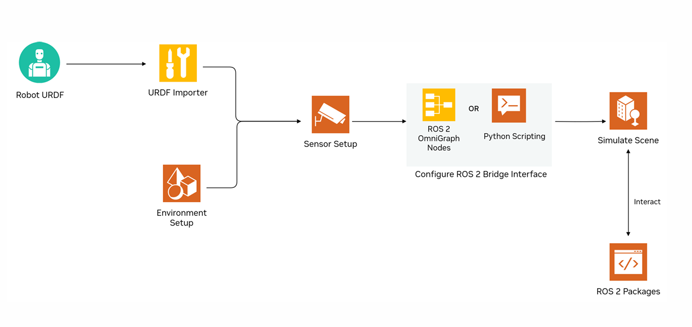
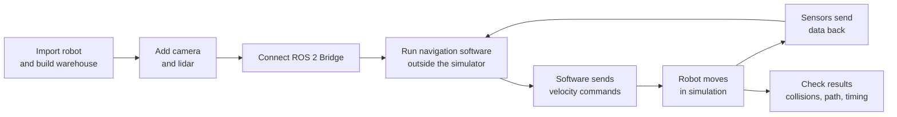

## Introduction

- A robot is not just a model. It is a full software stack: perception, planning, navigation, control and safety logic, all running together. 
- Testing that whole stack on a real robot has hard limits.

| Limit of testing on real hardware | Why it hurts?|
|-----------------------------------|--------------|
| Slow | Setting up scenes, charging, resetting and repeating takes time |
| Risky | A bug can crash the robot, break equipment or hurt someone |
| Narrow | You can only test the situations you can physically create |
| Costly | Hardware, space and people are tied up for every run |

- Teams need a way to run the **real robot software** against a **virtual robot** long before any hardware moves.
- That is software-in-the-loop testing.

## What Software-in-the-Loop Means?

- **Software-in-the-loop (SIL)** means the robot's real software runs on a computer and is connected to a simulated robot and a simulated world, instead of a physical one. 
- The software does not know the difference. 
- It receives sensor data and sends commands exactly as it would on a real machine.

| Test setup | Brain | The body and world | Typical use |
|------------|-----------|--------------------|-------------|
| **Software-in-the-loop (SIL)** | Real robot software on a normal computer | Simulated | Early testing of logic, navigation and perception |
| **Hardware-in-the-loop (HIL)** | Real software on the real onboard computer, such as a Jetson | Simulated | Checking performance and timing on the actual chip |
| **Real robot** | Real software on the real computer | Real | Final validation |

```
   SOFTWARE-IN-THE-LOOP

   +--------------------+      commands       +----------------------+
   |  ROBOT SOFTWARE    |  ---------------->  |   ISAAC SIM          |
   |  (ROS 2 packages)  |                     |   virtual robot and  |
   |  real code         |  <----------------  |   virtual world      |
   +--------------------+   sensor data       +----------------------+
```

> **Why it matters:** every bug found in simulation is a bug that never reaches a real robot. SIL is the cheapest and safest place to find problems, and HIL is the next step toward the real machine.

## Architecture



| Step | What happens? |
|------|--------------|
| **Robot URDF** | The robot's description file. URDF (Unified Robot Description Format) lists the robot's links, joints and shapes. Custom Isaac Sim tags for sensors can optionally be added |
| **URDF Importer** | An open source Isaac Sim extension that converts the URDF into USD so Isaac Sim can use it. It can read a URDF file directly or subscribe to a ROS 2 topic that publishes the robot description |
| **Environment Setup** | Build or load the world the robot will operate in, such as a warehouse or an office |
| **Sensor Setup** | Add simulated sensors to the robot, such as cameras, depth sensors and lidar |
| **Configure ROS 2 Bridge Interface** | Connect the simulation to ROS 2. There are two ways: ROS 2 OmniGraph nodes (visual, node based) or Python scripting (code) |
| **Simulate Scene** | Physics runs and sensors produce data |
| **ROS 2 Packages** | Your real robot software, running outside the simulator and exchanging messages with it. The two-way arrow labeled Interact means data flows both directions |

## ROS 2

- **ROS 2** (Robot Operating System 2) is the most widely used open source framework for building robot software. 
- It is not an operating system in the usual sense. 
- It is a set of tools and conventions that let different pieces of robot software talk to each other.

| Term | Meaning |
|------|---------|
| **Node** | One program that does one job, such as reading a camera or planning a path |
| **Topic** | A named channel that nodes publish messages to or subscribe to, such as a camera image channel |
| **Message** | A standard data packet sent over a topic, such as an image, a joint state or a robot position |
| **Package** | A bundle of ROS 2 code, such as a navigation package |

- Because ROS 2 has standard message types, software written for one robot can usually work with another. 
- The **ROS 2 Bridge** in Isaac Sim translates between Isaac Sim's internal data and ROS 2 messages. 
- NVIDIA's documentation describes it as bidirectional: the simulator publishes sensor data, and it subscribes to commands from your software.

> **OmniGraph nodes are not ROS nodes.**. An OmniGraph node is a small building block inside Isaac Sim that you connect in a graph, for example "publish this camera image to a ROS 2 topic". A ROS node is a separate program. Mixing up the two names is a common beginner mistake.

## Capabilities

- **Control, test, and monitor robots in high-fidelity, physically accurate simulation environments** 
    - Run your control code against a robot with realistic physics, and watch what happens inside the simulator while it runs
- **Simulate diverse scenarios and edge cases virtually to validate performance before real-world deployment** 
    - Create rare or dangerous situations on demand, such as a person stepping out suddenly or a sensor failing, and check how the software reacts
- **Generate physically accurate synthetic data to train and validate perception models, reducing the sim-to-real gap**
    - The same simulated cameras that feed your robot software can produce labeled images to train and check perception models
- **Full ROS 2 integration with support for standard message types for seamless workflow compatibility**
    - Common ROS 2 message types such as images, joint states, odometry and transforms are supported, so existing ROS 2 code connects without being rewritten

## Typical Test Loop

Here is one realistic way to use this setup for a wheeled robot that navigates a warehouse.



1. Import the robot and set up the environment and sensors.
2. Start your real navigation software, which listens for sensor topics and publishes movement commands.
3. The simulator moves the virtual robot according to those commands and sends fresh sensor data back.
4. Repeat across many layouts, obstacles and failure cases, then review the results.
5. Fix problems in software, and only then move on to hardware-in-the-loop or the real robot.

## Software Support and Setup

| Item | What NVIDIA's documentation says? |
|------|----------------------------------|
| ROS 2 versions | Compatible with **ROS 2 Humble** and **ROS 2 Jazzy**. These are the officially tested and recommended versions |
| Platforms | Ubuntu 24.04 with Jazzy (recommended), Ubuntu 22.04 with Humble or Jazzy, and Windows 11 with Humble |
| Without a ROS install | Isaac Sim includes bundled ROS 2 libraries, so basic operation does not need a separate ROS installation |
| Containers | The Isaac Sim container can talk to ROS 2 software running in another container once the bridge is enabled |
| Extra packages | Bounding box messages need the `vision_msgs` package, and Ackermann steering messages need the `ackermann_msgs` package |
| Python access | Enabling the bridge gives access to `rclpy`, the ROS 2 Python library, for scripting |
| Custom messages | Custom message types in Python scripting work after sourcing your own workspace before launching Isaac Sim. Custom interfaces are not supported in every setup, so check your platform's page |

## Where Hardware-in-the-Loop Fits?

- The Isaac Sim overview lists **SIL and HIL** testing together. 
- After software-in-the-loop passes, the usual next step is hardware-in-the-loop:

| | Software-in-the-loop | Hardware-in-the-loop |
|---|----------------------|----------------------|
| Where the robot software runs | Development computer or server | The robot's real onboard computer, for example a Jetson |
| What you learn | Is the logic correct? | Is it fast enough and stable on the real chip? |
| Connection to the simulator | Local or network ROS 2 connection | Network ROS 2 connection between the board and the simulation computer |

## Summary

1. Software-in-the-loop testing runs the **real robot software** against a **simulated robot and world**.
2. The setup flow: **robot URDF, URDF importer, environment, sensors, ROS 2 Bridge, simulate, interact with ROS 2 packages**.
3. The **ROS 2 Bridge** connects Isaac Sim to ROS 2 using **OmniGraph nodes** or **Python scripting**.
4. Standard ROS 2 message types are supported, with **Humble** and **Jazzy** as the tested versions.
5. Simulation lets you test edge cases safely and also generate labeled data for perception models.
6. After SIL, hardware-in-the-loop tests the same software on the real onboard computer.

## References

1. [Isaac Sim documentation, ROS 2 Reference Architecture](https://docs.isaacsim.omniverse.nvidia.com/latest/ros2_tutorials/ros2_reference_architecture.html)
2. [Isaac Sim documentation, ROS 2 Installation](https://docs.isaacsim.omniverse.nvidia.com/6.0.1/installation/install_ros.html)
3. [Isaac Sim ROS 2 Bridge extension (isaacsim.ros2.bridge)](https://docs.isaacsim.omniverse.nvidia.com/latest/py/source/extensions/isaacsim.ros2.bridge/docs/index.html)
4. [NVIDIA Technical Blog, "A Beginner's Guide to Simulating and Testing Robots with ROS 2 and NVIDIA Isaac Sim"](https://developer.nvidia.com/blog/a-beginners-guide-to-simulating-and-testing-robots-with-ros-2-and-nvidia-isaac-sim/)
5. [NVIDIA Isaac Sim](https://developer.nvidia.com/isaac/sim)
6. [NVIDIA Isaac ROS](https://developer.nvidia.com/isaac/ros)
