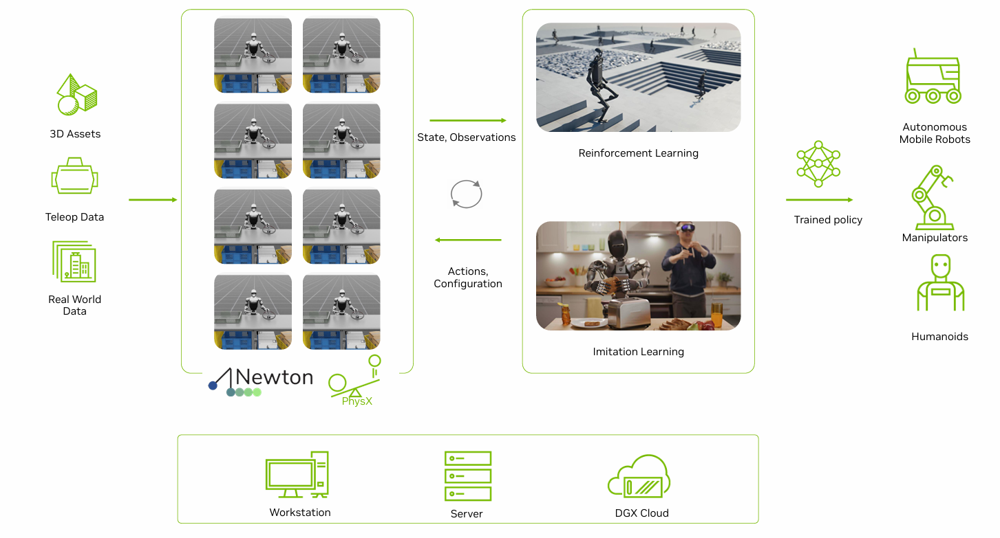

## Introduction

- A robot policy does not learn from a handful of attempts. 
- It learns from millions of them: stepping, falling, grasping, dropping and trying again. That creates three practical problems.

| Problem | Why it hurts? |
|---------|--------------|
| Too slow | One robot, or one simulation running one scene at a time, would take months to gather enough experience |
| Too much setup | Every project needs environments, tasks, rewards, sensors and training code, and most teams rebuild this from scratch |
| Too many tools | Physics engines, rendering and learning libraries each have their own interfaces |

- A good simulator is not enough. Teams also need a **training gym**: a framework that runs thousands of copies of a task at once and plugs straight into learning algorithms. That is Isaac Lab.

## What Isaac Lab Is?

- NVIDIA describes Isaac Lab as an open source, GPU-accelerated framework for robot learning, built to train robot policies at scale. 
- It combines massively parallel physics, photorealistic rendering, domain randomization and modular environments, and it supports reinforcement learning and imitation learning across humanoids, manipulators and mobile robots.

- A simple way to separate it from Isaac Sim:

| | Isaac Sim | Isaac Lab |
|---|-----------|-----------|
| Main job | Build and run the virtual world, sensors and robots | Train policies with many parallel copies of that world |
| Analogy | The world | The gym inside the world |
| Typical output | Images, sensor data, test results | A trained policy |

Three facts worth know:

1. It is open source under the **BSD-3-Clause** license.
2. NVIDIA calls it the **foundational robot learning framework** of the Isaac GR00T platform.
3. It does not implement physics, rendering or learning algorithms itself. It provides a **shared interface** to them, so the same task can run on different physics engines and with different learning libraries.

## Architecture



|  | What it means? |
|---------------------|---------------|
| **3D Assets, Teleop Data, Real World Data** | The raw material. Assets build the scenes, teleoperation provides demonstrations (for imitation learning), and real world data, such as reconstructed scenes, makes environments realistic |
| **Grid of simulated robots** | Many copies of the same task running side by side on the GPU. The picture shows a humanoid at a table in each tile |
| **Newton and PhysX logos** | The physics engines that calculate motion and contact inside each copy |
| **State, observations** | What the simulation sends to the learner |
| **Actions, configuration** | What the learner sends back |
| **Reinforcement Learning and Imitation Learning** | The two learning methods. The circular arrow between them shows they can be combined |
| **Trained policy** | The result, ready to test or deploy |
| **Robots served** | Autonomous mobile robots, manipulators and humanoids |
| **Workstation, Server, DGX Cloud** | Where the whole thing runs. The same framework scales from one machine to the cloud |

## Learning Loop

Every learning run repeats one cycle, thousands of times per second.

```
        +---------------------------------------------+
        |                                             |
        v                                             |
   OBSERVATION  --->  POLICY  --->  ACTION  --->  PHYSICS STEP
   what the robot     the robot's   a command     the world moves
   sees and feels     decision      to the        forward a tiny
                      maker         joints        bit in time
        ^                                             |
        |                                             v
        +------------------  REWARD  <---------------+
                          a score for how
                          well it did
```

|  | Meaning |
|------|---------|
| **Environment** | One simulated copy of the task: a scene, a robot and a goal |
| **State** | Everything true about the world at one moment |
| **Observation** | The part of the state that the policy is allowed to see, such as joint angles, camera images or a target position |
| **Action** | A command from the policy, such as target joint positions |
| **Reward** | A number that says how good the last step was. In reinforcement learning, this is how the robot knows it is improving |
| **Policy** | The learned rule that turns observations into actions |
| **Episode** | One complete attempt, from reset to success or failure |

## Two Ways to Learn

| | Reinforcement Learning (RL) | Imitation Learning (IL) |
|---|-----------------------------|-------------------------|
| How the robot learns? | Trial and error, guided by a reward | Copying demonstrations |
| Data needed | No demonstrations, only a reward definition and lots of simulation | Demonstrations, often from teleoperation |
| Example | A humanoid walking over stairs and rough ground | A humanoid in a kitchen, with a person in a headset showing the task |
| Good for | Locomotion, balance and skills that are hard to demonstrate | Manipulation tasks that a person can easily show |
| Weakness | Needs a well designed reward and many attempts | Needs good demonstrations, and cannot easily go beyond them |

- NVIDIA's documentation says Isaac Lab natively supports GPU-optimized RL libraries including **RSL-RL, RL-Games, skrl and Stable Baselines3**, and supports multi-agent RL. 
- Imitation learning workflows connect to the teleoperation tools and to synthetic demonstration generation.

- Many modern projects combine the two. A policy is first trained by imitation, then improved by reinforcement learning in simulation, which is why the diagram shows a circular arrow between them.

> **Why it matters:** locomotion is mostly learned with RL because no one can demonstrate exactly how every joint should move to stay balanced. Manipulation often starts with IL because people can easily show how to pick something up.

## Why running many environments **in parallel on the GPU** Matter?

- Isaac Lab runs many environments **in parallel on the GPU**. 
- Instead of simulating one robot a thousand times in a row, it simulates a thousand robots at once.

1. **Speed.** Experience is gathered in bulk. NVIDIA's paper explains that large batches help on-policy RL, the style used for most locomotion training.
2. **Variety.** Each copy can use different settings (different friction, mass, lighting or terrain). This is **domain randomization**, which helps policies survive the real world.
3. **Sensors at scale.** For camera-based learning, Isaac Lab uses a tiled rendering pipeline so that thousands of cameras can run in parallel environments.
4. **Realistic sensors.** NVIDIA lists RTX-based cameras, lidar and contact sensors.

## Physics Backends: Newton and PhysX

| Backend | Notes |
|---------|-------|
| **PhysX** | NVIDIA's physics engine. The default for most existing Isaac Lab tasks |
| **Newton** | Open source, GPU-accelerated physics engine built on NVIDIA Warp. Newton support has been validated against PhysX by transferring policies between them |

- NVIDIA's pages also list **NVIDIA Warp** and **MuJoCo** as physics options. 
- The design lets you switch engines **without rebuilding your learning pipeline** and without remapping actuator settings.

## Where It Runs?

| Place | Typical use |
|-------|-------------|
| **Workstation** | Development and small training runs on a local RTX GPU |
| **Server** | Larger training jobs on data center GPUs |
| **DGX Cloud** | Large scale training across many GPUs and machines |

- Isaac Lab 3.0 adds multi-GPU and multi-node RL training. 
- The cloud launchable on Brev (the browser-based option covered with the Isaac Lab features) is an easy way to try it without local hardware.

## Agent-Friendly

- The Isaac Lab is **agent-friendly**.
- NVIDIA's pages describe the workflows as agent ready, with standard connectors and skills. 
- The Isaac Lab 3.0 early access release ships **17 user-facing agent skills** in the repository, covering installation, migration, environment creation, backend selection, Newton asset preparation, training, debugging, sim-to-sim transfer, sensors and actuators. 
- These skills are discovered automatically by coding agents such as Codex and Claude.
- This is the same skills idea from the agent tools topic, applied to the training gym.

## Version Notes

| Version | Status |
|---------|--------|
| **Isaac Lab 2.x** | Built on Isaac Sim, with PhysX as the main backend |
| **Isaac Lab 3.0 early access** | Early access files were published on September 16, 2026, according to the release mirror. A multi-backend framework supporting Newton, OVRTX, OVPhysX and Isaac Sim, with a **kit-less** mode that runs Newton without installing Isaac Sim. General availability is targeted toward the end of October 2026 |

## Summary

1. **Isaac Lab** is NVIDIA's open source, GPU-accelerated framework for training robot policies at scale.
2. It runs **thousands of parallel simulated environments** on **Newton or PhysX**, and sends state and observations to learners, which send actions back.
3. It supports **reinforcement learning** (trial and error) and **imitation learning** (copying demonstrations), often combined.
4. Inputs are **3D assets, teleop data and real world data**. The output is a **trained policy** for mobile robots, manipulators and humanoids.
5. It scales from a **workstation** to a **server** to **DGX Cloud**.
6. Isaac Lab 3.0 is in early access, adds a kit-less mode and ships agent skills.

## References

1. [NVIDIA Isaac Lab](https://developer.nvidia.com/isaac/lab)
2. [Isaac Lab on GitHub](https://github.com/isaac-sim/IsaacLab)
3. [NVIDIA use case, Robot Learning in Simulation Using NVIDIA Isaac Lab](https://www.nvidia.com/en-us/use-cases/robot-learning/)
4. [NVIDIA learning course, Getting Started With Isaac Lab, The Isaac Platform](https://docs.nvidia.com/learning/physical-ai/getting-started-with-isaac-lab/latest/isaac-lab-basics/01-the-isaac-platform.html)
5. [NVIDIA Isaac Lab perspectives](https://perspectives.nvidia.com/isaac-lab/)
6. [Isaac Lab research paper, "Isaac Lab: A GPU-Accelerated Simulation Framework for Multi-Modal Robot Learning"](https://arxiv.org/abs/2511.04831)
