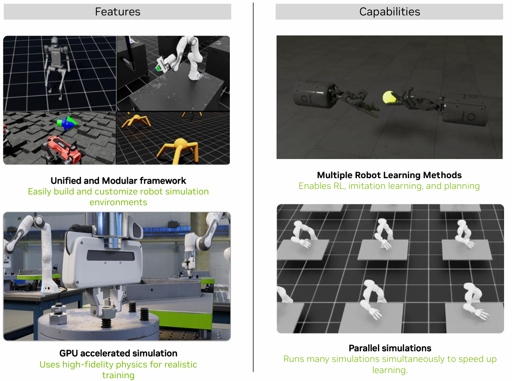

## Introduction

- Isaac Lab topic explained what the framework is.
- This topic answers a practical question: **what makes it easy and fast to use?**

Robot learning projects share a few pain points.

| Pain point | Why it hurts? |
|------------|--------------|
| Every robot is different | A humanoid, an arm, a quadruped and a wheeled robot all need different setups, but the learning code should not be rewritten each time |
| Every task is different | Walking, grasping and assembling need different goals, rewards and sensors |
| Learning is slow | Millions of attempts are needed, and simulating them one by one would take far too long |
| Many learning methods | Teams want to try reinforcement learning, imitation learning and planning without switching tools |

> **Labeling note:** this topic has the same title as the Isaac Sim feature topic. This one is about **Isaac Lab**.

## Features and Capabilities

- **Features** (what is built in)
- **Capabilities** (what you can do with it).



## Feature 1: Unified and Modular Framework

**Unified and Modular Framework:** easily build and customize robot simulation environments.

### What "unified" means?

- One framework covers many robot types, tasks and learning methods. 
- NVIDIA's documentation describes Isaac Lab as a framework that unifies workflows such as reinforcement learning, imitation learning and motion planning. 
- It comes with ready-to-train implementations of more than 30 environments.

### What "modular" means?

- An environment is assembled from separate, swappable parts, so you can change one without touching the rest.

|  | What it defines |
|------|-----------------|
| **Scene** | The robot, static and dynamic objects, terrain and sensors |
| **Actions** | What commands the policy can send, such as joint positions |
| **Observations** | What the policy gets to see, built from the simulation state and sensor data |
| **Rewards and terminations** | How success and failure are scored, and when an attempt ends |
| **Events** | Things that happen at resets or at intervals, such as randomizing friction or pushing the robot |

### Two ways to build a task

- Two workflow styles:

| Workflow | Idea | Good for |
|----------|------|----------|
| **Manager-based** | You describe the task with configuration. Separate managers for observations, actions, events and so on assemble it | Quickly building and changing tasks, and reusing parts between tasks |
| **Direct** | You write the code for scene setup, resets, rewards and observations yourself in one place | Maximum control and performance tuning |

> **Why it matters:** because the parts are modular, you can keep the same task and swap the robot, or keep the robot and swap the terrain.

- **Example:** Four robots in different settings: a humanoid on a grid floor, an arm at a workstation, a small wheeled robot on rough terrain and a yellow four legged robot. One framework serves all of them.

## Feature 2: GPU Accelerated Simulation

**GPU Accelerated Simulation:** uses high-fidelity physics for realistic training.

Two ideas sit behind this feature.

1. **Fidelity.** 

- The physics must be accurate enough that what the robot learns in simulation still works on a real machine.
- Contact-rich tasks such as inserting and tightening are the hardest test of that. 
- Isaac Lab supports several physics engines (PhysX, Newton, NVIDIA Warp and MuJoCo) behind one interface.

2. **Speed from the GPU.** 

- The physics, the observations and the learning algorithm all run on the GPU. 
- NVIDIA's documentation notes that the GPU pipeline is the default for vectorized reinforcement learning workloads. - Keeping everything on the GPU avoids slow copying between the GPU and CPU, which is one of the main reasons thousands of environments can run at once.

> **Note:** Sensors are part of fidelity too. NVIDIA lists RTX-based cameras, lidar and contact sensors, which matter when policies learn from camera images.

**Example:** the industrial arm working on bolts and nuts.

## Capability 1: Multiple Robot Learning Methods

**Multiple Robot Learning Methods:** enables RL, imitation learning, and planning.

| Method | What it is? | Isaac Lab support |
|--------|------------|-------------------|
| **Reinforcement learning (RL)** | Learn by trial and error with a reward | Works natively with GPU-optimized libraries including RSL-RL, RL-Games, skrl and Stable Baselines3, and supports multi-agent RL |
| **Imitation learning (IL)** | Learn by copying demonstrations | Demonstrations come from teleoperation tools, and Isaac Lab includes a Mimic workflow for generating more demonstrations from a few |
| **Planning** | Compute a motion from a model of the world, instead of learning it | NVIDIA lists motion planning among the workflows that Isaac Lab unifies |

- This matches the planning versus learning idea from the AI for Robotics topic. Isaac Lab lets one framework host both approaches, and combine them: for example a planner for reaching, and a learned policy for the delicate grasp.

**Example:** Two dexterous robot hands passing a glowing yellow ball between them, a typical hard manipulation task.

## Capability 2: Parallel Simulations

**Parallel Simulations:** runs many simulations simultaneously to speed up learning.

The idea is simple and powerful: instead of one robot practicing a thousand times, a thousand robots practice once.

| Benefit | How it works? |
|---------|--------------|
| **Speed** | Each simulation step produces thousands of experiences instead of one Large batches are especially helpful for on-policy reinforcement learning |
| **Variety** | Each copy can use different settings (mass, friction, lighting, terrain). This is domain randomization, which prepares a policy for the messy real world |
| **Camera learning** | A tiled rendering pipeline lets thousands of cameras render in parallel environments |
| **Scale out** | Isaac Lab 3.0 adds multi-GPU and multi-node training, so more machines mean even more parallel copies |

**Example:** a grid of identical white robot arms, each on its own platform, all working at once.

```
   ONE ROBOT, ONE ATTEMPT AT A TIME          THOUSANDS OF ROBOTS, ALL AT ONCE

   [robot] -> [robot] -> [robot] -> ...       [robot][robot][robot][robot]
                                              [robot][robot][robot][robot]
   slow                                       [robot][robot][robot][robot]
                                              fast
```

## Feature Comparison: Isaac Sim VS Isaac Lab

| | Isaac Sim | Isaac Lab |
|---|-------------------|-------------------|
| Feature cards | High-fidelity physics, robot models and SimReady assets | Unified and modular framework, GPU accelerated simulation |
| Capability cards | Synthetic data generation, fully extensible | Multiple learning methods, parallel simulations |
| The point | Build and test the world | Train policies inside it |

## What to Check Before You Start?

1. **Version.** Isaac Lab 2.x is built on Isaac Sim. Isaac Lab 3.0 is in early access, supports several backends and can run without Isaac Sim in a kit-less mode. Check the release notes for the one you install.
2. **Newton.** Support in Isaac Lab has been described as beta and validated on a set of locomotion and classic reinforcement learning tasks, so confirm what your task needs.
3. **Number of environments.** The right number of parallel copies depends on your GPU memory and the task. Start small and scale up.

## Summary

```
              FEATURES                          CAPABILITIES
   +-------------------------------+   +--------------------------------+
   | Unified and Modular           |   | Multiple Robot Learning        |
   | framework                     |   | Methods                        |
   | Easily build and customize    |   | RL, imitation learning,        |
   | robot simulation environments |   | and planning                   |
   +-------------------------------+   +--------------------------------+
   | GPU accelerated simulation    |   | Parallel simulations           |
   | High-fidelity physics for     |   | Many simulations at once       |
   | realistic training            |   | to speed up learning           |
   +-------------------------------+   +--------------------------------+
```

1. **Unified and modular:** one framework for many robots, tasks and methods, built from swappable parts, with manager-based and direct workflows.
2. **GPU accelerated:** realistic physics and learning both run on the GPU, which is what makes large scale training practical.
3. **Multiple learning methods:** reinforcement learning, imitation learning and planning.
4. **Parallel simulations:** thousands of environments at once, with domain randomization for variety.

## References

1. [NVIDIA Isaac Lab](https://developer.nvidia.com/isaac/lab)
2. [Isaac Lab on GitHub](https://github.com/isaac-sim/IsaacLab)
3. [Isaac Lab documentation, environments and workflow design](https://isaac-sim.github.io/IsaacLab/main/source/api/lab/isaaclab.envs.html)
4. [Isaac Launchable deployment guide](https://docs.isaacsim.omniverse.nvidia.com/latest/installation/install_advanced_cloud_setup_launchable.html)
5. [NVIDIA use case, Robot Learning in Simulation Using NVIDIA Isaac Lab](https://www.nvidia.com/en-us/use-cases/robot-learning/)
6. [Isaac Lab research paper, "Isaac Lab: A GPU-Accelerated Simulation Framework for Multi-Modal Robot Learning"](https://arxiv.org/abs/2511.04831)
