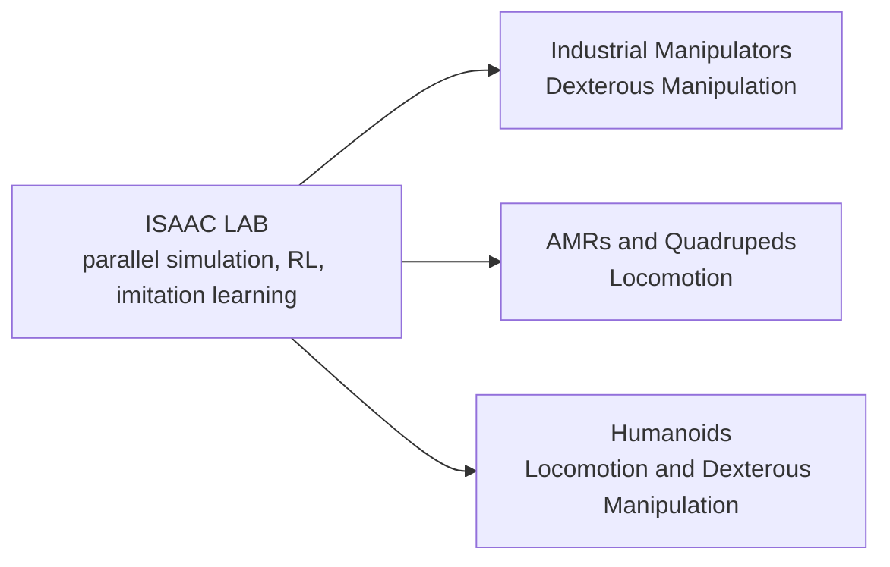
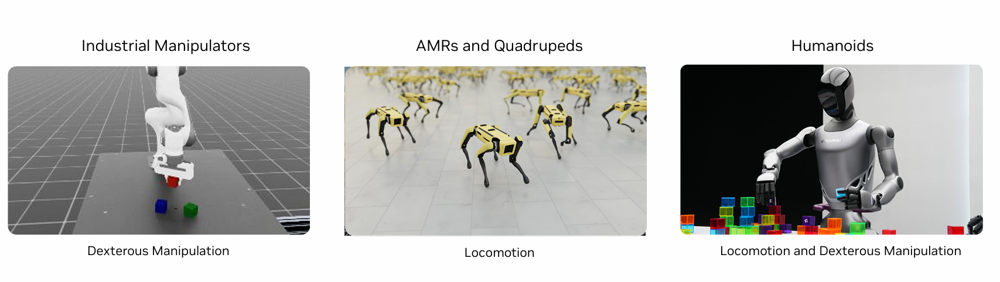
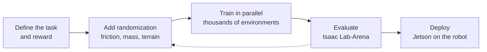

## Introduction

- The earlier Isaac Lab topics explained the framework and its features. 
- This topic answers a practical question: **what do people actually train with it?**

- The key challenge is that robots come in very different bodies, and each body needs a different skill to be learned.

| Robot family | Main skill to learn | Why it is hard? |
|--------------|-------------------------|----------------|
| Industrial manipulators | Handling objects with arms and hands | Contact is delicate, and small errors cause drops or jams |
| AMRs and quadrupeds | Moving through the world | Terrain varies, and a legged robot must stay balanced while it moves |
| Humanoids | Moving and handling objects together | Balance, walking and dexterous hands must work as one system |

## One Framework, Three Families



- A humanoid needs both skills at once, which is why it is the most demanding case.


## Industrial Manipulators: Dexterous Manipulation

- **Example:** a robot arm with a gripper reaching toward small red, blue and green cubes on a gridded floor, the kind of pick and place scene used in training.

- **Dexterous manipulation** means handling objects with skill: grasping the right way, turning an object in the hand, inserting a part, using a tool. It depends on precise **contact**: how fingers press, slide and grip.

- Isaac Lab supports this through high-fidelity simulation of multi-joint hands, accurate contact modeling, and rich sensing that includes vision and body-position feedback.

### Typical tasks in Isaac Lab

| Task type | Example |
|-----------|--------------------------------|
| **Lift and grasp** | A Franka arm learning to grasp and lift objects to target positions |
| **In-hand reorientation** | Turning a cube inside a robot hand, with the Allegro or Shadow hand, including a version that uses camera input |
| **Assembly** | The AutoMate assembly tasks, where policies learn to fit parts together |
| **Pick and place** | Picking up an object and placing it in a basket, including with a humanoid's hands |

### learn with privileged information, then distill

The Isaac Lab paper describes DextrAH-RGB, which trains a KUKA arm with an Allegro hand. The idea is:

1. **Teacher.** In simulation, train a policy that is allowed to see exact internal information, such as the true position of every object. This is called privileged information, and it makes learning easier.
2. **Student.** Distill that knowledge into a second policy that only sees what a real robot could see, such as camera images.
3. **Deploy.** The student runs on the real robot.

- Isaac Lab 2.3 added features aimed at dexterous tasks, including automatic domain randomization and population based training, which help reinforcement learning scale to hard hand and arm problems.

> **Why it matters:** factories need robots that handle varied parts, not only one fixed motion. Training in simulation lets a policy practice millions of grasps that would take a real arm years.

## AMRs and Quadrupeds: Locomotion

- **Example:** a large number of yellow four legged robots spread across a tiled floor, all training at the same time, which is the parallel simulation idea in action.
- **Locomotion** means getting the robot's body from one place to another.
- For a quadruped, that is walking, trotting and keeping balance over uneven ground.
- For an autonomous mobile robot (AMR), it is moving the base reliably through spaces.

### What a typical locomotion task looks like?

- The most common one is **velocity tracking**: a command says "move forward at this speed and turn at this rate", and the policy must make the legs follow, whatever the ground is like.

| Element | How it works in Isaac Lab? |
|---------|---------------------------|
| **Task** | Track a velocity command on flat terrain or on rough terrain. The documentation lists flat and rough versions, for example for the ANYmal C quadruped |
| **Terrain curriculum** | The robot trains on increasingly difficult terrain such as slopes, stairs and rubble, moving up a level as it improves |
| **Robots covered** | The velocity tracking recipes cover 11 robot types, including A1, Go1 and Go2, ANYmal B, C and D, Spot, Cassie, Digit and the humanoids G1 and H1 |
| **Randomization** | Friction, mass and pushes are varied so that the policy does not depend on perfect conditions |

### Worked example: Boston Dynamics Spot

Training a locomotion policy for the Spot quadruped in Isaac Lab.

1. The policy was trained with the PPO algorithm (from the RSL-RL library) and a small neural network.
2. Training ran at roughly 85,000 to 95,000 frames per second on one NVIDIA RTX 4090 GPU, taking about four hours.
3. The policy then ran on the real Spot, on a Jetson AGX Orin computer, with performance similar to simulation. NVIDIA calls this zero-shot deployment, meaning no extra training on the real robot.

## Humanoids: Locomotion and Dexterous Manipulation

- **Example:** A humanoid robot with fivevfingered hands stacking colored translucent blocks on a table.

- Humanoids combine both skills: they walk **and** use their hands. NVIDIA's term for the combination is **loco-manipulation**.

### Why it is the hardest case?

1. **Balance while working.** Reaching, lifting or pushing shifts the robot's weight, and the legs must compensate instantly.
2. **Many joints.** A humanoid with hands has dozens of joints to coordinate.
3. **Two training styles.** Walking is usually learned by reinforcement learning, while hand tasks often start from human demonstrations.

### What Isaac Lab provides?

| Capability | Example |
|------------|--------------------------------|
| **Locomotion** | Velocity tracking environments for the Unitree G1 on flat and rough terrain |
| **Manipulation** | A G1 pick and place task with three-fingered hands, using upper-body inverse kinematics |
| **Whole-body control** | Isaac Lab 2.3 added whole-body control, with Pink IK for upper-body control of the Fourier GR1T2 and Unitree G1 |
| **Teleoperation** | Support for Meta Quest VR, Manus gloves, and dexterous retargeting for the Unitree three-finger and Inspire five-finger hands (the retargeting idea from the Isaac Teleop topic) |

### Common steps:

```
   Step 1: Train walking with reinforcement learning on varied terrain
   Step 2: Train or imitate hand and arm skills
   Step 3: Combine them in one whole-body policy
   Step 4: Evaluate in many scenes, then deploy
```

## Coomon workflow

Across all three families the workflow is the same.



| | Manipulators | AMRs and quadrupeds | Humanoids |
|---|--------------|---------------------|-----------|
| **Main skill** | Dexterous manipulation | Locomotion | Both |
| **Typical learning** | RL, imitation, teacher and student | RL with terrain curricula | RL plus imitation, whole-body control |
| **What the policy observes** | Joint angles, object poses, camera images | Joint angles, body motion, command, terrain | All of these together |
| **What it outputs** | Joint targets for arm and hand | Joint targets for legs | Joint targets for legs, torso, arms and hands |
| **Hardest part** | Contact accuracy | Balance on rough ground | Doing everything together |

## Things to Check Before You Start

1. **Environment names change between versions.** Task names such as the velocity and reorientation environments are from the documentation I read, and Isaac Lab 3.0 is changing structure. Check the list for your version.
2. **The pictures are illustrations.** The photos show typical scenes and do not name specific tasks or robots, so my descriptions of them are my reading.
3. **Sim-to-real is never automatic.** Zero-shot deployment results, such as Spot's, depend on careful actuator modeling and randomization. Expect tuning on your own hardware.

## Summary

1. Isaac Lab trains policies for **all robot embodiments** with one framework.
2. **Industrial manipulators** learn **dexterous manipulation**: grasping, reorienting objects and assembly.
3. **AMRs and quadrupeds** learn **locomotion**, often by velocity tracking with terrain curricula.
4. **Humanoids** need **locomotion and dexterous manipulation** together, called loco-manipulation.
5. The workflow is the same each time: **define the task, randomize, train in parallel, evaluate, deploy**.

## References

1. [Isaac Lab, available environments](https://isaac-sim.github.io/IsaacLab/main/source/overview/environments.html)
2. [Isaac Lab research paper, "Isaac Lab: A GPU-Accelerated Simulation Framework for Multi-Modal Robot Learning"](https://arxiv.org/abs/2511.04831)
3. [NVIDIA Technical Blog, "Closing the Sim-to-Real Gap: Training Spot Quadruped Locomotion with NVIDIA Isaac Lab"](https://developer.nvidia.com/blog/closing-the-sim-to-real-gap-training-spot-quadruped-locomotion-with-nvidia-isaac-lab/)
4. [NVIDIA Technical Blog, "Streamline Robot Learning with Whole-Body Control and Enhanced Teleoperation in NVIDIA Isaac Lab 2.3"](https://developer.nvidia.com/blog/streamline-robot-learning-with-whole-body-control-and-enhanced-teleoperation-in-nvidia-isaac-lab-2-3/)
5. [NVIDIA use case, Robot Learning in Simulation Using NVIDIA Isaac Lab](https://www.nvidia.com/en-us/use-cases/robot-learning/)
6. [NVIDIA Isaac Lab](https://developer.nvidia.com/isaac/lab)
