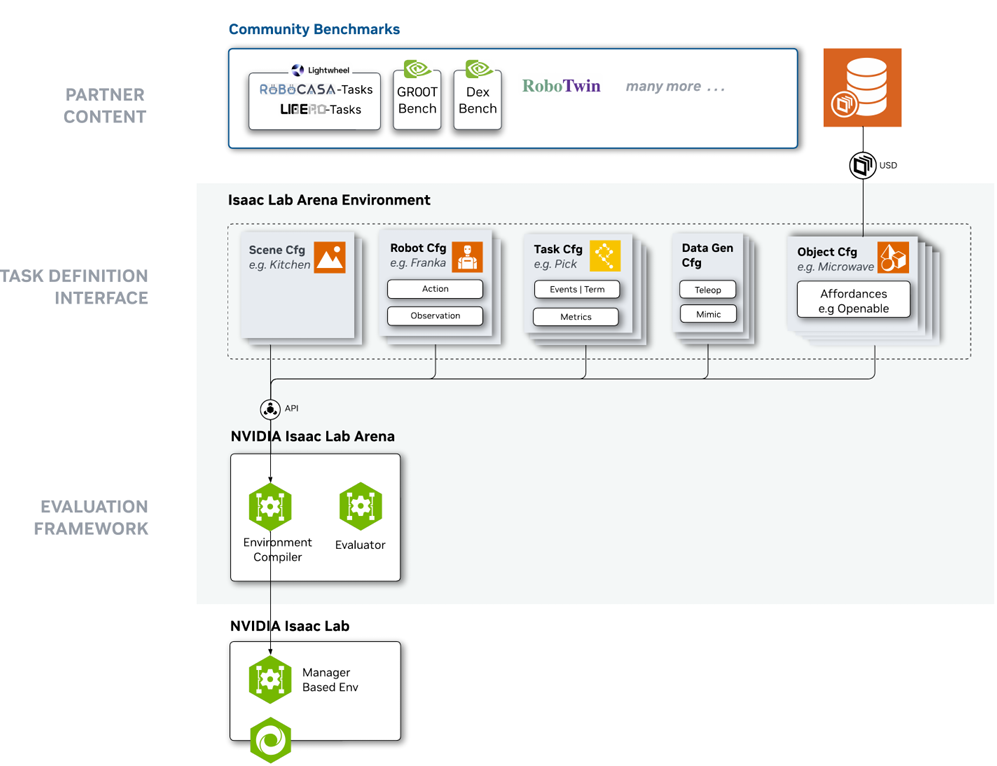
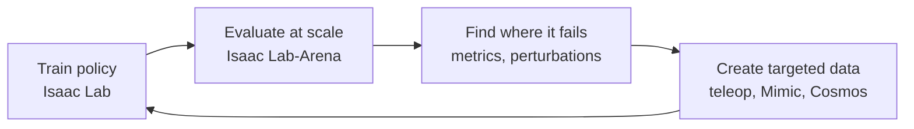

## Introduction

- Training a policy is only half the job. 
- The other half is answering a hard question: **is this policy actually good, and is it better than the last one?**

- Evaluating robot policies has its own difficulties.

| Difficulty | Why it hurts? |
|------------|--------------|
| Real robot testing is slow | One robot, one attempt at a time, with resets, repairs and people supervising |
| Real robot testing is narrow | You can only try the situations you can physically set up |
| Setup is fragmented | Each benchmark has its own robots, scenes and scoring, so results are hard to compare |
| Building environments takes effort | NVIDIA's Isaac Lab paper notes that going from asset preparation to a working environment and large-scale evaluation often takes significant manual effort, with high overhead and limited scalability |

- A policy that works in the scene where it was trained may fail when a lighting, object or position changes. 
- Good evaluation must test those changes on purpose, and test many of them.

## What Isaac Lab-Arena Is?

- **Isaac Lab-Arena** is an open source extension to Isaac Lab for simplified task curation and large-scale robot policy evaluation. 
- NVIDIA co-developed it with **Lightwheel**, a company that builds simulation assets and benchmarks. 
- It gives developers streamlined APIs for creating tasks, adding variety to them, and running evaluations across thousands of parallel simulations.

A simple way to place it:

| Tool | Job |
|------|-----|
| Isaac Lab | Train the policy |
| **Isaac Lab-Arena** | **Test the policy, fairly and at scale** |

- Its design idea is **composition**. 
- Instead of hand-writing a separate configuration for every combination of robot, scene and task, Arena builds environments on the fly from independent, reusable building blocks.

## How Issac Lab Work?



The diagram shows four layers, from partner content at the top down to Isaac Lab at the bottom.

### Partner content

- The top layer holds **community benchmarks**: ready-made collections of tasks and scoring that other groups have built.
- A database icon connected by a **USD** arrow to the object definitions shows that partners can also contribute 3D assets in OpenUSD. 
- Because everything plugs into the same interface, many benchmarks can run on one framework.

### Task definition interface

This is where you describe what to test. Each piece is defined separately.

| Piece | What it defines? | Example|
|-------|-----------------|----------------------|
| **Scene Cfg** | The place and its layout | Kitchen |
| **Robot Cfg** | The robot, plus its **actions** (what it can do?) and **observations** (what it senses?) | Franka arm |
| **Task Cfg** | The goal, plus the **events**, **termination** rules (when an attempt ends?) and **metrics** (how success is scored?) | Pick |
| **Data Gen Cfg** | How to collect data in the same environment, using **teleoperation** or **Mimic** (expanding a few demonstrations into many) | Teleop, Mimic |
| **Object Cfg** | The objects, plus their **affordances**, meaning what can be done with them | Microwave, with the affordance Openable |

> - **Cfg** is short for configuration. 
  - An **affordance** is a property that says how an object can be used.

### Evaluation framework

|  | Job |
|------|-----|
| **Environment Compiler** | Takes the pieces above and compiles them into a runnable simulation environment. The diagram shows it handing off to Isaac Lab's manager-based environment below |
| **Evaluator** | Runs the policy in that environment, many times, and collects the scores and metrics |

### Isaac Lab

- At the bottom, the compiled environment runs as a standard **manager-based environment** in Isaac Lab.
- so everything Isaac Lab provides (physics, sensors, GPU parallelism) is available for evaluation.

## Why Composable Matters?

- Suppose you want to test across different scenes, robots and tasks.

```
   Without composition:  one hand-written setup per combination
   5 scenes x 4 robots x 10 tasks = 200 separate setups to write and maintain

   With composition:     write each piece once, combine on demand
   5 scenes + 4 robots + 10 tasks = 19 pieces, and any mix is possible
```

> Note: The numbers above are only an illustration of the idea. The point is that adding one new robot adds one piece, not dozens of new setups. NVIDIA describes this as eliminating the redundant boilerplate that plagues traditional task libraries.

## Important Points

|  | What it means in practice? |
|---------------------|---------------------------|
| **Create diverse robot and scene environments** | Mix and match robots, scenes, objects and tasks from the building blocks, instead of building each environment from scratch |
| **Scale policy evaluation across thousands of parallel simulations** | Run the same policy in many varied environments at once on the GPU. NVIDIA's descriptions mention thousands of environments, and multi-node runs through OSMO |
| **Use standardized benchmarks for comparison and collaboration** | Run community benchmarks in one common framework so scores are comparable between teams |
| **Run evaluations anywhere: local, cloud, or LeRobot Environment Hub** | Run on your own machine or in the cloud, or share and use environments through the LeRobot Environment Hub on Hugging Face |

## Benchmarks in the Ecosystem

| Benchmark | What it is? |
|-----------|------------|
| **Lightwheel RoboCasa Tasks** | Open source household task collection. NVIDIA's announcement says Lightwheel contributed over 250 tasks across its RoboCasa and LIBERO suites |
| **LIBERO Tasks** | A well-known manipulation benchmark. The image label for it is hard to read, so this identification is my reading |
| **RoboTwin** | RoboTwin 2.0 uses the framework to expand its simulation benchmark |
| **RoboFinals** | Lightwheel's industrial benchmark for complex real-world scenarios, in development |
| **RoboLab** | NVIDIA Research's benchmarking platform for general-purpose robot policies. NVIDIA says RoboLab research powers Arena, and that key features are planned for productization in August 2026 |

- NVIDIA's own research teams, the GEAR lab and the Seattle Robotics Lab (from the research topic), also use Arena to evaluate generalist robot models at scale.

## Running Evaluations Anywhere

| Where? | How? |
|-------|-----|
| **Local machine** | Install Isaac Lab-Arena next to Isaac Lab and run evaluations on your own GPU |
| **Cloud** | Deploy on cloud environments, including OSMO for multi-node jobs |
| **LeRobot Environment Hub** | Arena environments are integrated with Hugging Face's LeRobot Environment Hub. Developers can register custom environments there and use a growing library of environments for evaluating policies such as Isaac GR00T N, pi0 and SmolVLA |

- NVIDIA's documentation shows that a policy can sit behind a **policy server**, a separate program that answers "what action should I take now?" while the simulation runs. 
- This keeps Arena **policy-agnostic**, meaning it can test any policy that speaks the same interface. 
- The Hugging Face documentation shows a single command (`lerobot-eval`) that evaluates a policy on an Arena environment such as a GR1 humanoid opening a microwave.

## Evaluation in the Bigger Loop

Evaluation is not the end of the story. It feeds the next round of improvement.



- NVIDIA's documentation notes that perturbing environment factors reveals how robust a policy is, and that this feedback guides the next round of targeted learning. 
- The **Data Gen Cfg** box in the image is what lets the same environment produce training data as well as test results.

## Things to Check Before You Start

1. **Maturity.** NVIDIA's announcement described the first release as pre-alpha. A third-party comparison from October 2026 lists the project as alpha, version 0.3, under Apache 2.0, and warns that APIs will change. Check the repository for the current status.
2. **Isaac Sim terms.** Arena runs on Isaac Sim, which has its own license terms. The Hugging Face guide asks users to accept the NVIDIA EULA.

## Summary

1. **Isaac Lab-Arena** is an open source framework, built on Isaac Lab and co-developed with Lightwheel, for **fair, large-scale policy evaluation in simulation**.
2. Environments are **composed** from reusable pieces: **scene, robot, task, data generation and object** configurations.
3. The **Environment Compiler** turns them into an Isaac Lab environment, and the **Evaluator** runs policies and records metrics.
4. It scales to **thousands of parallel simulations** and runs **locally, in the cloud or through the LeRobot Environment Hub**.
5. **Standardized community benchmarks** (RoboCasa, LIBERO, RoboTwin and others) make results comparable.
6. Evaluation results feed back into targeted data creation and retraining.

## References

1. [Isaac Lab-Arena documentation](https://isaac-sim.github.io/IsaacLab-Arena/)
2. [Isaac Lab-Arena on GitHub](https://github.com/isaac-sim/IsaacLab-Arena)
3. [NVIDIA Technical Blog, "Simplify Generalist Robot Policy Evaluation in Simulation with NVIDIA Isaac Lab-Arena"](https://developer.nvidia.com/blog/simplify-generalist-robot-policy-evaluation-in-simulation-with-nvidia-isaac-lab-arena)
4. [Hugging Face LeRobot documentation, NVIDIA IsaacLab Arena and LeRobot](https://huggingface.co/docs/lerobot/envhub_isaaclab_arena)
5. [NVIDIA Technical Blog, "How to Evaluate General-Purpose Robot Policies for Real-World Deployment" (RoboLab)](https://developer.nvidia.com/blog/how-to-evaluate-general-purpose-robot-policies-for-real-world-deployment/)
6. [Isaac Lab research paper, policy evaluation and benchmarks section](https://arxiv.org/abs/2511.04831)
