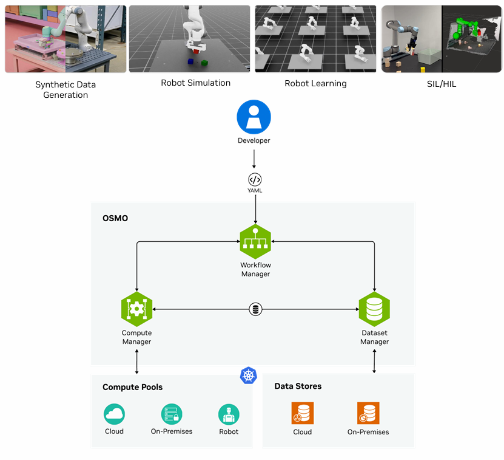
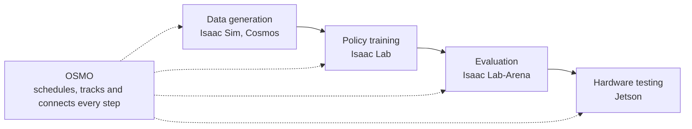

## Introduction

- Everything covered so far in this section runs as a **job**: generate synthetic data, run a simulation, train a policy, test on hardware.
- A real project runs hundreds of these jobs, across very different machines.

| Challenge | Why it hurts? |
|-----------|--------------|
| Different kinds of compute | Training needs GPU clusters, simulation needs RTX GPUs, and hardware testing needs real robot computers such as Jetson |
| Jobs depend on each other | Data generation must finish before training starts, and training before evaluation |
| Data moves around | Datasets and models must be available wherever a job runs |
| Scaling is painful | A workflow that works on a laptop often needs rewriting for a cloud cluster |
| Monitoring and debugging | When a job fails at 3 AM across ten machines, someone has to find out why |

- Teams need a **conductor**: one tool that runs the whole pipeline across all that compute. That is OSMO.

## What OSMO Is?

- NVIDIA's documentation describes OSMO as an **open source workflow orchestration platform purpose-built for physical AI and robotics**. 
- You write your entire pipeline (training, simulation, hardware-in-the-loop testing) in declarative **YAML**, and OSMO coordinates the tasks across different compute, managing dependencies and resource allocation.

|  | Meaning |
|------|---------|
| **Workflow** | A pipeline of connected tasks |
| **Orchestration** | Deciding what runs where and when, and keeping track of it |
| **YAML** | A simple, readable text format for describing settings. Here it describes the workflow, so it is written as configuration instead of programming code |
| **Kubernetes** | A widely used system for running containers across many machines. OSMO uses it as its compute backend |

- A simple way to remember it: **Isaac Lab trains the robot, and OSMO runs everything around it.**

## How OSMO work?



### what runs through OSMO?

- The four pictures show the four kinds of work from earlier topics: 
    - **synthetic data generation**
    - **robot simulation**
    - **robot learning**
    - **SIL/HIL testing**.
- OSMO does not replace these tools. It runs them.

### Developer and YAML

- The developer describes the pipeline in a YAML file and submits it. 
- NVIDIA's documentation notes you can also define workflows in Python for those who prefer code.

### Inside OSMO: three managers

The diagram names three parts. NVIDIA's architecture documentation uses slightly different names for the same roles.

|  | Role | 
|-------------------|------|
| **Workflow Manager** | This is Workflow Engine. Reads the YAML, plans the steps, handles dependencies and tracks the state of the workflow |
| **Compute Manager** | This is Compute layer, pools and platforms. Decides which machines run each task and sends tasks there. A scheduler assigns tasks to pools with available capacity |
| **Dataset Manager** | This is Dataset service. Stores, versions and serves datasets so any task can reach them |

- The three talk to each othes. 
- For example, a task asks the dataset manager for training data, and the compute manager places the task near that data.

### Compute pools: cloud, on-premises and robot

| Pool | Meaning |
|------|---------|
| **Cloud** | Rented GPU clusters, such as AWS, Azure or Google Cloud |
| **On-Premises** | Your own data center machines |
| **Robot** | Real robot computers such as NVIDIA Jetson, used for hardware-in-the-loop testing |

- The Kubernetes logo shows that each pool is a Kubernetes cluster. 
- NVIDIA's guide says you can connect cloud clusters (AKS, EKS, GKE), on-premises bare-metal clusters and edge devices **at the same time**, and mix them in one workflow.

### Data stores

- Cloud and on-premises storage for datasets and models. OSMO gives all compute backends access to them.

## One Workflow, Three Kinds of Compute

OSMO can run training, simulation and edge testing **at the same time in a single workflow**.

```
   One YAML workflow
          |
          +--> Task 1: generate data        runs on  simulation cluster (cloud)
          |
          +--> Task 2: train policy         runs on  GPU cluster (on-premises)
          |       waits for Task 1
          |
          +--> Task 3: test on hardware     runs on  Jetson AGX Thor (robot)
                  waits for Task 2
```

> This example only illustrates the idea of dependencies. The exact YAML fields are in NVIDIA's user guide.

## Running a Workflow

- NVIDIA's technical blog on synthetic data pipelines shows the command pattern. You submit a workflow file and name the pool to run on:

```
osmo workflow submit workflows/mobilitygen_replay.yaml --pool <pool-name>
```

- Other commands in the same family let you list workflows, check their status, read logs and open a port to watch a running simulation. 
- Each task in a workflow runs as a Kubernetes pod with the container image and resources you specify.

Key properties:

1. **Zero code changes between environments.** The same workflow runs on a laptop, in the cloud or on-premises.
2. **Behind the firewall.** OSMO does not need network access into your compute cluster. Clusters can sit behind corporate firewalls or in restricted networks.
3. **Versioned datasets.** Datasets and models are stored with automatic version control and content-addressable deduplication, so identical data is stored only once. NVIDIA's guide claims this saves 10 to 100 times on storage costs, which is a vendor figure that depends on your data.

## Agents and OSMO

### Coding agents as infrastructure experts

- OSMO turns coding agents, such as Claude Code and Codex, into physical AI infrastructure experts by giving them real-time insight into pipelines, workflows and distributed GPU capacity.

- NVIDIA's OSMO repository makes this concrete with **agent skills**, built on the open Agent Skills standard.

| Skill | What it lets an agent do? |
|-------|-------------------------|
| **osmo-user** | Check GPU resources, generate and submit workflows, monitor progress, read logs and diagnose failures |
| **osmo-deploy** | Deploy OSMO onto a Kubernetes cluster |
| **osmo-admin** | Prepare configuration file changes for service administration |

- The repository says these skills work with Claude Code, Cursor, Codex, GitHub Copilot, Gemini CLI and many other agent tools. 
- For complex workflows, the skill can start specialized sub-agents for resource selection, YAML writing, submission, monitoring, log fetching, failure diagnosis and retries.

- A realistic exchange: you say "my workflow failed, find out why and resubmit", and the agent reads the logs, spots the error, fixes the YAML and submits again.

### Claws

- Developers can use **claws** to automate physical AI workflows with OSMO. 
It refers to autonomous, always-on agent assistants of the OpenClaw type, similar to the agents that NVIDIA's NemoClaw stack runs inside OpenShell.

- Because these agents can run commands and change infrastructure, the OpenShell safeguards from the agents topic matter here.

## Cloud Partners: Microsoft Azure and Nebius

| Partner | What partner support?|
|---------|----------------------|
| **Microsoft Azure** | A jointly published architecture runs OSMO, Isaac Lab and Isaac Sim on Azure Kubernetes Service, with GPU accelerated reinforcement learning, auto-scaling compute and enterprise Kubernetes security. Microsoft's example training workflows include Isaac Lab reinforcement learning, LeRobot imitation learning and evaluation, and use GPU pools that scale down to zero so you pay only while a job runs |
| **Nebius** | NVIDIA's data factory announcement says Nebius integrates OSMO into its AI Cloud, with NVIDIA RTX PRO 6000 Blackwell Server Edition GPUs |

## Key Takeways:

- **OSMO turns coding agents into infrastructure experts** Supported by OSMO's agent skills repository
- **Developers can also use claws to automate workflows**
- **Massive UX update for monitoring and debugging** Consistent with the web UI described in the deployment guide, but I could not verify what changed or how large the update is
- **Faster, easier setup with agent-powered deployment and reduced service dependencies** Agent-powered deployment matches the osmo-deploy skill. I could not verify the claim about fewer service dependencies

## Where OSMO Sits in stack?

OSMO is not one box in the training pipeline. It wraps the whole thing.



- The data factory topic used OSMO for the same reason: to run curation, augmentation and grading stages across large amounts of compute.

## Things to Check Before You Start

1. **Version and features.** OSMO moves quickly.
2. **Kubernetes knowledge.** NVIDIA offers automated provisioning to reduce the need for deep Kubernetes expertise, but you should still understand pools, quotas and costs before launching large jobs.
3. **Cost control.** Large workflows on cloud GPUs can be expensive. Scale-from-zero pools and spot capacity help, so use them.
4. **Agent permissions.** If you let an agent submit or deploy workflows, limit what it can reach.

## Summary

1. **OSMO** is an open source orchestrator for physical AI: you describe the pipeline in **YAML**, and it runs the tasks across **cloud, on-premises and robot** compute.
2. It has three parts: a **workflow manager**, a **compute manager** and a **dataset manager**, using **Kubernetes** clusters as compute backends.
3. It runs **data generation, simulation, learning and SIL/HIL testing** in one workflow.
4. **Agent skills** let coding agents such as Claude Code and Codex submit, monitor, diagnose and deploy.
5. Partners **Microsoft Azure** and **Nebius** bring it to the cloud.
6. It is the conductor that connects every other tool in this section.

## References

1. [NVIDIA OSMO on GitHub](https://github.com/NVIDIA/OSMO)
2. [OSMO documentation, User Guide](https://nvidia.github.io/OSMO/main/user_guide/)
3. [OSMO documentation, Architecture](https://nvidia.github.io/OSMO/main/user_guide/architecture.html)
4. [OSMO documentation, Deployment Guide](https://nvidia.github.io/OSMO/main/deployment_guide)
5. [OSMO agent skills](https://github.com/NVIDIA/OSMO/tree/main/skills)
6. [NVIDIA Technical Blog, "Build and Orchestrate End-to-End SDG Workflows with NVIDIA Isaac Sim and NVIDIA OSMO"](https://developer.nvidia.com/blog/build-synthetic-data-pipelines-to-train-smarter-robots-with-nvidia-isaac-sim/)
7. [Microsoft Physical AI Toolchain, OSMO training workflows](https://microsoft.github.io/physical-ai-toolchain/training/osmo-training/)
