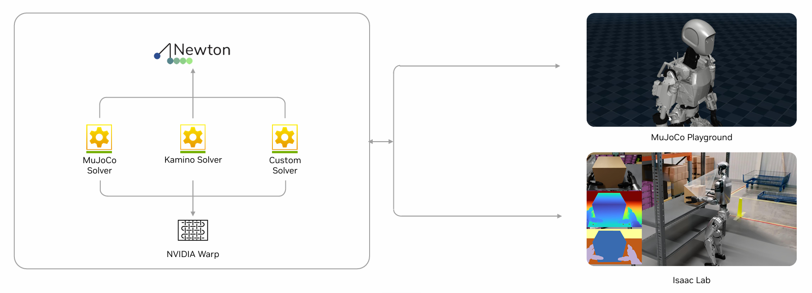

## Introduction

- Every simulator has a **physics engine** at its core. 
- It is the part that calculates how things move, collide and push on each other. Robot learning puts heavy demands on it.

| Demand | Why it matters? |
|--------|----------------|
| **Speed** | Learning needs millions of simulation steps, so the engine must run thousands of robots in parallel on GPUs |
| **Accuracy in contact** | Grasping, walking and assembling depend on how surfaces touch, slip and grip. Small errors become the sim-to-real gap |
| **Flexibility** | Different tasks need different physics: rigid robots, cloth, sand, closed linkages |
| **Openness** | Researchers want to inspect, change and extend the engine, and share results across labs |
| **Differentiability** | If the engine can pass gradients backward through a simulation step, learning algorithms can use that information to optimize faster |

- Existing engines were usually good at some of these and weak at others, and each had its own interface. 
- Newton is an attempt to bring them together in one open project.

## What Newton Is?

- NVIDIA's pages describe Newton as an **open source, GPU-accelerated, extensible physics engine** built on **NVIDIA Warp**. 
- OpenUSD, made to advance robot learning and development. The Isaac Lab documentation adds that it is **differentiable**.
- Newton is **accelerated by NVIDIA Warp, open source and purpose-built for robot learning.**

| Word | Meaning |
|------|---------|
| **GPU-accelerated** | The physics runs on the GPU, so thousands of environments step together |
| **Extensible** | You can add your own solvers and features |
| **Differentiable** | Gradients can flow through the physics, which helps optimization and learning research |
| **Open source** | The code is public under the Apache-2.0 license |

## Who Is Behind It?

- There are the three founding partners. Each brings something different.

| Partner | What it brings? |
|---------|----------------|
| **Disney Research** | Expertise in simulating characters and complex mechanisms. It developed **Kamino**, a Newton-based solver, because its robotic characters needed physics that standard tools handled poorly |
| **Google DeepMind** | The **MuJoCo** physics engine and its GPU version **MuJoCo Warp**, which is Newton's main solver |
| **NVIDIA** | **Warp**, the GPU framework Newton is built on, plus the Isaac Sim and Isaac Lab platforms that use it |

- At the bottom, "The Linux Foundation" shows who **hosts** the project. 
- Newton is a Linux Foundation project, which means it has neutral, community-based governance instead of belonging to one company. 
- The Linux Foundation announced it on September 29, 2025.

## Working of Newton



| | What it means? |
|---------------------|---------------|
| **Newton** | The engine itself: the common framework that holds the model, the state and a standard interface |
| **MuJoCo Solver** | The default rigid-body solver, based on DeepMind's MuJoCo, running through MuJoCo Warp |
| **Kamino Solver** | Disney Research's solver, aimed at hard cases such as linkages and strong frictional contact |
| **Custom Solver** | A placeholder showing that you can plug in your own solver |
| **NVIDIA Warp** | The foundation. All the solvers run as Warp programs that compile to fast GPU code |
| **MuJoCo Playground** | A robot learning framework from Google DeepMind |
| **Isaac Lab** | NVIDIA's robot learning framework |
| **Two-way arrows** | Newton can serve both frameworks, and models and benchmarks can move between them |

## NVIDIA Warp: The Engine Underneath

- **Warp** is an open source Python framework for writing high-performance GPU code for simulation and spatial computing. 
- You write ordinary-looking Python functions, and Warp compiles them into fast GPU kernels.

- NVIDIA says this gives roboticists CUDA-level speed without low-level coding. 
- Warp also supports **automatic differentiation**, which is what makes Newton's differentiability possible.

Think of the layers like this:

```
   Isaac Lab / MuJoCo Playground    robot learning: tasks, rewards, training
                |
              Newton                physics engine: model, state, solver interface
                |
      MuJoCo / Kamino / custom      solvers: the maths of motion and contact
                |
           NVIDIA Warp              compiles to GPU code (CUDA)
```

## Solvers

- A **solver** is the part of the engine that actually computes the next state of the world. Different solvers suit different physics.

| Solver | What it is good at? | Status |
|--------|--------------------|--------------|
| **MuJoCo Warp** | Fast, accurate rigid-body robotics with joints, contacts and tendons. The main solver | Mature, and the focus of the Isaac Lab integration |
| **Kamino** | Constrained multi-body systems with closed kinematic loops and hard frictional contact | Described as beta or experimental in the sources I found |
| **Custom** | Anything you build yourself through Newton's solver interface | Depends on you |

- The Newton repository lists further solvers for other kinds of physics, such as XPBD and VBD (methods for deformable and soft objects), Featherstone (efficient articulated body dynamics) and an implicit material point method solver for granular materials and fluids.

## Why a Common Interface Matters?

- NVIDIA's Isaac Lab tutorial explains the key design idea: Newton's solver API provides one interface and one tensor-based data model for different physics engines. 
- Whether you run MuJoCo Warp, Disney's Kamino solver or a custom one, you interact with Newton the same way.

```
   WITHOUT A COMMON INTERFACE            WITH NEWTON

   Task code written for engine A         Task code written once
   Task code rewritten for engine B             |
   Task code rewritten for engine C        Newton interface
                                            /     |      \
                                      MuJoCo  Kamino   Custom
```

The benefits:

1. **Swap physics without rewriting your learning setup.**
2. **Compare solvers fairly** on the same task.
3. **Move models and benchmarks** between Newton, Isaac Lab and MuJoCo environments with little friction.

> **Why it matters:** a policy that works under two different physics engines is less likely to be exploiting a quirk of one of them. That is a useful guard against the sim-to-real gap.

## Newton in Isaac Lab and Isaac Sim

| Place | Status |
|-------|--------|
| **Isaac Lab** | NVIDIA's documentation says the Newton integration is under active development. NVIDIA validated it against PhysX by transferring learned policies from Newton to PhysX and the reverse, and deployed a Newton-trained locomotion policy to a Unitree G1 robot. The integration focuses mainly on the MuJoCo Warp solver for now |
| **Isaac Sim** | Newton is supported as a second physics backend alongside PhysX, and is still labeled experimental in Isaac Sim 6.x |
| **Isaac Lab 3.0** | Built around multiple backends, with a mode that runs Newton without installing Isaac Sim |

So today, **PhysX is the established default, and Newton is the open, extensible, differentiable alternative that is maturing quickly.**

## Performance Claims

NVIDIA publishes speed figures for Newton and MuJoCo Warp. These are vendor reported, measured on specific hardware and tasks.

| Claim | Source and conditions |
|-------|------------------------|
| MuJoCo Warp up to **152 times** faster for locomotion and **313 times** faster for manipulation than MJX | NVIDIA Technical Blog, on a GeForce RTX 4090 |
| Newton Beta up to **65 percent faster** for in-hand dexterous manipulation with MuJoCo Warp than PhysX | NVIDIA Technical Blog, as the next-generation Isaac Lab backend |
| Earlier announcement figures of about **70 times** for humanoid simulation and **100 times** for in-hand manipulation | Reported at the project's first announcement. Different baselines and conditions |

MJX is DeepMind's earlier GPU version of MuJoCo built on JAX. Treat these numbers as indications of direction, not guarantees for your own tasks.

## Newton and PhysX Compared

| | PhysX | Newton |
|---|-------|--------|
| Origin | NVIDIA's long-established physics engine | Open project by Disney Research, Google DeepMind and NVIDIA, hosted by the Linux Foundation |
| Openness | Used inside Omniverse and Isaac Sim | Fully open source under Apache-2.0, community governed |
| Differentiable | Not the main design goal | Yes, through Warp |
| Solver choice | One engine | Several solvers behind one interface |
| Maturity in Isaac Lab | Established default | Under active development |
| Best use today | Existing tasks and stable workflows | New research, differentiable simulation, cross-framework comparison, contact-rich tasks |

## Things to Check Before You Start

1. **Integration maturity.** Newton in Isaac Lab and Isaac Sim is described as beta or experimental, so test your own tasks against PhysX before committing.
2. **Kamino.** Described as beta in the Newton sources I found, so expect changes.
3. **Versions.** Newton has had several releases, and the version bundled with Isaac Sim and Isaac Lab can differ from the latest. Check which one you are using.
4. **Benchmark conditions.** The speedups depend on the GPU, the task and the baseline.

## Summary

1. **Newton** is an open source, GPU-accelerated, differentiable physics engine, **built on NVIDIA Warp** and designed for robot learning.
2. It was started by **Disney Research, Google DeepMind and NVIDIA**, and is hosted by the **Linux Foundation** under Apache-2.0.
3. It offers **several solvers behind one interface**: **MuJoCo Warp**, Disney's **Kamino** and **custom** solvers.
4. It works with **Isaac Lab** and **MuJoCo Playground**, so models and benchmarks can move between them.
5. In Isaac Lab and Isaac Sim, **PhysX is still the established default**, and Newton is the maturing open alternative.
6. Published speedups are vendor reported, so test on your own tasks.

## References

1. [NVIDIA Newton Physics](https://developer.nvidia.com/newton-physics)
2. [Newton on GitHub](https://github.com/newton-physics/newton)
3. [Newton Physics GitHub organization (Linux Foundation)](https://github.com/newton-physics)
4. [Isaac Lab documentation, Newton Physics Integration](https://isaac-sim.github.io/IsaacLab/main/source/experimental-features/newton-physics-integration/index.html)
5. [NVIDIA Technical Blog, "Train a Quadruped Locomotion Policy and Simulate Cloth Manipulation with NVIDIA Isaac Lab and Newton"](https://developer.nvidia.com/blog/train-a-quadruped-locomotion-policy-and-simulate-cloth-manipulation-with-nvidia-isaac-lab-and-newton)
6. [Linux Journal, "Linux Foundation Welcomes Newton"](https://www.linuxjournal.com/content/linux-foundation-welcomes-newton-next-open-physics-engine-robotics)
7. [NVIDIA Warp on GitHub](https://github.com/NVIDIA/warp)
