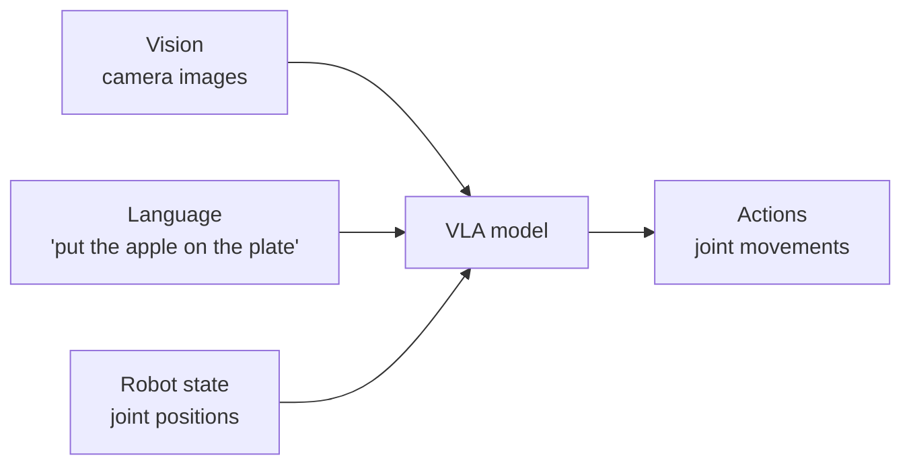
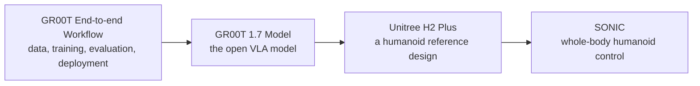
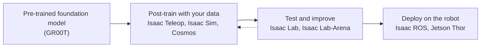

## Introduction

- The previous sections covered where robots get **data** and where they **practice**. 
- This section covers the part that does the learning and the thinking: the **robot's brain**.

- Before foundation models, building that brain was slow and narrow.

| Old way | Why it hurt? |
|---------|-------------|
| Write a program or train a model for each task | A new task meant starting almost from scratch |
| Train separately for each robot body | A model for one arm did not work on another robot |
| Hand-code the rules | Messy real-world situations broke the rules |
| Small datasets | Each team had too little data to learn general skills |

- The idea behind a foundation model is to change that: learn broadly once, then adapt cheaply many times.

## What a Foundation Model Is?

- A **foundation model** is a large AI model trained on very broad data, so that it gains general knowledge and skills. 
- It is then **adapted** (fine-tuned) to specific jobs using much less data.

- Large language models are the familiar example. One model learns from huge amounts of text, and then it can answer questions, write code and summarize documents with a little guidance.

- The same pattern now applies to robots.

| | Language foundation model | Robot foundation model |
|---|---------------------------|------------------------|
| Learns from | Text from the internet | Robot demonstrations, human videos, simulation and synthetic data |
| Takes as input | Text | Camera images, the robot's own joint readings, and a language instruction |
| Produces | Text | Robot actions: movements of arms, hands and legs |
| Adapted by | Fine-tuning on examples | Post-training on data from your robot and task |

## Vision, Language and Action

- A robot foundation model is usually a **vision-language-action model**, often shortened to **VLA**.



| Part | What it does? |
|------|--------------|
| **Vision** | Understands what the cameras see |
| **Language** | Understands what the person wants |
| **Action** | Decides what the robot should physically do next |

## Dual System Idea
- NVIDIA describes its GR00T model as a **dual system** design, borrowing an idea from how people think.

| System | Style | Job in the model |
|--------|-------|------------------|
| **System 2** | Slow, deliberate reasoning | A vision-language model reads the images and the instruction and works out what to do at a high level |
| **System 1** | Fast, reflex-like action | An action model turns that plan into smooth, continuous robot movements |

```
   "Pick up the apple and put it on the plate"
                      |
                      v
        SYSTEM 2: reasoning (slower)
        sees the scene, understands the goal
                      |
                      v
        SYSTEM 1: action (fast)
        produces smooth arm and hand motion
                      |
                      v
                 Robot moves
```

## Isaac GR00T: NVIDIA's Robot Foundation Model

- NVIDIA describes **Isaac GR00T** as an open reference platform for general purpose humanoid robots. 
- It brings together open data and data pipelines, an open robot foundation model, simulation frameworks, middleware, accelerated runtime libraries, and Jetson Thor for real-time inference and control.

- The model itself has developed in steps.

| Version | Notes |
|---------|-------|
| **GR00T N1** | Introduced at GTC in March 2025 as an open foundation model for humanoid robot skills. NVIDIA's research paper describes it as trained on a mix of egocentric human videos, real and simulated robot trajectories, and synthetic data |
| **GR00T N1.5 and N1.6** | Successive upgrades to the model architecture and training data |
| **GR00T N1.7** | The current release in the repository. A 3 billion parameter vision-language-action model that uses a **Cosmos Reason** vision-language backbone for reasoning (replacing the Eagle backbone of the previous version) and a flow-matching action transformer for continuous actions |

NVIDIA's N1.7 documentation highlights three things:

1. **Cross-embodiment.** It is trained on a mix of bimanual, semi-humanoid and humanoid robot data, so one model can support several robot bodies.
2. **Human video.** It also learns from about 20,000 hours of human video, using an action format shared between robots and humans so that skills seen in human video can transfer to robot control.
3. **Open.** Weights and code are published, so developers can post-train the model on their own robots.

## Foundation Models and Cosmos

Two families of foundation models appear in this workshop, and they do different jobs.

| | Cosmos | GR00T |
|---|--------|-------|
| Main job | Understand and generate **worlds**: video, scenes, scenarios | Produce **actions** for robots |
| Used for | Synthetic data, world simulation, evaluation, reasoning | Controlling humanoids and other robots |
| Relationship | GR00T uses a Cosmos Reason model as its reasoning backbone, and Cosmos creates data to train GR00T |

- You can think of Cosmos as the model that knows **how the world works**.
- GR00T as the model that knows **what the robot should do in it**.

## What This Section Covers?

- The section follows the path from an end-to-end workflow, to the model, to a robot that uses it, to a related whole-body controller.



| Topic to come | What to expect |
|---------------|----------------|
| **GR00T End-to-end Workflow** | One platform for data creation, training, evaluation and deployment, using Isaac Lab, Isaac Teleop, GR00T models, Isaac Lab-Arena and Isaac ROS |
| **GR00T 1.7 Model** | The open vision-language-action model for general-purpose humanoid robots, and what is new in it |
| **Unitree H2 Plus** | A full-stack humanoid reference design for robotics research and development |
| **SONIC** | A model for controlling the whole body of a humanoid with a single policy |

## How a Robot Foundation Model Gets Used?

- Putting this section together with the earlier ones gives the full path.



- This is the same pipeline described in How Robots Become Robots, now with the model in the center.

## Summary

1. A **foundation model** learns broadly once and is adapted many times, which fixes the old problem of starting over for every task and robot.
2. A robot foundation model is typically a **vision-language-action (VLA)** model: it sees, understands an instruction and produces actions.
3. NVIDIA's **Isaac GR00T** uses a **dual-system** design: slow reasoning (System 2) plus fast action (System 1).
4. **GR00T N1.7** is a 3 billion parameter, cross-embodiment model with a Cosmos Reason backbone, trained on robot data and human video.
5. **Cosmos** knows how the world works, and **GR00T** knows what the robot should do in it.
6. The section ahead covers the **end-to-end workflow**, the **GR00T 1.7 model**, the **Unitree H2 Plus** reference design and **SONIC** whole-body control.

## References

1. [NVIDIA Isaac GR00T](https://developer.nvidia.com/isaac/gr00t)
2. [Isaac GR00T on GitHub](https://github.com/NVIDIA/Isaac-GR00T)
3. [GR00T N1 research paper](https://arxiv.org/abs/2503.14734)
4. [NVIDIA research, "NVIDIA Isaac GR00T N1: An Open Foundation Model for Humanoid Robots"](https://research.nvidia.com/publication/2025-03_nvidia-isaac-gr00t-n1-open-foundation-model-humanoid-robots)
5. [GR00T N1.7 on Hugging Face](https://huggingface.co/nvidia/GR00T-N1.7-3B)
6. [NVIDIA Cosmos](https://www.nvidia.com/en-us/ai/cosmos/)
