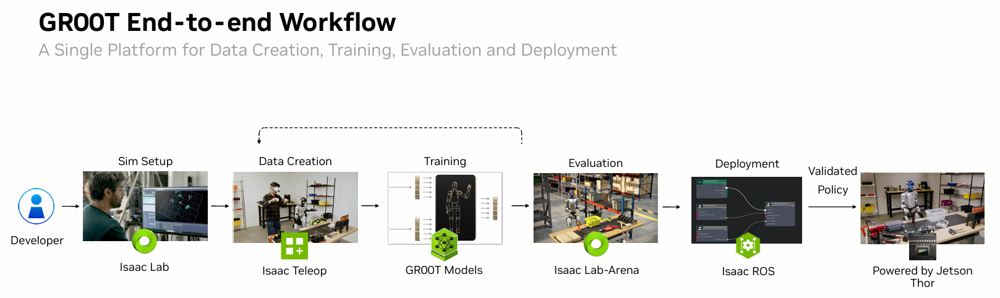

- By now the workshop has introduced many separate tools: Isaac Lab, Isaac Teleop, Isaac Lab-Arena, GR00T, Isaac ROS and Jetson Thor. 
- Knowing each tool is not the same as knowing how to **use them together** to get a working robot.

| Gap | Why it hurts? |
|-----|--------------|
| Many tools, no clear order | A newcomer does not know what to run first or what feeds what |
| Format mismatches | Data recorded in one tool must be converted before the next tool can read it |
| Simulation and real robots feel separate | Teams are unsure how work in simulation carries over to hardware |
| No tested example | Without a working reference, every team has to discover the pitfalls alone |

## What the Workflow Is?

- The **GR00T End-to-end Workflow**, is **a single platform for data creation, training, evaluation and deployment**. 



| Stage | Tool | What happens? |
|-------|-------------------|--------------|
| **Sim Setup** | Isaac Lab | Build and validate the simulated environment for the task |
| **Data Creation** | Isaac Teleop | A person teleoperates the robot to record demonstrations |
| **Training** | GR00T Models | Fine-tune the GR00T model on those demonstrations |
| **Evaluation** | Isaac Lab-Arena | Test the trained policy in simulation, measuring success |
| **Deployment** | Isaac ROS | Run the policy on the robot's software stack |
| **Validated Policy** | (result) | A policy that has passed testing |
| **Powered by Jetson Thor** | Jetson Thor | The onboard computer the policy runs on |

- The **dashed arrow along the top**, from Training back to Data Creation, shows that the process is not one pass. 
- If training or evaluation shows weaknesses, you collect better or more data and train again.

## Example Task

- The course uses a simple but complete task so that every stage can be shown end to end.

| Property | Value from the course |
|----------|-----------------------|
| Task | Static apple-to-plate pick and place |
| Robot | Unitree G1, a 29 degree-of-freedom humanoid |
| Skills | Pick and place only. The robot does not walk, squat or turn |
| Balance | A whole-body controller keeps the standing pose stable |
| Learning method | Imitation learning from demonstrations |
| Model | GR00T 1.7, fine-tuned |
| Data format | LeRobot dataset format, converted from teleoperation recordings |
| Success measure | Success rate |

- NVIDIA also publishes a ready-made dataset and a tuned checkpoint for this task, so you can start at any stage without recording your own data.

## Stage by Stage

### Sim Setup

1. Install Isaac Lab-Arena, prepare the working folders and run validation tests.
2. Review how the environment is defined: how it is registered, which robot is used, where the objects are placed and how success is decided.

**Output:** a validated simulated environment for the task.

### Data Creation

1. A person wears an XR headset and teleoperates the simulated robot with **Isaac Teleop** (the retargeting idea from the Isaac Teleop topic).
2. The robot's lower body is balanced by the whole-body controller, while the operator commands the arms and hands.
3. The recordings are saved, then converted into **LeRobot format**, the standard dataset layout that GR00T training reads.

**Output:** a dataset of demonstrations.

### Training

1. Fine-tune GR00T 1.7 from a standalone checkout of NVIDIA's Isaac-GR00T repository.
2. The model starts from the pretrained base and learns this robot and task from the demonstrations.

**Output:** a fine-tuned checkpoint.

### Evaluation

1. Run the policy in **closed loop**: the simulator shows the robot's cameras and state to the model, the model returns actions, and the simulator applies them, repeatedly.
2. Arena uses a **server-client** design. The GR00T model runs as a server in its own environment, and the simulation runs as a client in the standard Arena container, asking the server over a network connection (ZeroMQ).
3. Score the result as a success rate.

**Output:** a measured success rate and confidence in the policy.

### Deployment

1. Run the policy on the physical robot using **Isaac ROS** on **Jetson AGX Thor**.
2. The Thor runs the controllers and policies. The whole-body controller keeps the lower body stable, while the GR00T policy commands the upper body.

**Output:** a validated policy running on real hardware.

## Two Paths: Simulation and Real Robot

- The course has two workflows that are independent of each other.

| | Simulation workflow | Real robot workflow |
|---|---------------------|---------------------|
| Where the robot is | In Isaac Lab-Arena | A physical Unitree G1 |
| How data is collected | OpenXR teleoperation in simulation, saved as HDF5 | Teleoperation of the real robot, recorded as MCAP bags |
| Convert to training format | HDF5 to LeRobot | MCAP to LeRobot |
| Fine-tuning | GR00T 1.7 | GR00T 1.7, then prepare a deployment export |
| Evaluation | Closed loop in Arena | On the real robot |
| Hardware needed | A GPU workstation | G1 with Dex3-1 hands, a head-mounted RealSense camera and Jetson AGX Thor |

- The real robot workflow has eight lessons: set up Isaac ROS on Thor, set up the G1 and read the safety guidance, teleoperate, record demonstrations, convert the recordings, fine-tune GR00T 1.7, export the policy with a tool called LEAPP, and deploy.
- Fine-tuning and export run on a standard x86 computer, and everything touching the robot runs on Thor.

> **Safety:** NVIDIA's course warns that working with a physical humanoid brings real safety risks. It tells you to read the safety lesson fully before powering on, and recommends at least two people: one to teleoperate and one to watch the robot.

## How Data Changes Form?

```
   Teleoperation               Convert              Train                Deploy

   sim:  HDF5   ----+
                    +---->  LeRobot dataset  ---->  fine-tuned    ---->  Isaac ROS
   real: MCAP   ----+        (common format)        GR00T 1.7           on Jetson Thor
                                                    checkpoint
```

- Common **LeRobot** format is what lets simulated and real demonstrations feed the same training step.

## Feedback Loop

The dashed arrow from Training back to Data Creation represents the most important habit in robot learning.

1. Evaluate the policy and note where it fails.
2. Collect more demonstrations for those cases, or generate them.
3. Fine-tune again and re-evaluate.

## Things to Check Before You Start

1. **Versions.** The course targets GR00T 1.7 and current Isaac Lab-Arena, Isaac Teleop and Isaac ROS releases. Tools change quickly, so check the course's prerequisites page.
2. **Hardware.** The simulation part needs a capable GPU. The real part needs a Unitree G1 with specific hands, a camera and a Jetson AGX Thor. Fine-tuning a 3 billion parameter model needs a strong GPU setup.
3. **Scope.** The example is a static task with no walking. Walking and loco-manipulation are harder and are not what this reference workflow demonstrates.
4. **Safety.** Follow the safety lesson before any hardware step.

## Summary

1. The **GR00T End-to-end Workflow** is one tested path from an idea to a policy running on a real humanoid.
2. Stages: **Sim Setup, Data Creation, Training, Evaluation, Deployment**, with a loop back from training to data.
3. Tools in order: **Isaac Lab (Arena), Isaac Teleop, GR00T models, Isaac Lab-Arena, Isaac ROS on Jetson Thor**.
4. NVIDIA's course uses a **Unitree G1** doing a static **apple-to-plate** task, with a simulation path and an independent real-robot path.
5. **LeRobot format** is the common dataset format between recording and training.
6. Always follow the **safety guidance** before touching real hardware.

## References

1. [NVIDIA course, How to Develop and Deploy Humanoid Robots End-to-End with NVIDIA Isaac GR00T and Unitree G1, Simulation Workflow](https://docs.nvidia.com/learning/physical-ai/gr00t-e2e-workflow/latest/simulation-workflow/sim-overview.html)
2. [NVIDIA course, Real Robot Workflow](https://docs.nvidia.com/learning/physical-ai/gr00t-e2e-workflow/latest/real-robot-workflow/real-overview.html)
3. [Isaac GR00T on GitHub](https://github.com/NVIDIA/Isaac-GR00T)
4. [Isaac Lab-Arena documentation](https://isaac-sim.github.io/IsaacLab-Arena/main/index.html)
5. [Isaac Teleop on GitHub](https://github.com/NVIDIA/IsaacTeleop)
6. [NVIDIA Isaac GR00T](https://developer.nvidia.com/isaac/gr00t)
