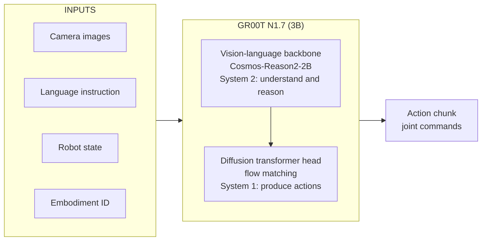
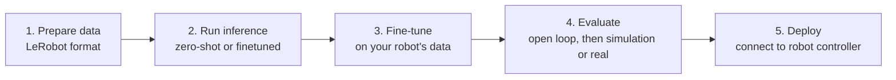

- The Foundation Models introduction explained why robots need a pretrained, adaptable brain. 
- This introduces NVIDIA's current answer, and a team choosing a robot model usually asks the same practical questions.

| Question | Why it matters? |
|----------|----------------|
| Can I use it in a real product? | A research model is of little use if the license or support does not allow deployment |
| Does it work on my robot? | Robots differ, so the model must adapt to new bodies |
| Can it handle long, multi-step jobs? | Real tasks are not single grasps |
| Can it do more than pick and place? | Humanoids need two-arm work and walking while handling objects |
| Can I run and train it with the hardware I have? | A model that needs unusual hardware is hard to adopt |

- GR00T 1.7 is NVIDIA's attempt to answer all five.

## What GR00T N1.7 Is?

- It is **open vision language action for general-purpose humanoid robots**.
- NVIDIA's repository describes **Isaac GR00T N1.7** as an open **vision-language-action (VLA)** model for generalized humanoid robot skills.
- It takes multimodal input, including language and images, and produces robot actions. 
- It is **cross-embodiment**, meaning it was trained on a mix of bimanual, semi-humanoid and humanoid robot data, and it can be post-trained for a specific robot, task and environment.

| Fact | Detail from NVIDIA's repository and model cards |
|------|--------------------------------------------------|
| Size | 3 billion parameters |
| Inputs | Camera images, the robot's own state (proprioception), a language instruction and an embodiment ID that says which robot body is being used |
| Output | A chunk of actions, produced by a flow-matching transformer |
| Reasoning backbone | Cosmos-Reason2-2B, built on the Qwen3-VL architecture |
| Action module | A diffusion transformer head that denoises continuous actions |

- This is the **dual-system** design introduced earlier: a reasoning part that understands the scene and the instruction, and a fast action part that produces smooth movement.

## Capabilities

- **Commercial-ready**: icensed and supported for production use.
- **Reasoning for long-horizon tasks**: Task-level and subtask-level reasoning improves reliability on multi-step jobs
- **Better performance**: Better motion quality and cross-embodiment generalization. Over 10 percent higher success rate on DROID than N1.6.
- **Expanded capabilities**: New bimanual and loco-manipulation tasks.
- **Cosmos backbone**: Uses Cosmos-Reason2-2B for reasoning.

## Commercial Ready

- The repository announces GR00T N1.7 as a **General Availability** release and says this brings full support and stability guarantees. 
- Among the things it lists as available are production deployment with commercial support and a fully validated, stable feature set.
- The repository's introduction says the model is "fully commercially licensable under Apache 2.0", while its License section and the Hugging Face model cards list the weights under the NVIDIA Open Model License. 
- NVIDIA's technical blog on the end-to-end workflow also describes GR00T 1.7 as released under the permissive Apache 2.0 license, so NVIDIA's public statements are not fully consistent. 
- The License section is the most precise statement, so check the LICENSE files in the repository and on the model card. Both licenses allow commercial use as described by NVIDIA, but you should read both before shipping a product.

---

## Cosmos Backbone

- N1.7 replaces the earlier Eagle vision-language backbone with **Cosmos-Reason2-2B**, a 2 billion parameter reasoning model from the Cosmos family, built on the Qwen3-VL architecture. 
- NVIDIA notes it supports flexible resolution and encodes images in their native aspect ratio without padding.

- This links the two foundation model families: **Cosmos supplies the reasoning, and GR00T supplies the action**.

> **Practical catch:** Cosmos-Reason2-2B is a **gated** model on Hugging Face. Every GR00T checkpoint loads it on first use, so you must request access on the model page and log in with a token, or loading fails with an authorization error.

## Learning From Human Video: Relative End-Effector Actions

- Two connected changes in N1.7 explain how it learns from people.

1. **Human video pretraining.** The model is pretrained on about **20,000 hours of human video** (called EgoScale in the repository) alongside diverse robot demonstrations.
2. **Relative end-effector action space.** The **end effector** is the robot's hand or gripper. Instead of saying "move the hand to this exact position in the room" (absolute), the model says "move the hand this far from where it is now" (relative).

| Absolute target | Relative change |
|-----------------|-----------------|
| "Hand to position X, Y, Z" | "Hand 5 cm to the left of where it is" |
| Depends on the robot's setup and coordinate system | Means the same thing for any arm or human hand |

- Because the relative form looks the same for people and robots, NVIDIA says the model can transfer manipulation skills learned from human video directly to robot control. 
- This is a clear example of the base of the data pyramid (human video) feeding the top (robot control).

## Better Performance:

- It improved motion quality, better cross-embodiment generalization and a success rate more than 10 percent higher on DROID than N1.6.
- N1.7 delivers **comparable performance** to N1.6, with **improved generalization and language following** from the added human video
- DROID is a large real-robot manipulation dataset, and NVIDIA publishes a DROID fine-tuned checkpoint.
- A 10 percent improvement on one benchmark can be consistent with "comparable" overall performance.

## Expanded Capabilities: Bimanual and Loco-manipulation

| Capability | What it means? |
|------------|---------------|
| **Bimanual** | Using two arms together, such as holding a container with one hand while the other works. N1.7 is trained on bimanual data |
| **Loco-manipulation** | Walking or balancing while also handling objects|

- NVIDIA's repository explains how loco-manipulation works with a related controller called SONIC (covered in a later topic). In this workflow:

1. The robot uses a dedicated embodiment tag (`UNITREE_G1_SONIC`).
2. GR00T predicts compact **latent action tokens**, a compressed code for what the whole body should do.
3. A learned **whole-body controller** decodes those tokens into joint commands for the legs, arms and hands.
4. One policy therefore produces language-driven, coordinated manipulation and locomotion from start to finish.

## How to Use It

### Checkpoints

| Checkpoint | Use |
|------------|-----|
| **GR00T-N1.7-3B** | The base model. Try zero-shot, or fine-tune for new tasks |
| **GR00T-N1.7-DROID** | Fine-tuned on the DROID dataset |
| **GR00T-N1.7-LIBERO** | Fine-tuned on the LIBERO benchmark (Franka Panda arm) |
| **GR00T-N1.7-SimplerEnv-Bridge and Fractal** | Fine-tuned on SimplerEnv robot setups |

### Hardware

| Task | Recommended hardware |
|------|----------------------|
| **Inference** | One GPU with 16 GB or more of memory, for example RTX 4090, L40, H100, Jetson AGX Thor or Orin, or DGX Spark |
| **Fine-tuning** | One or more GPUs with 40 GB or more of memory. H100 or L40 nodes are recommended |

- N1.7 also adds ONNX and TensorRT export for deployment on desktop GPUs and edge platforms, which connects to running it on Jetson Thor. 
- It is also available through Hugging Face's LeRobot library as the `groot` policy type.

## Summary

1. **GR00T N1.7** is an open, 3 billion parameter **vision-language-action** model for humanoid robots, with a **Cosmos-Reason2-2B** reasoning backbone and a **diffusion transformer** action head.
2. It is a **General Availability** release with commercial support. **Code is Apache 2.0, and weights use the NVIDIA Open Model License.**
3. It uses a **relative end-effector action space** and **20,000 hours of human video** so skills can transfer from people to robots.
4. It supports **bimanual** work and, with **SONIC**, **loco-manipulation** from a single policy.
5. NVIDIA describes its performance as comparable to N1.6 overall, with better generalization and language following.
6. It is available on **GitHub** and **Hugging Face**, with a gated backbone that needs access approval.

---

## References

1. [Isaac GR00T on GitHub](https://github.com/NVIDIA/Isaac-GR00T)
2. [NVIDIA Isaac GR00T](https://developer.nvidia.com/isaac/gr00t)
3. [GR00T N1.7 on Hugging Face](https://huggingface.co/nvidia/GR00T-N1.7-3B)
4. [GR00T N1 research paper](https://arxiv.org/abs/2503.14734)
5. [GR00T Whole-Body Control repository (SONIC)](https://github.com/NVlabs/GR00T-WholeBodyControl)
6. [NVIDIA course, How to Develop and Deploy Humanoid Robots End-to-End with NVIDIA Isaac GR00T and Unitree G1](https://docs.nvidia.com/learning/physical-ai/gr00t-e2e-workflow/latest/simulation-workflow/sim-overview.html)
