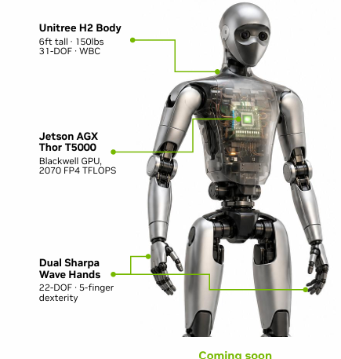
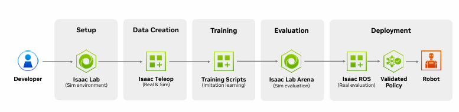

- Software and models are only half of humanoid robotics. 
- A research team also needs a **robot body** to run them on. 
- Building a capable humanoid from separate parts is hard and slow.

| Challenge | Why it hurts? |
|-----------|--------------|
| Many separate pieces | The body, the hands, the onboard computer and the software all come from different places and must be made to work together |
| Long bring-up time | Weeks can pass before the robot does anything useful |
| Results are hard to compare | Every lab has a different robot, so one lab's results are hard to reproduce in another |
| Not enough onboard compute | Running reasoning and control models on the robot itself needs a powerful computer |

- A **reference design** solves this by offering one agreed combination of parts and software that many teams can share. 

## What the H2 Plus Reference Design Is?



- It is the **world's first open frontier humanoid robot reference design for robotics R&D**.
- NVIDIA's official name for the complete package is the **NVIDIA Isaac GR00T Reference Humanoid Robot**, announced at GTC Taipei on June 1, 2026. The robot itself is the **Unitree H2 Plus**.

- NVIDIA describes it as a single integrated design with two halves.

| Half | Parts |
|------|-------|
| **The body** | A Unitree H2 Plus humanoid, plus Sharpa Wave tactile five-finger hands |
| **The brain** | NVIDIA Jetson Thor onboard compute, plus Isaac GR00T software, models and workflows |

- The aim is to help research teams move faster from robot bring-up, to skill development, to real-world validation.

## Three Callouts

```
                  +---------------------------+
   Unitree H2     |         HEAD              |
   Body           |                           |     Jetson AGX Thor T5000
   6ft tall,      |   TORSO  [ Thor module ]  |     (inside the torso)
   150 lbs,       |                           |
   31-DOF, WBC    |   ARMS                    |
                  |   HANDS: Sharpa Wave x 2  |     Dual Sharpa Wave Hands
                  |   LEGS                    |     22-DOF each, 5 fingers
                  +---------------------------+
```

### Unitree H2 Body

| Spec| Meaning |
|-------------------|---------|
| **6 ft tall, 150 lbs** | Human scale. NVIDIA's announcement says nearly 6 feet and 150 pounds, for human-scale testing |
| **31-DOF** | 31 **degrees of freedom**: independent ways the body can move, roughly one per controlled joint motion |
| **WBC** | **Whole-body control**: coordinating all joints (legs, torso, arms) together so the robot stays balanced while it works |

### Jetson AGX Thor T5000

- The onboard computer sits in the torso.  In the lists **Blackwell GPU** and **2070 FP4 TFLOPS** (trillions of operations per second using a compact 4-bit number format). 
- NVIDIA's published Thor specifications add 128 GB of memory and a 40 W to 130 W power range, which is the same module introduced in the Three Computer Solution topic. 
- It lets the robot run large models on board in real time, without depending on a network connection.

### Dual Sharpa Wave Hands

| Spec | Meaning |
|-------------------|---------|
| **22-DOF** | 22 degrees of freedom in each hand |
| **5-finger dexterity** | Five fingers that can grasp and manipulate like a human hand |

- Sharpa is a company that makes the Wave hands, which NVIDIA describes as **tactile**: they can sense touch, which helps with delicate tasks.

- **The arithmetic:** 31 body DOF + 22 for the left hand + 22 for the right hand = **75 degrees of freedom** for the full system, a figure NVIDIA's announcement also gives.

## Workflow Diagram



- The is same development pipeline as the GR00T End-to-end Workflow, now attached to this robot.

| Stage | Tool | Role |
|-------|------|--------------------|
| **Setup** | Isaac Lab | Build the simulated environment |
| **Data Creation** | Isaac Teleop | Works for both real and simulated robots |
| **Training** | Training scripts | Imitation learning from the recorded demonstrations |
| **Evaluation** | Isaac Lab Arena | Evaluation in simulation |
| **Deployment** | Isaac ROS | Evaluation on the real robot, then a validated policy runs on the robot |

- **Real evaluation** appears only at the deployment stage, so the sequence is: test in simulation first, then confirm on the real H2 Plus.

## Four Bullet Points

- **Scales humanoid R&D with a full-stack H2 Plus reference design**: Body, hands, compute and software come as one tested package
- **Enables real-time reasoning and control with NVIDIA Jetson Thor onboard compute**: Models run on the robot itself
- **Reduces setup time from days to hours with preconfigured GR00T workflows**: Ready-made workflows replace manual setup
- **Accelerates human-scale humanoid testing from simulation to real-world deployment**: One path from the simulator to the real robot

## Who Will Use It and When?

- NVIDIA's announcement names leading research groups that will use the reference design, including **Ai2, ETH Zurich, Stanford Robotics Center and the UC San Diego Advanced Robotics and Controls Laboratory**. 
- The focus is **academic research**.
- **Availability**: NVIDIA says the complete robot will be available from **Unitree in late 2026**.
- **Delivery timing**: One third-party report says Unitree plans to begin deliveries around October 2026. I could not confirm this from NVIDIA
- **Price**: Not announced by NVIDIA or Unitree
- **Software**: The Isaac GR00T software platform is available now

## Why a Reference Design Matters?

- NVIDIA is positioning the Isaac GR00T platform as something closer to what **standardized development boards** did for embedded computing: a common starting point so that people can build on each other's work.

- For research, that brings concrete benefits:

1. **Comparable results.** Two labs using the same robot and software can reproduce and compare behaviors.
2. **Shared behaviors.** A quote from one university partner describes using it for "creating, comparing and sharing robot behaviors on physical hardware".
3. **Faster start.** Less time on integration means more time on research questions.

## G1 Course and the H2 Plus

- The hands-on course in the GR00T End-to-end Workflow topic uses a **Unitree G1**, a smaller humanoid with different hands. - NVIDIA's announcement says the reference workflow for the G1 is expected on GitHub and Hugging Face for robot developers.

| | Unitree G1 (used in the course) | Unitree H2 Plus |
|---|---------------------------------|------------------------------|
| Size | Smaller humanoid | Human scale, nearly 6 ft |
| Degrees of freedom | 29 for the body | 31 for the body, plus 22 per hand |
| Hands | Dex3-1 in the course | Sharpa Wave tactile five-finger hands |
| Onboard compute | Jetson AGX Thor | Jetson AGX Thor T5000 |
| Pipeline | Setup, data, training, evaluation, deployment | The same pipeline |

- The pipeline is the same, so what you learn from the G1 course carries over to the H2 Plus, even though the robot-specific settings differ.

## Things to Check Before You Start

1. **Availability and price.** Check Unitree for current ordering, delivery dates and cost.
2. **What is "open".** NVIDIA calls it an open reference design, but I did not find a clear statement of exactly which hardware and software components are released under permissive licenses.
3. **Robot-specific workflows.** The public course I found uses the G1. Confirm what ready-made workflows exist for the H2 Plus itself.
4. **Safety.** A human-scale humanoid with 31 body joints is a serious machine. Follow the safety guidance before any hardware work.

## Summary

1. The **Unitree H2 Plus** is the body of NVIDIA's **Isaac GR00T Reference Humanoid Robot**, announced at GTC Taipei on June 1, 2026.
2. It combines a human-scale body (**about 6 ft, 150 lbs, 31 DOF**), **Sharpa Wave tactile hands** (**22 DOF each**, 75 total) and a **Jetson AGX Thor T5000** onboard computer.
3. The software side uses the standard pipeline: **Isaac Lab, Isaac Teleop, training scripts, Isaac Lab Arena, Isaac ROS**.
4. It is aimed at **academic research**, with partners including Ai2, ETH Zurich, Stanford and UC San Diego.
5. It is **coming soon**: available from Unitree in late 2026, with no price announced.

## References

1. [NVIDIA Newsroom, "NVIDIA Announces NVIDIA Isaac GR00T Reference Humanoid Robot for Academic Research"](https://nvidianews.nvidia.com/news/nvidia-open-humanoid-robot-reference-design)
2. [NVIDIA investor relations press release, same announcement](https://investor.nvidia.com/news/press-release-details/2026/NVIDIA-Announces-NVIDIA-Isaac-GR00T-Reference-Humanoid-Robot-for-Academic-Research/default.aspx)
3. [NVIDIA Isaac GR00T](https://developer.nvidia.com/isaac/gr00t)
4. [NVIDIA Jetson AGX Thor](https://developer.nvidia.com/embedded/jetson-agx-thor)
5. [Humanoid Guide, Unitree H2 Plus specifications](https://humanoid.guide/product/h2-plus/)
6. [NVIDIA course, How to Develop and Deploy Humanoid Robots End-to-End with NVIDIA Isaac GR00T and Unitree G1](https://docs.nvidia.com/learning/physical-ai/gr00t-e2e-workflow/latest/simulation-workflow/sim-overview.html)
