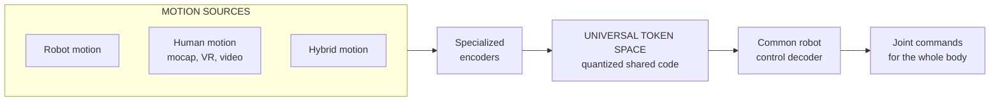
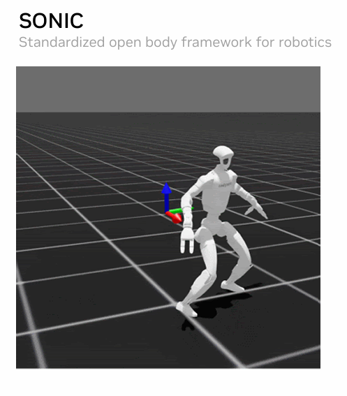

- A humanoid has to do something no arm on a table ever faces: **control the whole body at once.** Walking, balancing, reaching and holding objects all happen together, and each affects the others.

| Challenge | Why it hurts? |
|-----------|--------------|
| Many joints, one body | Dozens of joints must move in coordination, and every arm movement shifts the robot's balance |
| Hand-written rewards | Reinforcement learning needs a reward for each behavior, and designing those rewards by hand is slow and tends to produce stiff, robotic movement |
| One controller per interface | Separate systems for gamepad control, VR teleoperation, video imitation and AI planning mean a lot of duplicated work |
| Hard to connect to AI models | A reasoning model, such as the GR00T VLA, needs a simple way to command a complicated body |

- SONIC attacks all four with one idea.

## What SONIC Is?

- SONIC stands for **Supersizing mOtion tracking for Natural humanoId Control**. 
- It comes from NVIDIA's GEAR research lab (introduced in the research topic), in the paper "SONIC: Supersizing Motion Tracking for Natural Humanoid Whole-Body Control".
- **SONIC is a single, large, learned controller that makes a humanoid's whole body follow human-like motion naturally.** 
- It is described as a behavior foundation model for humanoid whole-body control.
- It was tested in simulation and on a real **Unitree G1** humanoid.
- It "Standardized open body framework for robotics".
- **supersizing motion tracking for natural humanoid whole-body control**.
- The two are related, though. SOMA is the **body format** for human motion, and SONIC is a **controller** trained on that kind of motion data.
- The motion dataset described in the SONIC paper is provided in SOMA and Unitree G1 formats.

## Key Idea: Motion Tracking as the Foundation Task

- **Motion tracking** means making the robot copy a reference motion, frame by frame: "here is a human walking and waving, now make the robot do the same thing while staying upright."

- Why choose this as the foundation task?

| Reason | Explanation |
|--------|-------------|
| **Dense supervision** | A motion capture recording tells the controller what every joint should do at every instant. This is far richer feedback than a single reward at the end |
| **No manual reward design** | The reward is simply "match the motion", so there is no need to hand-engineer rewards for every behavior |
| **Natural movement** | Because it copies real people, the motion looks and feels human |
| **It scales** | More motion data and bigger models keep improving results, like language models |

- The paper states that scaling this task gives steady improvement with compute and data diversity, and that the learned policies handle motions they have not seen before.

## How SONIC Is Built?

- The design has three parts: encoders, a shared token space and a decoder.



| Part | What it does? |
|------|--------------|
| **Specialized encoders** | Turn each kind of motion command (robot motion, human motion, or a mix) into a compact internal code |
| **Universal token space** | The shared language. The encoded representation is **quantized**, meaning rounded to a fixed set of codes, into a universal token |
| **Common decoder** | Takes the tokens and generates the actual joint commands for the robot |

> **Why it matters?:** because every input is converted to the same kind of token, **anything that can produce tokens can drive the robot**: a gamepad, a person in VR, a video, a text prompt or an AI model. This is the answer to the "one controller per interface" problem.

## Supersizing: Data, Model and Compute

- "Supersizing" is the paper's word for scaling three things together.

| Axis | What the paper reports? |
|------|------------------------|
| **Data** | Over 100 million frames of motion, from about 700 hours of motion capture (one summary gives 611 hours) |
| **Model size** | From 1.2 million up to 42 million parameters |
| **Compute** | Training on 128 GPUs. The project page reports 21,000 GPU hours. An earlier version of the paper reported 9,000 GPU hours |

- **A quick check of the data numbers.** The motion is recorded at 50 frames per second. 100 million frames divided by 50 is 2 million seconds, which is about 556 hours. So "over 100 million frames" fits with 611 to 700 hours of data.
- Notice how small the model is compared with language models: 42 million parameters, against billions for GR00T. 
- The controller works at high speed and must run on a robot, so it is deliberately compact.
- The motion data was retargeted and filtered for the Unitree G1, and comes with natural language descriptions and labels for segmenting sequences.

## Multi-modal Control Interfaces

- **VR, video, language and music**. The paper's project page adds interactive gamepad control.

| Interface | How it works? |
|-----------|--------------|
| **Gamepad** | Interactive control. A kinematic motion generator turns joystick commands into target motions |
| **VR teleoperation** | A person in a headset moves their whole body, and the robot follows |
| **Video** | A camera watches a person, an estimator recovers their body motion, and SONIC maps it directly to robot control, bypassing manual retargeting |
| **Language** | A text description such as "walk forward and wave" generates a motion for the robot |
| **Music** | Music input can drive dance-like motion |
| **VLA model** | An AI model predicts tokens directly |

- The last three connect to the SOMA topic: text-to-motion and video-to-motion models produce human motion in the SOMA format, which SONIC can then track.

## Working With GR00T

- SONIC is the **low-level body controller** that GR00T commands. 
- This matches the dual-system idea from the Foundation Models introduction.

```
   GR00T (VLA)                         SONIC
   reasons about the task              controls the whole body
   "pick up the apple"                 keeps balance, walks, reaches
          |                                   ^
          |   predicts universal tokens       |
          +-----------------------------------+
                                              |
                                      joint commands
```

| Result | Detail |
|--------|--------|
| **Paper result** | A GR00T N1.5 model that predicted SONIC's universal motion tokens achieved a **75 percent average success rate** across five whole-body loco-manipulation tasks |
| **Task example** | A mobile bimanual apple-to-plate task on the Unitree G1, controlled through the same token interface |
| **GR00T N1.7** | NVIDIA's N1.7 repository describes a setup with the embodiment tag `UNITREE_G1_SONIC`: GR00T predicts compact latent action tokens, and a learned whole-body controller decodes them into joint commands for legs, arms and hands |

- The result is one policy that handles **language-driven manipulation and locomotion together**, which is the loco-manipulation skill from the embodiments and use cases topics.

## Bullet Points

- **Unified whole-body humanoid control with a single policy across locomotion and manipulation**
- **Human motion-driven learning from 100M+ motion frames for natural movement**
- **Multi-modal control interfaces including VR, video, language and music inputs**
- **Generalist humanoid foundation model that scales with more data and compute**

## Example



- Image shows a white humanoid in a crouched pose on a dark grid floor, with a small set of colored axis lines near one hand. 
- This looks like a simulation view of a motion tracking test, where the axes mark a tracked body part. 

## Summary

1. **SONIC** is a large-scale learned controller for **whole-body humanoid control**, from NVIDIA's GEAR lab.
2. Its foundation task is **motion tracking**: copying human motion data, which gives dense supervision and natural movement without hand-designed rewards.
3. It converts every kind of command into a **universal token space**, so VR, video, text, music, a gamepad or a VLA model can all drive the same body.
4. It was trained on **100 million+ frames** (about 700 hours), with models up to **42 million parameters**.
5. Paired with **GR00T**, it achieved **75 percent average success** across five loco-manipulation tasks in the paper, on a Unitree G1.

## References

1. [SONIC research paper (arXiv)](https://arxiv.org/abs/2511.07820)
2. [SONIC project page, GEAR lab](https://nvlabs.github.io/GEAR-SONIC/)
3. [GR00T Whole-Body Control repository](https://github.com/NVlabs/GR00T-WholeBodyControl)
4. [Isaac GR00T on GitHub](https://github.com/NVIDIA/Isaac-GR00T)
5. [SOMA-X on GitHub](https://github.com/NVlabs/SOMA-X)
6. [NVIDIA Isaac GR00T](https://developer.nvidia.com/isaac/gr00t)
