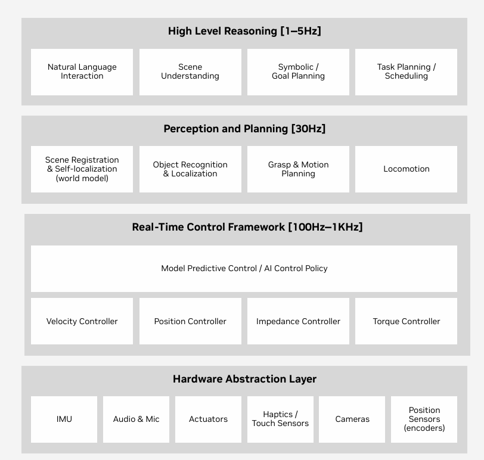
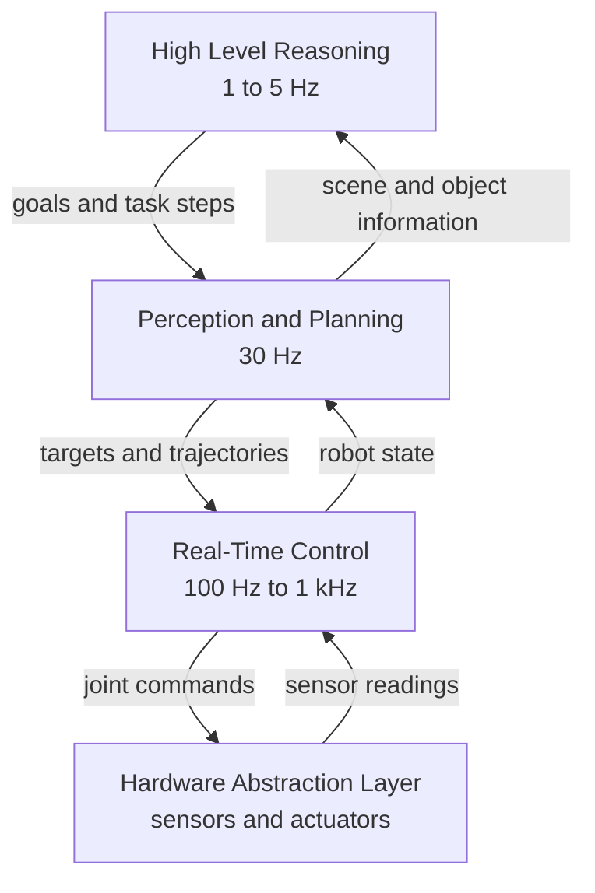

- A humanoid robot has to do many different things at the same time. 
- It must understand a spoken request, recognize objects, plan a grasp, keep its balance, and move dozens of motors, all while the world changes around it.
- These jobs do not run at the same speed.

| Job | How fast it must respond? |
|-----|--------------------------|
| Understanding "clean up the table" | A second or so is fine |
| Spotting a cup and planning a grasp | Tens of milliseconds |
| Keeping balance while a leg swings | A millisecond or two, or the robot falls |

- If everything were one big program running at one speed, it would be either too slow to balance or too wasteful to think. 
- The answer is an **architecture in layers**, where each layer runs at the speed its job needs.

## Layers by Speed

- It is **generative AI and real-time control for general purpose humanoids**. 
- The two halves of that phrase are the top and bottom of the picture: slow, AI-driven thinking on top, fast, hard real-time control underneath.

- **Hz** (hertz) means times per second. 30 Hz means the layer updates thirty times every second.

## Why Different Speeds?

Turning the rates into time budgets makes the difference clear.

| Layer | Rate | Time for one update |
|-------|------|---------------------|
| High level reasoning | 1 to 5 Hz | 200 ms to 1 second |
| Perception and planning | 30 Hz | about 33 ms |
| Real-time control, slower end | 100 Hz | 10 ms |
| Real-time control, faster end | 1 kHz | 1 ms |

- A balance controller that updates every second would be useless, because a falling robot cannot wait. 
- A language model that tried to update a thousand times a second would be impossible and pointless. 
- Each layer gets the speed it needs and no more.

> **Why it matters:** the slow layers can use large, powerful AI models that need time to think. The fast layers must be simple, predictable and guaranteed to finish on time.

## High Level Reasoning (1 to 5 Hz)

**Question it answers:** what should the robot do?

|  | What it means? |
|------------------|---------------|
| **Natural Language Interaction** | Understanding spoken or written requests and responding |
| **Scene Understanding** | Working out what is in view and what is going on, such as "there is a cup on the table and a person nearby" |
| **Symbolic / Goal Planning** | Turning a goal into logical steps, such as "get the cup, then bring it to the person" |
| **Task Planning / Scheduling** | Ordering and timing tasks, and deciding what to do next |

- This is where large vision-language and reasoning models live. 
- It matches the **System 2** reasoning in GR00T's dual-system design, and the agent loop (observe, reason, act) from the agents topic.

## Perception and Planning (30 Hz)

**Question it answers:** what do I see, and how do I carry out the plan?

|  | What it means?|
|------------------|---------------|
| **Scene Registration and Self-localization (world model)** | Building a map of the surroundings and working out where the robot is in it. The bracketed "world model" means an internal picture of the environment |
| **Object Recognition and Localization** | Finding objects and measuring where they are and how they are oriented |
| **Grasp and Motion Planning** | Choosing how to grip an object and planning an arm path that avoids collisions |
| **Locomotion** | Planning where and how to step or move the body |

- NVIDIA tools that serve this layer appear in the next topic: Nvblox and cuVSLAM for mapping and localization, FoundationPose for object pose, and Isaac ROS packages that run them fast on the GPU. 
- NVIDIA describes a GR00T Perception suite built around libraries such as nvblox and cuVSLAM and models such as FoundationPose.

## Real-Time Control Framework (100 Hz to 1 kHz)

**Question it answers:** how do I move every joint, right now, without falling?

| | What it means |
|------------------|---------------|
| **Model Predictive Control / AI Control Policy** | The "whole-body brain" of the layer. Either a classical method that predicts the near future and picks the best motion (**MPC**), or a learned neural network policy that does the same job |
| **Velocity Controller** | Makes a joint move at a requested speed |
| **Position Controller** | Moves a joint to a requested angle and holds it there |
| **Impedance Controller** | Makes a joint behave like a spring and damper, so it gives way when it touches something instead of pushing hard. This is vital for safe contact with people and objects |
| **Torque Controller** | Commands the motor's force directly, the lowest level of control |

### Classical versus learned

- "MPC **or** AI control policy", which captures a shift in the field. 
- NVIDIA's GR00T material describes **GR00T-Control** as a learning-based alternative to traditional model predictive control for whole-body control, and the **SONIC** controller from the Foundation Models section is a large-scale learned example. 
- GR00T's own output is an **action chunk**: a short predicted sequence of relative joint motions, which NVIDIA says helps keep whole-body control smooth and stable.

> **Why it matters:** this layer must **always** meet its deadline. NVIDIA notes that Jetson AGX Thor comes with integrated functional safety, which supports this kind of safety-critical work.

## Hardware Abstraction Layer

- This layer connects software to physical parts. .
- A **hardware abstraction layer** (HAL) gives the software one standard way to talk to sensors and motors, so the code above does not depend on one particular brand.

| Component | What it provides? |
|-----------|------------------|
| **IMU** | Inertial measurement unit: tilt, rotation and acceleration, essential for balance |
| **Audio and Mic** | Sound input for voice commands, and sound output |
| **Actuators** | The motors and drives that move the joints |
| **Haptics / Touch Sensors** | Sensing contact and pressure, especially in the hands |
| **Cameras** | Vision |
| **Position Sensors (encoders)** | Measure each joint's angle |

- **Why abstraction matters?:** swap one camera or motor driver for another, and only the HAL changes. Everything above keeps working. This is also why ROS 2, which standardizes message types for sensors and commands, is so widely used (see the Isaac ROS topic).

## How Information Flows Between Layers?

Goals travel **down**, and sensing travels **up**.

An example: "put the cup in the sink."

1. **Reasoning** turns it into steps: find the cup, grasp it, walk to the sink, release it.
2. **Perception and planning** finds the cup's position and plans the arm and walking paths.
3. **Control** turns those paths into joint commands, a thousand times a second, while holding balance.
4. **Hardware** executes the commands, and sensors report back what really happened.

## Where NVIDIA's Tools Fit?

| Layer | NVIDIA pieces |
|-------|-----------------------------------------------|
| High level reasoning | GR00T's vision-language backbone, Cosmos Reason, agent tools and skills |
| Perception and planning | Isaac ROS, Nvblox, cuVSLAM, FoundationPose, navigation models such as COMPASS and X-Mobility |
| Real-time control | Policies trained in Isaac Lab and Newton, GR00T-Control and SONIC |
| Hardware abstraction | ROS 2 and Isaac ROS on JetPack |
| The computer under all of it | Jetson AGX Thor |

- NVIDIA's Isaac GR00T platform description lists exactly this span: open data and pipelines, an open robot foundation model, simulation frameworks, middleware, CUDA-X accelerated runtime libraries, and Jetson Thor for real-time inference and control.

## Layers Are Blurring

- The layered diagram is a clear teaching tool, but real systems are changing. 
- Foundation models like GR00T cut across layers: a single model sees images, understands language and outputs joint motions directly. Learned controllers such as SONIC replace hand-built control. 
- The trend is that learned components take over more of the stack, while the fast, safety-critical control loop stays separate and predictable.

## Summary

1. A humanoid's software is built in **layers by speed**, so each job runs at the rate it needs.
2. **High level reasoning (1 to 5 Hz):** language, scene understanding, goal and task planning.
3. **Perception and planning (30 Hz):** mapping, localization, object recognition, grasp and motion planning, locomotion.
4. **Real-time control (100 Hz to 1 kHz):** MPC or an AI control policy, over velocity, position, impedance and torque controllers.
5. **Hardware abstraction layer:** a standard interface to IMU, microphones, actuators, touch sensors, cameras and encoders.
6. Goals flow down, sensing flows up, and learned models are increasingly blending the layers.

## References

1. [NVIDIA Isaac GR00T](https://developer.nvidia.com/isaac/gr00t)
2. [NVIDIA, Humanoid Robots](https://www.nvidia.com/en-us/use-cases/humanoid-robots)
3. [NVIDIA Technical Blog, "Advancing Humanoid Robot Sight and Skill Development with NVIDIA Project GR00T"](https://developer.nvidia.com/blog/advancing-humanoid-robot-sight-and-skill-development-with-nvidia-project-gr00t/)
4. [NVIDIA Technical Blog, "Develop Humanoid Robot Policies End-to-End with NVIDIA Isaac GR00T"](https://developer.nvidia.com/blog/develop-humanoid-robot-policies-end-to-end-with-nvidia-isaac-gr00t/)
5. [NVIDIA Jetson AGX Thor](https://developer.nvidia.com/embedded/jetson-agx-thor)
6. [NVIDIA Isaac ROS](https://developer.nvidia.com/isaac/ros)
