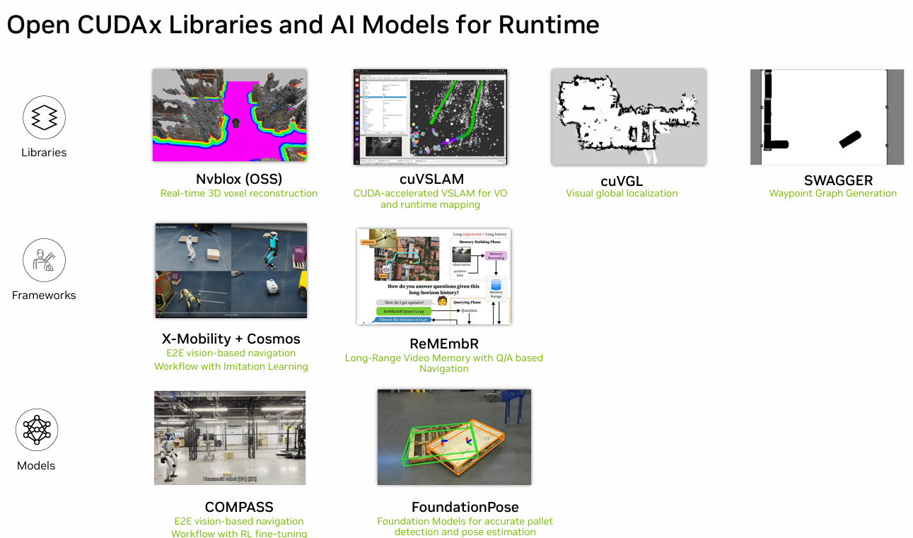
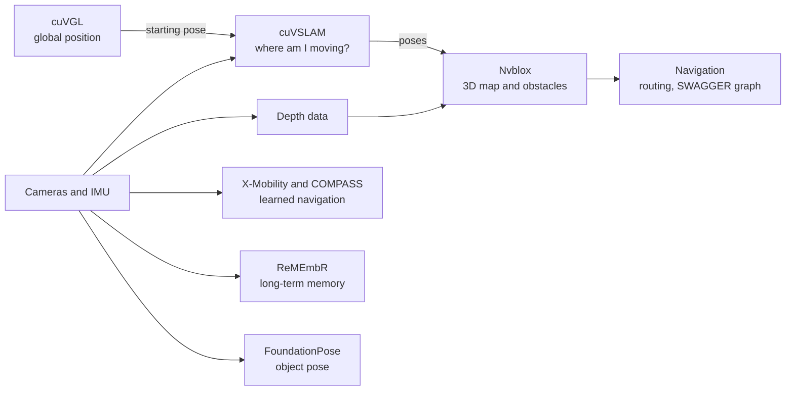
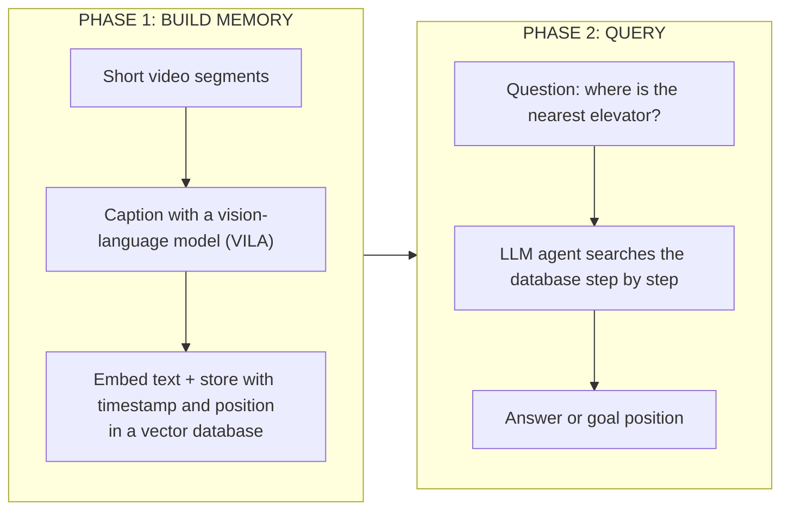

- The previous topic showed that a robot's runtime has a **perception and planning layer** that runs about thirty times a second. 
- This topic fills that layer with real building blocks. 
- The layer exists to answer five practical questions the robot must answer all the time.

| Question | Why the robot needs it? |
|----------|------------------------|
| **What is around me?** | To avoid obstacles and to know where it can drive or step |
| **Where am I?** | To know its own position as it moves |
| **How do I get there?** | To route from here to a goal |
| **What did I see before?** | To answer "where is the nearest elevator?" or "where did I last see the forklift?" |
| **Where exactly is that object?** | To pick up a box or a pallet, the robot needs its position and orientation |

- Writing each of these from scratch is a big job. 
- NVIDIA offers open, GPU-accelerated building blocks for each, grouped into **libraries**, **frameworks** and **models**.

## Three Kinds of Building Blocks

- **Libraries**: Reusable code components that do one job, such as mapping or localization.
- **Frameworks**: Ready-made workflows that combine several pieces to solve a larger problem.
- **Models**: Trained AI networks for a task such as navigation or pose estimation.

- Each group's lines map to the five questions.

| Question | Building block | Group |
|----------|----------------|-------|
| What is around me? | **Nvblox** | Library |
| Where am I? | **cuVSLAM** and **cuVGL** | Libraries |
| How do I get there? | **SWAGGER**, plus **X-Mobility** and **COMPASS** for learned navigation | Library, framework, model |
| What did I see before? | **ReMEmbR** | Framework |
| Where exactly is that object? | **FoundationPose** | Model |

## How the Pieces Fit Together?

- NVIDIA's Isaac Lab 2.3 announcement describes the combination this way: a robot knows where it is with cuVSLAM, builds a map for localization with cuVGL, and understands the scene to produce actions with COMPASS, so it can navigate changing environments in real time.

## Libraries

### Nvblox: Real-time 3D Voxel Reconstruction

**Example** a 3D reconstruction of a space with a colored (rainbow and magenta) overlay.

| Fact | Detail |
|------|--------|
| What it is? | A GPU-accelerated library that builds a 3D map from depth cameras, using **TSDF** and **ESDF** representations |
| Voxel | A small cube of space. The map is a grid of voxels, each marked as free, occupied or unknown |
| TSDF | Truncated signed distance field: for each voxel, how far it is from the nearest surface |
| ESDF | Euclidean signed distance field: the distance to the nearest obstacle, useful for path planning |
| Output | A 3D reconstruction and a 2D costmap that a navigation system can use to avoid obstacles |
| Input | RGB-D cameras (color plus depth) |
| Openness | The marks it **(OSS)**, open source software. |

- The colored overlay in the picture is a visualization of the distance field around obstacles, which tells the planner where it is safe to move.

### cuVSLAM: CUDA-accelerated VSLAM for VO and Runtime Mapping

| Fact | Detail |
|------|--------|
| **VSLAM** | Visual simultaneous localization and mapping |
| **VO** | Visual odometry: estimating how the robot has moved by watching camera images change |
| What it does? | NVIDIA's Isaac ROS description says it uses one or more stereo cameras, and optionally an IMU, to estimate odometry |
| Speed | GPU accelerated for real-time, low-latency results |
| Good for | An extra odometry source for ground robots, and a primary source for drones |
| Maps | It can build, save and load maps. To localize in a saved map, it needs an initial pose hint from a global localizer |

- **Odometry** is a running estimate of how far and in which direction the robot has moved. It drifts over time, which is where mapping and global localization help.

### cuVGL: Visual Global Localization

| Fact | Detail |
|------|--------|
| What it answers | "Where am I in the whole map?", with no prior guess |
| How | It builds a map database from images with known poses (for example from cuVSLAM), then matches new camera images against it |
| Needs | One or more stereo cameras |
| Role with cuVSLAM | cuVGL gives cuVSLAM its **starting position**. Once cuVSLAM localizes, cuVGL stops and cuVSLAM takes over continuously |

- A simple analogy: cuVGL is like waking up and recognizing a landmark to learn where you are, and cuVSLAM is like then walking while keeping track of each step.

> **Licensing detail:** the Isaac ROS documentation says the visual mapping package that holds the core cuVGL implementation is released only as a Debian package and not in source form. The ROS wrapper packages around it are open source under Apache 2.0. So "open" here means open to use and integrate, but not every core component is source code.

### SWAGGER: Waypoint Graph Generation

| Fact | Detail |
|------|--------|
| Name | **S**parse **WA**ypoint **G**raph **G**eneration for **E**fficient **R**outing |
| Idea | Turn a map into a **sparse graph**: points (waypoints) joined by routes. Robots then plan along the graph instead of searching the whole space |
| Why it helps? | A small graph is much faster to search than a full map, which is useful for fleets in large buildings |
| Openness | An open repository from NVIDIA Isaac, listed under Apache 2.0 |

## Frameworks

### X-Mobility + Cosmos: End-to-end Vision-based Navigation with Imitation Learning

- **End-to-end** means one learned system goes from camera images straight to movement commands, instead of a chain of separate modules.

| Fact | Detail from NVIDIA's X-Mobility paper |
|------|----------------------------------------|
| Core idea | Combine **world modeling** (learning how the environment behaves) with **imitation learning** (copying a teacher) |
| Teacher | The classical Nav2 navigation stack |
| Smart trick | It separates learning the world model from learning the action policy, so it can train on data both with and without control commands |
| Cross-embodiment | Deployed in Isaac Sim on four robots: Nova Carter (wheeled), a forklift, a Unitree Go2 (quadruped) and a Unitree G1 (humanoid) |
| Real world | Deployed on a real Nova Carter with no fine-tuning (zero-shot sim-to-real) |

- The **+ Cosmos** refers to using Cosmos world models to improve the training data. NVIDIA's mobility workflow uses Cosmos Transfer to improve synthetic data and reduce the sim-to-real gap.

### ReMEmbR: Long-Range Video Memory with Q/A based Navigation

- ReMEmbR stands for **Retrieval-augmented Memory for Embodied Robots**. 
- It lets a robot remember what it has seen over hours of operation and answer questions about it.

- It works in two phases.

| Fact | Detail |
|------|--------|
| Why it is needed? | A language model cannot hold hours of video in its head. A searchable memory solves that |
| Storage | Captions, timestamps and robot positions in a vector database (Milvus) |
| Output | Either an answer, or a position the robot can navigate to |
| Evidence | The paper reports it outperforms language model and vision-language model baselines with low latency, and NVIDIA demonstrated it on a Nova Carter robot with Isaac ROS |

## Models

### COMPASS: End-to-end Vision-based Navigation with RL Fine-tuning

- COMPASS is under Models while describing it as a workflow. NVIDIA's own pages use both words.

| Fact | Detail |
|------|--------|
| Goal | A **mobility generalist**: one navigation policy that works across robot types and changing environments |
| Recipe | Imitation learning (building on X-Mobility), then **residual reinforcement learning** to fine-tune for each robot body, then policy distillation |
| Workflow | Synthetic data in Isaac Sim with Cosmos Transfer, training and post-training in Isaac Lab, deployment on Jetson Orin or Thor |
| Result | The Isaac Lab paper reports strong zero-shot sim-to-real performance |
| Link to GR00T | COMPASS can generate large datasets to train VLA models, and fine-tuning GR00T N1.5 on its data showed zero-shot sim-to-real navigation |

- **X-Mobility versus COMPASS in one line:** X-Mobility learns navigation by imitation with a world model, and COMPASS builds on it and adds reinforcement learning fine-tuning so that it works well on each different robot.

### FoundationPose: Foundation Models for Pallet Detection and Pose Estimation

| Fact | Detail |
|------|--------|
| **Pose** | An object's position and orientation in 3D, six numbers in total (**6D**) |
| What it is? | A foundation model for 6D pose estimation and tracking of **novel objects** |
| Strength | NVIDIA says it handles unseen objects, including textureless, glossy or tiny ones, and scenes with fast motion or heavy occlusion |
| In Isaac ROS | Packaged as ROS 2 pose estimation nodes for use with a depth camera |
| In the diagram| The photo shows a pallet with green and orange 3D boxes around it, marking the estimated pose |

- **Why pallets?** In warehouses, a robot or forklift must know exactly where a pallet is and how it is rotated before it can slide its forks in. Pose estimation turns a camera image into that precise answer.

- Isaac ROS combines FoundationPose with an object detector, which first draws a 2D box around the object so the pose model knows where to look.

## Worked Example: A Warehouse Robot

| Job | Building block |
|-----|----------------|
| Find its starting position after boot | cuVGL |
| Track its movement | cuVSLAM |
| Build a map of obstacles | Nvblox |
| Plan a route around the building | SWAGGER graph |
| Or navigate with a learned policy | X-Mobility or COMPASS |
| Find and align with a pallet | FoundationPose |
| Answer "where did you last see the red forklift?" | ReMEmbR |

- All of these run on the GPU of the robot's Jetson computer, and most plug into ROS 2 through Isaac ROS, which is the next topic.

## Summary

1. The perception and planning layer answers five questions: **what is around me, where am I, how do I get there, what did I see before, and where is that object**.
2. **Libraries:** **Nvblox** (3D map), **cuVSLAM** (visual odometry and mapping), **cuVGL** (global localization) and **SWAGGER** (waypoint graphs).
3. **Frameworks:** **X-Mobility + Cosmos** (learned navigation through imitation) and **ReMEmbR** (long-term memory and question answering).
4. **Models:** **COMPASS** (navigation fine-tuned with reinforcement learning across robot types) and **FoundationPose** (6D object pose).
5. They combine into a full navigation and perception stack on the robot's GPU.
6. "Open" applies differently to each component, so check the licenses.

## References

1. [NVIDIA Isaac platform](https://developer.nvidia.com/isaac)
2. [Isaac ROS documentation](https://nvidia-isaac-ros.github.io/)
3. [Nvblox on GitHub](https://github.com/nvidia-isaac/nvblox)
4. [Isaac ROS Visual SLAM (cuVSLAM)](https://github.com/NVIDIA-ISAAC-ROS/isaac_ros_visual_slam)
5. [Isaac ROS, Visual Global Localization (cuVGL)](https://nvidia-isaac-ros.github.io/concepts/visual_global_localization/index.html)
6. [SWAGGER on GitHub](https://github.com/nvidia-isaac/SWAGGER)
7. [X-Mobility paper](https://arxiv.org/abs/2410.17491)
8. [ReMEmbR paper](https://arxiv.org/abs/2409.13682)
9. [NVIDIA Technical Blog, "Using Generative AI to Enable Robots to Reason and Act with ReMEmbR"](https://developer.nvidia.com/blog/using-generative-ai-to-enable-robots-to-reason-and-act-with-remembr/)
10. [NVIDIA Technical Blog, Isaac Lab 2.3 whole-body control and teleoperation (COMPASS navigation)](https://developer.nvidia.com/blog/streamline-robot-learning-with-whole-body-control-and-enhanced-teleoperation-in-nvidia-isaac-lab-2-3/)
11. [Isaac Lab research paper (COMPASS section)](https://arxiv.org/abs/2511.04831)
