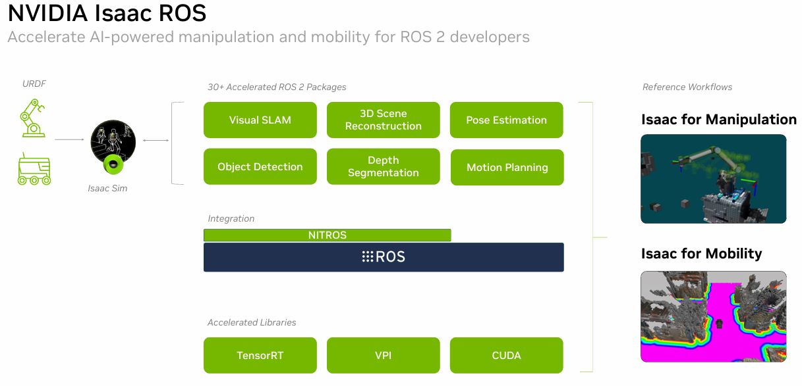

- **ROS 2** is the standard open source framework for robot software. 
- Most robot developers already use it, and it provides a common way for software pieces to talk to each other. 
- But ordinary ROS 2 code mostly runs on the CPU, and modern robots need much more.

| Challenge | Why it hurts? |
|-----------|--------------|
| AI perception is heavy | Running neural networks on several camera streams at 30 frames per second needs a GPU |
| Copying data is slow | Moving big images between CPU memory and GPU memory over and over wastes time and power |
| Every team rebuilds the same pieces | Visual SLAM, object detection and motion planning are needed on almost every robot |
| Starting from nothing is hard | A new developer needs working examples of full applications, not only parts |

- Developers want to keep using ROS 2, but with **GPU-accelerated** building blocks that plug straight in. That is Isaac ROS.

## What Isaac ROS Is?

- It is **accelerate AI-powered manipulation and mobility for ROS 2 developers**.
- Isaac ROS is a collection of GPU-accelerated ROS 2 packages and AI models. 
- Earlier documentation called the packages **GEMs**. 
- They run on NVIDIA Jetson computers and on x86 systems with an NVIDIA GPU, and they are published openly on GitHub. 
- NVIDIA's documentation lists ROS 2 Jazzy as the tested ROS version, and the packages use Docker containers so that setups are reproducible across machines.
- A way to remember it: **ROS 2 is the road system, and Isaac ROS puts GPU-powered vehicles on it.**



| Layer | What it is? |
|-------|------------|
| **Packages** | The ready-to-use ROS 2 nodes for perception, mapping and planning |
| **Integration** | NITROS, sitting between the packages and ROS 2 |
| **Accelerated Libraries** | TensorRT, VPI and CUDA, the engines doing the actual GPU work |
| **Reference Workflows** | Complete example applications built from the packages |

### Simulation link

- **URDF** file (the robot's description, introduced in the software-in-the-loop topic) feeds **Isaac Sim**.
- The two way arrow shows that Isaac Sim connects to the Isaac ROS packages through the ROS 2 bridge.
- This means you can run the same accelerated packages against a simulated robot before moving them to a real one.

## Six Package Families

- There are six groups, and NVIDIA says there are more than 30 packages in total. 

| Family | What it does? | Related building blocks |
|---------------------|--------------|--------------------------|
| **Visual SLAM** | Tracks the robot's position and builds a map from camera images | cuVSLAM, with cuVGL for global localization (from the CUDA-X topic) |
| **3D Scene Reconstruction** | Builds a 3D model of the surroundings and obstacle costmaps | Nvblox |
| **Pose Estimation** | Finds an object's 3D position and orientation | FoundationPose and other pose estimators |
| **Object Detection** | Finds objects in images and draws boxes around them | Detection models run through the TensorRT or Triton nodes. These also work as a front end to pose estimators |
| **Depth Segmentation** | Uses depth information to separate parts of a scene |  |
| **Motion Planning** | Plans collision-free arm motions | cuMotion, which NVIDIA describes as integrating with MoveIt 2 and providing CUDA-accelerated manipulation |

- The Isaac ROS documentation also covers the neural network inference nodes: a **TensorRT** node and a **Triton** node that run trained models efficiently, including on Jetson and discrete GPUs.

## NITROS: Integration Layer

- The green bar labeled **NITROS** sits above the dark ROS bar. 
- It is the most distinctive piece of Isaac ROS.

- **NITROS** stands for **NVIDIA Isaac Transport for ROS**. 
- NVIDIA's documentation describes it as its implementation of two ROS 2 features:

| ROS 2 feature | Meaning |
|---------------|---------|
| **Type adaptation** | Lets a node work with data in the format best suited to the hardware, such as GPU memory, instead of a generic message |
| **Type negotiation** | Lets nodes tell each other which formats they support so the framework picks the fastest compatible one |

- The result is **zero-copy** transfer between compatible nodes: data stays in GPU memory and is passed along without being copied back to the CPU and converted.

```
   WITHOUT NITROS                              WITH NITROS

   Camera -> CPU memory                        Camera -> GPU memory
        |   copy to GPU                              |
        v                                            v
   [GPU node A] -> copy to CPU                 [GPU node A] -> stays on GPU
        |   convert, copy to GPU                     |
        v                                            v
   [GPU node B] -> copy to CPU                 [GPU node B] -> stays on GPU
```

- Three useful facts from the documentation:

1. Each NITROS data type maps one-to-one to a standard ROS message type, so existing ROS tools and code stay compatible.
2. Most Isaac ROS packages are NITROS-accelerated.
3. **A condition on zero-copy:** all NITROS-accelerated nodes must run in the **same process** to get the full benefit. A graph does not become end-to-end zero-copy just because several nodes are labeled NITROS, so check how your nodes are composed.

## Accelerated Libraries

| Library | What it provides? |
|---------|------------------|
| **TensorRT** | NVIDIA's optimizer and runtime for neural networks, used to run models fast on Jetson and other GPUs |
| **VPI** | NVIDIA's Vision Programming Interface, a library of computer vision algorithms that can run on different processors in a Jetson, including the GPU |
| **CUDA** | The base platform for GPU computing. It is the shared foundation behind the CUDA Everywhere idea from the Three Computer Solution |

- CUDA code written inside your own ROS node can also use NITROS to share data directly with Isaac ROS nodes in GPU memory.

### Isaac for Manipulation

**Example:** a robot arm in a 3D scene with a voxel (grid of small cubes) map of the workspace.

- For robot arms: perceiving objects, estimating their pose, planning collision-free motion and executing grasps.
- It brings together packages such as pose estimation, object detection and cuMotion for motion planning.

### Isaac for Mobility

- **Example:** a 3D map of a space with a colored cost overlay, showing where the robot can and cannot go.

- For mobile robots: localizing, mapping, avoiding obstacles and navigating. It brings together cuVSLAM, Nvblox and navigation.

## Isaac ROS and Humanoids

- Isaac ROS is also the **deployment stage** in the GR00T End-to-end Workflow topic. 
- NVIDIA's Isaac ROS documentation includes a tutorial for whole-body teleoperation of a Unitree G1 humanoid from an XR headset, which runs on Jetson Thor. 
- This shows that the same framework serves arms, mobile robots and humanoids.

## Where to Find It and What Runs It?

| Item | Detail |
|------|--------|
| **Isaac ROS 4.0** | Generally available for Jetson AGX Thor, with JetPack 7.0 |
| **Isaac ROS 4.4.0** | Lists support for Jetson Thor (T5000 and T4000) with JetPack 7.1, and DGX Spark |
| **ROS 2** | Tested with ROS 2 Jazzy |
| **Source** | The NVIDIA-ISAAC-ROS organization on GitHub. For example, the mapping and localization repository is listed under Apache 2.0, though some core components, such as the cuVGL implementation, ship only as Debian packages |

## Summary

1. **Isaac ROS** is a set of **GPU-accelerated ROS 2 packages** and AI models for perception, mapping and planning, for Jetson and x86 with an NVIDIA GPU.
2. The stack: **packages**, then **NITROS** and **ROS 2**, then **TensorRT, VPI and CUDA**, plus **reference workflows** for manipulation and mobility.
3. **NITROS** implements ROS 2 type adaptation and negotiation to keep data in GPU memory, with a same-process condition for full zero-copy.
4. Six package families: **Visual SLAM, 3D Scene Reconstruction, Pose Estimation, Object Detection, Depth Segmentation, Motion Planning**.
5. A **URDF** and **Isaac Sim** let you test the same packages in simulation before deploying them.
6. It is the deployment layer for arms, mobile robots and humanoids, running on **Jetson Thor** with current releases.

## References

1. [NVIDIA Isaac ROS](https://developer.nvidia.com/isaac/ros)
2. [Isaac ROS documentation](https://nvidia-isaac-ros.github.io/)
3. [Isaac ROS, NITROS concepts](https://nvidia-isaac-ros.github.io/concepts/nitros/index.html)
4. [Isaac ROS, CUDA with NITROS](https://nvidia-isaac-ros.github.io/concepts/nitros/cuda_with_nitros.html)
5. [Isaac ROS, DNN Inference](https://nvidia-isaac-ros.github.io/repositories_and_packages/isaac_ros_dnn_inference/index.html)
6. [Isaac ROS, Visual Global Localization](https://nvidia-isaac-ros.github.io/concepts/visual_global_localization/index.html)
7. [NVIDIA Developer Forums, "NVIDIA Isaac ROS 4.0 for Thor is HERE"](https://forums.developer.nvidia.com/t/nvidia-isaac-ros-4-0-for-thor-is-here/352008)
8. [NVIDIA Isaac platform](https://developer.nvidia.com/isaac)
