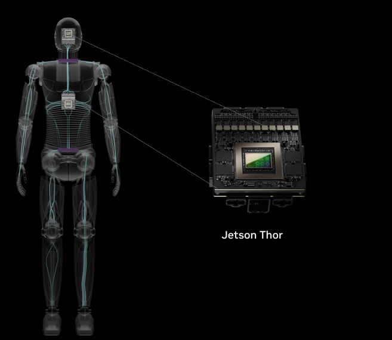
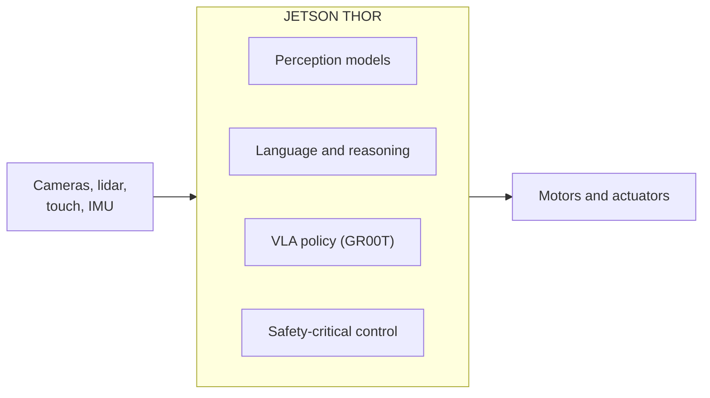

- A robot's brain is a collection of large AI models: a vision-language-action model, perception networks, navigation policies and a whole-body controller. 
- They all have to run **on the robot**, at the same time, in real time.

| Demand | Why it is hard? |
|--------|----------------|
| **Big models** | Transformer based models such as GR00T need serious compute and memory |
| **Many models at once** | Vision, language, planning and control run together |
| **Many sensors** | Cameras, lidar and tactile sensors stream data continuously |
| **Tight power** | A robot runs on a battery, so a data center chip cannot be used |
| **Safety** | The computer that drives motors must behave predictably |

- The previous Jetson generation, Orin, was built for smaller models. 
- Thor is NVIDIA's answer to the new generation of generative AI robots.

## What Jetson Thor Is?

- It is **the ultimate platform for physical AI and robotics**. 
- It is the **third computer** from the Three Computer Solution: the one that sits inside the robot.

| Fact | Detail |
|------|--------|
| What it is? | A compact computer module for robots, built around a **Blackwell** GPU, the same architecture family as the data center systems |
| Modules | **Jetson T5000** (the flagship) and **Jetson T4000** (a lower-cost, lower-power option) |
| Developer kit | **Jetson AGX Thor Developer Kit**, which uses the T5000 module |
| Software | JetPack, NVIDIA's software package for Jetson, with Isaac ROS and the rest of the Isaac stack |

>   - The below picture shows a translucent humanoid with Thor modules highlighted in the head and the chest, and a close-up of the module.
- This shows that a robot can carry more than one computer, for example one near the sensors and one for the body.

## Features of Jeston Thor

- Next generation GPU with Blackwell architecture.
- **8X** Orin GPU performance for transformers.
- **2.6X** Orin CPU performance.
- **2X** Orin memory capacity.

## Key Specifications

| | Jetson AGX Orin (previous) | Jetson T5000 | Jetson T4000 |
|---|---------------------------|--------------|--------------|
| **AI performance** | Up to 275 TOPS | 2070 FP4 TFLOPS | 1200 FP4 TFLOPS |
| **GPU** | Ampere | 2560-core Blackwell, 96 Tensor Cores | Blackwell, fewer cores (about 1500 CUDA cores and 64 Tensor Cores per one report) |
| **CPU** | 12-core Cortex-A78AE | 14-core Arm Neoverse-V3AE | 12-core Arm |
| **Memory** | 32 or 64 GB, 205 GB/s | 128 GB LPDDR5X, 273 GB/s | 64 GB, 273 GB/s |
| **Power** | 15 to 60 W | 40 to 130 W, configurable | Lower than T5000 |

### Connectivity and I/O

|  | Detail |
|------|--------|
| Networking | 4 x 25 GbE (QSFP) plus a multi-gigabit Ethernet port |
| Cameras | 16 CSI-2 lanes, supporting 20 or more cameras |
| Expansion | PCIe Gen5 |
| Robot interfaces | CAN, I2C, UART, SPI, GPIO and PWM |
| Video | Hardware decode up to 10 x 4K at 60 frames per second |

- This I/O is what lets a humanoid take in many cameras and fast sensors at once.

## Understanding the TFLOPS Number

- The headline figure is **2070 FP4 TFLOPS**. Three words need unpacking.

| Term | Meaning |
|------|---------|
| **TFLOPS** | Trillions of floating point operations per second |
| **FP4** | 4-bit floating point numbers. Smaller numbers let the chip do more math per second and use less memory, which suits running large models |
| **Sparse** | The figure assumes the model uses a pattern of zeros that the hardware can skip |

> **A comparison warning:** Orin's headline figure (275 TOPS) is an INT8 number, while Thor's is FP4 with sparsity. The 7.5x claim comes from NVIDIA's own comparison, and the two headline numbers are not directly comparable by dividing them. Real speedups depend on the model and precision.

## What Makes It Suited to Robots?

| Feature | Why it matters for a robot? |
|---------|-----------------------------|
| **Blackwell GPU with a Transformer Engine and native FP4** | Tuned for the transformer models that robots now use |
| **Multi-Instance GPU (MIG)** | Splits the GPU into isolated slices so time-sensitive control can stay predictable beside heavy AI work |
| **128 GB of memory** | Holds several large models at once |
| **Fast I/O** | Many cameras and sensors in parallel |
| **40 to 130 W power range** | Fits a robot's power budget and can be tuned |
| **Integrated functional safety** | NVIDIA lists this for Thor, supporting safety-critical designs |

- These design choices tie back to the Compute for Robotics topic, where robot demands (real time, many sensors, low power) shaped the hardware.

## Software Side

| Layer | What runs? |
|-------|-----------|
| **JetPack 7** | NVIDIA's software package for Thor, including the operating system and drivers. Isaac ROS 4.0 supports it, as the Robot Runtime introduction noted |
| **Isaac ROS** | Accelerated ROS 2 packages and reference workflows |
| **TensorRT** | Optimizes neural networks for fast inference |
| **Models** | GR00T N1.7 inference on Thor, with TensorRT export. NVIDIA recommends 16 GB or more of GPU memory for inference, which Thor exceeds |
| **Agents** | Jetson agent skills, covered in the next topic |

- Thor also runs generative AI such as large language models and vision-language models at the edge.

## Availability and Price

| Item | Detail |
|------|--------|
| **General availability** | August 25, 2025, for the developer kit and the T5000 production module |
| **Launch price of the developer kit** | $3,499 |
| **Later price** | Two 2026 third-party sources report that NVIDIA's own marketplace now lists the developer kit at $5,499. |
| **T5000 and T4000 modules** | Priced for volume orders through distributors. Quotes in third-party sources differ, so check with a distributor |
| **Later family members** | One 2026 guide says smaller Thor modules (T3000 and T2000) are announced for roughly 2027. This is a single third-party report |

## Summary

1. **Jetson Thor** is NVIDIA's flagship edge computer for physical AI, built on the **Blackwell** GPU.
2. The **T5000** delivers up to **2070 FP4 TFLOPS** with **128 GB** of memory and **40 to 130 W** of configurable power. The **T4000** is the smaller option.
3. NVIDIA's launch figures against Orin are **7.5x AI compute, 3.5x efficiency, 3.1x CPU and 2x memory**. 
4. Features for robots include a **Transformer Engine**, **MIG** partitioning, **fast I/O** for many cameras and **integrated functional safety**.
5. It has been **generally available since August 25, 2025**.
6. It runs **JetPack 7**, **Isaac ROS** and models such as **GR00T**.

## References

1. [NVIDIA Jetson AGX Thor](https://developer.nvidia.com/embedded/jetson-agx-thor)
2. [NVIDIA Technical Blog, "Introducing NVIDIA Jetson Thor, the Ultimate Platform for Physical AI"](https://developer.nvidia.com/blog/introducing-nvidia-jetson-thor-the-ultimate-platform-for-physical-ai/)
3. [NVIDIA Blog, "NVIDIA Jetson Thor Unlocks Real-Time Reasoning for General Robotics and Physical AI"](https://blogs.nvidia.com/blog/jetson-thor-physical-ai-edge)
4. [NVIDIA Isaac GR00T](https://developer.nvidia.com/isaac/gr00t)
5. [NVIDIA Developer Forums, "NVIDIA Isaac ROS 4.0 for Thor is HERE"](https://forums.developer.nvidia.com/t/nvidia-isaac-ros-4-0-for-thor-is-here/352008)
6. [Isaac GR00T on GitHub (hardware requirements for inference)](https://github.com/NVIDIA/Isaac-GR00T)
