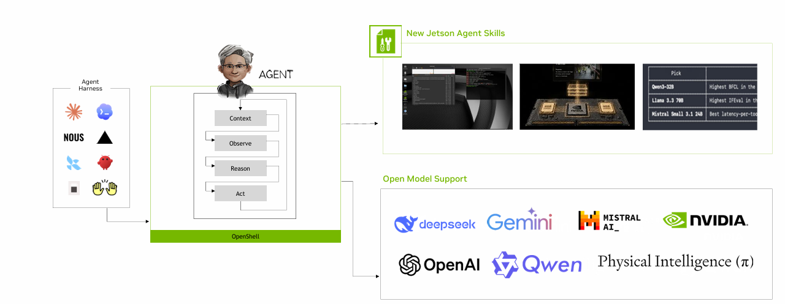

- Jetson computers are powerful, but working with them is specialized. 
- A Jetson is **not** a standard Linux PC, and developers hit the same obstacles again and again.

| Obstacle | Why it hurts? |
|----------|--------------|
| **Custom hardware bring-up** | A new robot usually has its own circuit board, and the low-level software must be adapted to it. This can take weeks |
| **Tight memory** | Edge devices have far less memory than servers, and large models do not fit unless carefully tuned |
| **Many choices** | Which model, which size, which serving framework and which settings work best on this particular Jetson? Finding out takes trial and error |
| **Generic AI help** | AI coding assistants often give advice that is correct for a normal Linux machine but wrong for a Jetson |

- The previous topic on agent tools showed that coding agents become far more useful when they have **skills**: written, tested procedures for a particular tool. This topic applies the same idea to Jetson itself.

## What "Agent Ready" Means?

- NVIDIA introduced agent features for Jetson with **JetPack 7.2**, around mid 2026. 
- JetPack is NVIDIA's software package for Jetson.
-  NVIDIA's announcement describes JetPack 7.2 as bringing agentic AI skills, official Yocto Project support, CUDA 13 on Jetson Orin, and Multi-Instance GPU (MIG) support on Jetson Thor.

- "Agent ready" has three parts.

| Part | Meaning |
|------|---------|
| **Agents can run on Jetson** | NVIDIA lists one-command deployment of NemoClaw, its reference stack for running agents safely, on Jetson |
| **Agents know how to work with Jetson** | New **Jetson agent skills** teach coding agents Jetson specific tasks |
| **Open models run well on Jetson** | Jetson supports a wide range of open generative AI models |

## Agent ready Jeston Workflow

| | What it means? |
|-------------------|---------------|
| **Agent Harness** | The agent application that hosts the loop, such as a coding assistant. The grid of icons stands for several such apps. The same box appeared in the agent tools topic |
| **Agent loop and OpenShell** | The same Context, Observe, Reason, Act loop, running inside **OpenShell**, the secure runtime that limits what the agent can touch |
| **New Jetson Agent Skills** | The three skill areas (next section) |
| **Open Model Support** | A set of model families that run on Jetson |
| **Hardware at the bottom** | Three Jetson products, which appear to be modules and a developer kit.|

## Three Jetson Agent Skills

- **Jetson Linux Customization**, **Memory Optimization** and **Model Benchmarking**. 
- NVIDIA's JetPack page describes them as skills that build, configure, optimize and measure Jetson applications through reusable workflows, with developer-in-the-loop controls.

### Jetson Linux Customization

|  | Detail |
|------|--------|
| What it automates? | **BSP** bring-up. A **board support package** is the low-level software for a specific board: the boot code, operating system kernel, drivers and hardware settings |
| Why it matters? | Custom carrier boards need those settings adapted, and doing it by hand is slow. NVIDIA says automated bring-up gives faster time to market |
| What it can change? | NVIDIA's skills list pin multiplexing (what each pin does), USB, PCIe, camera, clocks, fan, power modes and memory related configuration |
| Related feature | Official **Yocto Project** support in JetPack 7.2, for lean, reproducible custom Linux builds |

### Memory Optimization

|  | Detail |
|------|--------|
| Goal | Run more capable workloads in smaller memory, which lowers the cost of the device |
| How? | Optimizes across the software stack. NVIDIA's blog describes five layers, including the board support package and JetPack, the inference pipeline, the inference frameworks and model quantization |
| Reported savings | NVIDIA says optimization across the stack can reclaim up to 10 to 12 GB while keeping accuracy |
| Worked example | Skills helped an agent inspect a Jetson Orin Nano with 8 GB, find memory bottlenecks, choose a low-memory runtime and verify the result, saving about 5 GB |
| Customer example | SandStar reports it moved an AI vending application from 16 GB to 8 GB devices with nearly 40 percent memory optimization |

### Model Benchmarking

| | Detail |
|------|--------|
| Goal | Find the best model setup for each Jetson, instead of guessing |
| Covers | Model benchmarking, inference optimization and Jetson diagnostics |
| Example skills | A diagnostic skill collects a full device health snapshot (memory, GPU, thermals, power, storage). Others recommend runtime and memory settings for serving frameworks such as vLLM, SGLang, llama.cpp and TensorRT Edge-LLM |

## Two Skill Repositories

- NVIDIA published open source repositories for these skills.

| Repository | Where it runs? | What it does? |
|------------|---------------|---------------|
| **Jetson BSP Skills** | On your host workstation | Customizes the board support package before you flash the device |
| **Jetson Device Skills** | On the Jetson itself | Diagnoses and manages a running device, tunes memory and serves models |

- NVIDIA's forum announcement says they work with agent runtimes such as **Claude Code, OpenAI Codex, Cursor and NemoClaw or OpenClaw**, on Jetson Orin Nano, Orin NX, AGX Orin and Thor.

- A typical interaction: you ask your agent "why is my Jetson running out of memory?" With the skills loaded, it can read the device's real memory use, find which service is holding it, suggest a smaller runtime, apply the change and check the result.

## Why Memory Is the Big Theme?

- Two of the three skills are about squeezing models into limited memory. Here is why.

|  | Why it matters? |
|------|----------------|
| An AI model's weights take memory | A model with several billion parameters can need many gigabytes |
| Edge devices have limited memory | Compared with a server, a Jetson Orin Nano has 8 GB in some versions |
| **Quantization** shrinks models | Storing numbers with fewer bits saves memory. One tutorial reports a vision-language model shrinking from 6.6 GB to 2.2 GB when quantized from 16-bit to 4-bit on an Orin Nano 8 GB |
| Every gigabyte costs money | Fitting a workload into a smaller device lowers the cost of every robot built |

## Open Model Support

|  | What it likely refers to | Status |
|------|--------------------------|--------|
| **NVIDIA** | Models such as Cosmos Reason 2 and the Nemotron family | NVIDIA's Jetson AI Lab has a tutorial running Cosmos Reason2 8B on Jetson Thor |
| **Qwen** | Alibaba's open Qwen models | The same tutorials run Qwen3-4B on Jetson Orin Nano |
| **Physical Intelligence** | The open pi 0.5 vision-language-action model from OpenPi | Jetson AI Lab has a tutorial deploying pi 0.5 on Jetson AGX Thor with TensorRT NVFP4 quantization |
| **DeepSeek, Mistral AI, OpenAI** | Open weight models from these providers | I did not verify specific Jetson tutorials for these in this session |

- The common way to run these models on Jetson is through serving tools such as **vLLM**, **llama.cpp**, **SGLang** or **TensorRT Edge-LLM**, with **NVIDIA Model Optimizer** used to quantize models to NVFP4 directly on Thor.

## Staying in Control

- Giving an AI agent access to a device and the power to change low level settings raises real risks. 
- Reflecting NVIDIA's description of **developer-in-the-loop controls**, keep these habits:

1. **Run the agent inside OpenShell or NemoClaw**, which limit its file, network and credential access.
2. **Review changes before flashing.** BSP changes can stop a board from booting.
3. **Test on a development kit first** before changing a production robot.
4. **Verify results.** Ask the agent to measure memory and performance before and after.
5. **Use verified skills** from NVIDIA's repositories, as discussed in the agent tools topic.

## Summary

1. **Jetson is now agent ready** with **JetPack 7.2**: agents can run on it, know how to work with it, and open models run on it.
2. Three **Jetson agent skills**: **Jetson Linux Customization** (board support package bring-up and Yocto), **Memory Optimization** and **Model Benchmarking**.
3. They live in two open source repositories: **Jetson BSP Skills** (host workstation) and **Jetson Device Skills** (on the device), and work with Claude Code, Codex, Cursor and NemoClaw or OpenClaw.
4. Memory is the central theme: NVIDIA reports reclaiming up to 10 to 12 GB, and customers have moved from 16 GB to 8 GB devices.
5. **Open model support** covers many model families, like Google's open Gemma models.
6. The agent runs inside **OpenShell**, with developer-in-the-loop controls.

## References

1. [NVIDIA Technical Blog, "Deploy Agentic-Ready AI at the Edge with Memory Efficiency in NVIDIA JetPack 7.2"](https://developer.nvidia.com/blog/deploy-agentic-ready-ai-at-the-edge-with-memory-efficiency-in-nvidia-jetpack-7-2/)
2. [NVIDIA Blog, "NVIDIA Jetson Brings Agentic AI to the Physical World"](https://blogs.nvidia.com/blog/jetson-agentic-ai-physical-world/)
3. [NVIDIA Technical Blog, "Maximizing Memory Efficiency with Agent Skills to Run Bigger Models on NVIDIA Jetson"](https://developer.nvidia.com/blog/maximizing-memory-efficiency-to-run-bigger-models-on-nvidia-jetson/)
4. [NVIDIA JetPack Software Stack](https://developer.nvidia.com/embedded/jetpack)
5. [NVIDIA Developer Forums, "Jetson Agent Skills: AI-Assisted Workflows for Device and BSP Customization"](https://forums.developer.nvidia.com/t/jetson-agent-skills-ai-assisted-workflows-for-device-bsp-customization/374150)
6. [Jetson AI Lab, Tutorials](https://www.jetson-ai-lab.com/tutorials/)
7. [NVIDIA NemoClaw documentation](https://docs.nvidia.com/nemoclaw/latest/)
