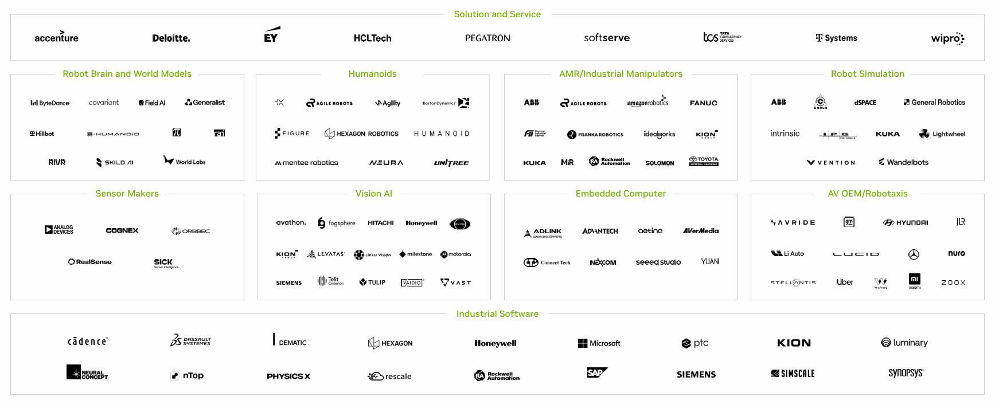

- Everything in this workshop so far has been about NVIDIA's own tools: simulators, models, libraries and computers. 
- But no single company can build physical AI alone.
- A working robot or autonomous machine needs a long chain of contributors.

| Link in the chain | Who has to supply it? |
|-------------------|----------------------|
| The robot body | A robot maker |
| The sensors | Camera, lidar and touch sensor makers |
| The onboard computer | A hardware maker that builds on NVIDIA modules |
| The intelligence | A model developer |
| The test world | A simulation company |
| The factory or warehouse software | An industrial software provider |
| The rollout | A systems integrator |

- This final main section of the workshop is about **the ecosystem**: the wide network of companies that build on NVIDIA's platform and that a newcomer can rely on, learn from or partner with.

## What the Ecosystem Introduces?

- It simply names the topic, **Ecosystem**. It marks the move from "how the technology works" to "who is using it". 

- The ecosystem matters for three practical reasons.

1. **Choice.** You do not need to build every part. There are existing robots, sensors and computers that work with NVIDIA's software.
2. **Proof.** Many large companies building on the same platform is evidence that the tools work at industrial scale.
3. **Connections.** Partners can integrate with each other, because they build on shared standards such as OpenUSD, ROS 2 and CUDA.

## Reading the Partner Map

- This group naturally by where each category sits in the chain of building and deploying a physical AI system.
    - The top box is about **delivering** solutions to customers. 
    - The middle two rows are the **products** being built. 
    - The bottom row is the **tools and components** that go into them.

## Category by Category

### Solution and Service

**Role:** the consulting and engineering firms that help enterprises plan, build and roll out physical AI projects.

**Contributors:** Tata consultancy Services (TCS), Accenture, Deloitte, EY, HCLTech, Pegatron, SoftServe, T-Systems, Wipro.

- Recently TCS Launches Industrial AI Solutions Lab in Bengaluru Powered by NVIDIA. This is New Physical AI facility at TCS Global Axis Campus will accelerate AI-led mobility and industrial solutions using NVIDIA AI Infrastructure.
- Also TCS Industrial Autonomy & Engineering Lab – Lights-Out Factory, is the latest addition to TCS' Industrial Autonomy & Engineering innovation footprint.

**What to know:** these are integrators. They matter most for large organizations that want a finished solution instead of assembling the parts themselves.

### Robot Brain and World Models

**Role:** companies building the AI that controls robots, or the models that understand the physical world. This is the category that matches the Foundation Models section of the workshop.

**Contributors:** ByteDance, Covariant, Field AI, Generalist, Hillbot, X-Humanoid, RIVR, Skild AI, World Labs etc.

- **FieldAI and Skild AI**: Building generalized robot brains using Cosmos world models.
- **Skild AI**: Partnering with ABB Robotics and Universal Robots to deploy its robot intelligence across industries.
- **World Labs**: Using Isaac Sim to validate its generative world models.
- **Generalist AI**: Using Cosmos to explore generating synthetic data.
- **RIVR**: Listed among startups in NVIDIA's Inception program.

### Humanoids

**Role:** companies making humanoid robots.

**Contributors:** 1X, Agile Robots, Agility, Boston Dynamics, Figure, Hexagon Robotics, Humanoid, Mentee Robotics, NEURA Robotics, Unitree etc.

- 1X, AGIBOT, Agility, Agile Robots, Boston Dynamics, Figure, Hexagon Robotics, Humanoid, Mentee and NEURA Robotics as building humanoids with Cosmos world models, Isaac Sim and Isaac Lab.
- Boston Dynamics, Humanoid and RLWRLD integrated Jetson Thor into their humanoids. 
- Unitree is the maker of the G1 and H2 Plus robots from earlier topics.

### AMR and Industrial Manipulators

**Role:** autonomous mobile robots (AMRs, such as warehouse vehicles) and industrial robot arms.

**Contributors:** ABB, Agile Robots, Amazon Robotics, FANUC, Franka Robotics, idealworks, KION, KUKA, MiR, Rockwell Automation, SOLOMON, Toyota Material Handling, and one logo I could not read.

- FANUC, ABB Robotics, YASKAWA and KUKA, which together have an install base of more than 2 million robots, are integrating Omniverse libraries and Isaac simulation frameworks into their **virtual commissioning** solutions. 
- Virtual commissioning means building and testing a complete production line as a physically accurate digital twin before it is built. 
- They are also adding Jetson modules to their controllers for AI inference. Franka Robotics is the maker of the Franka arm mentioned in the Isaac Lab-Arena topic.

### Robot Simulation

**Role:** companies that provide simulation platforms and content.

**Contributors:** ABB, CARLA, dSPACE, General Robotics, Intrinsic, IPG Automotive, KUKA, Lightwheel, Vention, Wandelbots.

- Lightwheel co-developed Isaac Lab-Arena and contributes RoboCasa benchmark tasks. 
- CARLA is the open source driving simulator that integrates NuRec. 
- Vention is among the Inception startups NVIDIA named in March 2026.

### Sensor Makers

**Role:** companies that make cameras, lidar and other sensors.

**Contributors:** Analog Devices, Cognex, Orbbec, RealSense, SICK.

- Sensors feed the hardware abstraction layer of a humanoid and the perception tools in Isaac ROS. 
- NVIDIA's end-to-end GR00T course uses a RealSense camera on its Unitree G1.

### Vision AI

**Role:** companies building camera-based AI for factories, cities, retail and security. This category connects to NVIDIA's **Metropolis** vision AI platform, which the Data Factory topic mentioned.

**Contributors:** Avathon, fogsphere, Hitachi, Honeywell, KION, Levatas, Linker Vision, Milestone, Motorola Solutions, Siemens, Telit Cinterion, Tulip, Vaidio, VAST.

- Linker Vision and Milestone Systems are among the companies NVIDIA lists as using the Physical AI Data Factory blueprint.

### Embedded Computer

**Role:** companies that build ruggedized computers and carrier boards around NVIDIA Jetson modules.

**Contributors:** ADLINK, Advantech, Aetina, AVerMedia, Connect Tech, NEXCOM, seeed studio, YUAN.

- NVIDIA's CES 2026 announcement lists ADLINK, Advantech, Aetina, AVerMedia, Connect Tech and YUAN among partners offering Thor-powered systems for edge AI, robotics and embedded applications.

### AV OEM and Robotaxis

**Role:** car makers and robotaxi operators building autonomous driving. This is the **automotive** domain from the physical AI foundation model diagram.

**Contributors:** Avride, GM, Hyundai, JLR, Li Auto, Lucid, Mercedes-Benz, Nuro, Stellantis, Uber, Waymo, Xiaomi, Zoox.

- NVIDIA's announcements name JLR, HD Hyundai, Mercedes-Benz and Uber among its partners.

### Industrial Software

**Role:** the engineering, design and operations software used to plan and run factories and products. These companies often integrate with Omniverse and OpenUSD.

**Contributors:** Cadence, Dassault Systèmes, Dematic, Hexagon, Honeywell, Microsoft, PTC, KION, Luminary, Neural Concept, nTop, PhysicsX, Rescale, Rockwell Automation, SAP, Siemens, SIMSCALE, Synopsys.

- Microsoft Azure is a partner for the Physical AI Data Factory Blueprint, as the data factory topic described. 

## What Each Category Uses From NVIDIA?

| Category | NVIDIA technology it most connects to |
|----------|----------------------------------------|
| Solution and Service | The whole stack, as integrators |
| Robot Brain and World Models | Cosmos, GR00T, Isaac Lab, Jetson Thor |
| Humanoids | Isaac Sim, Isaac Lab, Cosmos, GR00T, Jetson Thor |
| AMR and Industrial Manipulators | Omniverse, Isaac Sim, Isaac ROS, Jetson modules in controllers |
| Robot Simulation | Isaac Sim, Omniverse, Isaac Lab, OpenUSD |
| Sensor Makers | Isaac ROS, JetPack, sensor bridges to Jetson |
| Vision AI | Metropolis, Cosmos, Jetson |
| Embedded Computer | Jetson modules, especially Thor |
| AV OEM and Robotaxis | DRIVE, Cosmos, Omniverse, Hyperion |
| Industrial Software | Omniverse libraries, OpenUSD, CUDA-X |

> This is my summary of how each category relates to NVIDIA's products, drawn from the topics in this workshop and NVIDIA's announcements. It is not an official mapping.

## What the Map Shows?

1. **Breadth.** The categories run from chips and sensors, through robots, to software and consulting. The breadth matters more than the number of names.
2. **Names repeat.** Several companies appear in more than one box: ABB and KUKA (industrial robots and simulation), Agile Robots (humanoids and industrial robots), KION (industrial robots, vision AI and industrial software), Honeywell and Hexagon (vision AI or humanoids and industrial software) and Rockwell Automation. This shows how modern companies span roles.
3. **Mix of old and new.** The list includes long-established industrial names alongside humanoid and AI startups.
4. **Every part of the workshop has a partner.** Simulation, foundation models, runtime computers and sensors all have partner categories.

## Summary

1. The **ecosystem** is the network of companies building on NVIDIA's physical AI platform, which matters because no single company can supply every part.
2. The partner map has ten categories: **Solution and Service, Robot Brain and World Models, Humanoids, AMR and Industrial Manipulators, Robot Simulation, Sensor Makers, Vision AI, Embedded Computer, AV OEM and Robotaxis, Industrial Software**.
3. NVIDIA's March 2026 announcement says **FANUC, ABB Robotics, YASKAWA and KUKA** (over 2 million installed robots) are integrating **Omniverse and Isaac** into virtual commissioning.
4. Humanoid developers including **1X, Agility, Boston Dynamics, Figure and NEURA Robotics** build with **Cosmos, Isaac Sim and Isaac Lab**.
5. Embedded partners such as **ADLINK, Advantech, Aetina, AVerMedia, Connect Tech and YUAN** offer Thor-powered systems.

## References

1. [NVIDIA Newsroom, "NVIDIA and Global Robotics Leaders Take Physical AI to the Real World"](https://investor.nvidia.com/news/press-release-details/2026/NVIDIA-and-Global-Robotics-Leaders-Take-Physical-AI-to-the-Real-World)
2. [NVIDIA Newsroom, "NVIDIA Releases New Physical AI Models as Global Partners Unveil Next-Generation Robots"](https://investor.nvidia.com/news/press-release-details/2026/NVIDIA-Releases-New-Physical-AI-Models-as-Global-Partners-Unveil-Next-Generation-Robots)
3. [The Robot Report, "NVIDIA works with global robotics leaders to make physical AI a reality"](https://www.therobotreport.com/nvidia-collaborates-global-robotics-leaders-make-physical-ai-reality/)
4. [SiliconANGLE, "Nvidia builds partnerships in effort to connect AI-driven robots to the real world"](https://siliconangle.com/2026/03/16/nvidia-builds-partnerships-effort-connect-ai-driven-robots-real-world/)
5. [NVIDIA Isaac platform](https://developer.nvidia.com/isaac)
6. [NVIDIA Physical AI Data Factory Blueprint announcement](https://nvidianews.nvidia.com/news/nvidia-announces-open-physical-ai-data-factory-blueprint-to-accelerate-robotics-vision-ai-agents-and-autonomous-vehicle-development)
