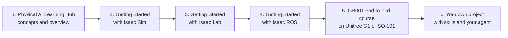

- The workshop has covered a very large stack: simulation, data pipelines, foundation models, runtime libraries and computers. 
- After a session like this, the next question is almost always the same: **where do I start, and where do I go for help?**

| Challenge | Why it hurts? |
|-----------|--------------|
| Too many tools | Isaac Sim, Isaac Lab, Isaac ROS, GR00T, Cosmos, OSMO and Jetson can feel like too much at once |
| Fast-moving software | Versions change every few months, so old tutorials may not match |
| Hardware barriers | Many people lack a workstation with a suitable GPU |
| Getting stuck | A cryptic error with no one to ask can end a project |

- The last section of the workshop answers this by pointing to the places where learning happens, from open source code to live sessions with NVIDIA engineers.

This is four different learning style, so you can mix them.

| Learning style | Resource | URL |
|----------------|------------------------|--------------|
| **Let your AI agent help** | Open source skills | [github.com/NVIDIA/skills](https://github.com/NVIDIA/skills) |
| **Look it up** | Developer forum and documentation | [developer.nvidia.com/isaac/sim](https://developer.nvidia.com/isaac/sim) · [forums.developer.nvidia.com](https://forums.developer.nvidia.com/) |
| **Ask a person** | Office hours and livestreams | [Isaac Sim Office Hours (YouTube playlist)](https://www.youtube.com/watch?v=ybtJxQbj2NE&list=PL3jK4xNnlCVewIu3MAcrP3HbvVUmKWNpS) |
| **Study step by step** | Self-paced and instructor-led courses | [nvidia.com/en-us/learn/learning-path/robotics](https://www.nvidia.com/en-us/learn/learning-path/robotics/) |

## Open Source Skills

- **NVIDIA Agent Skills** repository on GitHub ([github.com/NVIDIA/skills](https://github.com/NVIDIA/skills)) this is "Official, NVIDIA-verified skills for AI agents", with links to documentation ([docs.nvidia.com/skills](https://docs.nvidia.com/skills)), a livestream called "From Vulnerable to Verified", and a blog on agent capability governance.

### What it is?

- Skills are portable instruction sets that teach an AI coding agent how to use NVIDIA libraries and tools correctly.
- This is the same idea from the agent tools and Jetson topics, collected into one public catalog.

- NVIDIA says the repository acts as a catalog that mirrors skills from the product repositories where they are developed, updated daily.

### How to install?

```
npx skills add nvidia/skills
```

| Command | What it does? |
|---------|--------------|
| `npx skills add nvidia/skills --list` | Browse the catalog without installing anything |
| `npx skills add nvidia/skills` | Interactive install. It asks which skill and where to put it |
| `npx skills add nvidia/skills --skill <name> --yes` | Install one specific skill without prompts |
| `... --agent claude-code` (or `codex`, `cursor`, `kiro-cli`) | Install for a particular agent |
| `npx skills list`, `npx skills check`, `npx skills update` | See what is installed, preview what is out of date, and update |

- After installation, the agent can use the skill the next time it meets a relevant task.

### What "verified" means?

- NVIDIA's documentation says a verified skill is **cataloged** from the owning product team, **scanned**, **evaluated**, **signed** and **documented with a skill card**. 
- The aim is to let you know where a skill came from and whether it changed after publication.
- NVIDIA describes this as capability governance for the skill layer.

## Developer Forum and Documentation

This stands for two things: documentation to read, and a community to ask.

| Resource | What it offers? | URL |
|----------|----------------|-----|
| **Product documentation** | Reference pages and tutorials for each tool, such as the Isaac Sim, Isaac Lab, Isaac ROS and OSMO documentation | [Isaac Sim docs](https://docs.isaacsim.omniverse.nvidia.com/latest/index.html) · [Isaac Lab docs](https://isaac-sim.github.io/IsaacLab/main/index.html) · [Isaac ROS docs](https://nvidia-isaac-ros.github.io/) |
| **NVIDIA Developer Forums** | Questions and answers with the community and NVIDIA staff. NVIDIA also posts release announcements here, such as the Isaac Sim 6.0 general availability post | [forums.developer.nvidia.com](https://forums.developer.nvidia.com/) · [Announcements](https://forums.developer.nvidia.com/c/omniverse/announcements) |
| **Physical AI Learning Hub** | NVIDIA's documentation site for physical AI learning, which lists developer forums and a community Discord as places to get support | [docs.nvidia.com/learning/physical-ai](https://docs.nvidia.com/learning/physical-ai/) |
| **Isaac Sim Learning Library** | A collection of learning materials linked from the Isaac Sim page | [developer.nvidia.com/isaac/sim](https://developer.nvidia.com/isaac/sim) |
| **Product pages on developer.nvidia.com** | Entry points that link to documentation, GitHub repositories and tutorials | [Isaac Sim](https://developer.nvidia.com/isaac/sim) · [Isaac Lab](https://developer.nvidia.com/isaac/lab) · [Isaac GR00T](https://developer.nvidia.com/isaac/gr00t) |

> **Cost note:** NVIDIA's Isaac Sim page says Isaac Sim can be used for free under the NVIDIA Isaac Sim Additional Software and Materials License. Check the license for your use case.

## Office Hours and Livestreams

| Resource | What it offers? | URL |
|----------|----------------|-----|
| **Office Hours** | Recurring live sessions where you can ask experts questions. The Isaac Sim page describes recurring Office Hours that cover in-depth topics with experts and customers using Isaac Sim | [Isaac Sim Office Hours playlist](https://www.youtube.com/watch?v=ybtJxQbj2NE&list=PL3jK4xNnlCVewIu3MAcrP3HbvVUmKWNpS) · [Isaac Lab Office Hours](https://developer.nvidia.com/isaac/lab) |
| **Livestreams** | Live or recorded sessions on specific topics. The Agent Skills repository, for example, links a livestream called "From Vulnerable to Verified" | [github.com/NVIDIA/skills](https://github.com/NVIDIA/skills) (livestream link is in the README) |
| **Virtual learning series** | NVIDIA's robotics virtual learning series covers sessions such as an introduction to physical AI and robotics at NVIDIA, accelerating robotics research, edge AI with Jetson and sim-to-real with Isaac Sim | [Physical AI Learning Hub](https://docs.nvidia.com/learning/physical-ai/) |

- **How to use them well:** bring a specific question and the exact error message, mention your software versions, and watch recordings of past sessions before asking something that may already have been answered.

## Self-Paced and Instructor Led Courses

### Robotics Fundamentals learning path

- NVIDIA's training site ([nvidia.com/en-us/learn/learning-path/robotics](https://www.nvidia.com/en-us/learn/learning-path/robotics/)) describes it as a free path that builds foundations in **simulation, Robot Operating System (ROS) and robot learning**, with hands-on training in Isaac Sim and Isaac Lab.

| Course | What it covers? | URL |
|--------|----------------|-----|
| **Getting Started With Isaac Sim** | Basic robot simulation, ROS 2 integration, synthetic data generation and AI-powered robotics | [Open course](https://docs.nvidia.com/learning/physical-ai/getting-started-with-isaac-sim/latest/index.html) |
| **Getting Started With Isaac Lab** | Robot learning: defining tasks, training and evaluating policies, and preparing for the move from simulation to a real robot | [Open course](https://docs.nvidia.com/learning/physical-ai/getting-started-with-isaac-lab/latest/index.html) |
| **Getting Started With Isaac ROS** | A foundation in Isaac ROS, NITROS and GPU-accelerated perception and navigation | [Open course](https://docs.nvidia.com/learning/physical-ai/getting-started-with-isaac-ros/latest/index.html) |
| **Getting Started With Isaac for Healthcare** | Advanced workflows combining Isaac Sim, Isaac Lab and GR00T for autonomous healthcare | [Open course](https://docs.nvidia.com/learning/physical-ai/getting-started-with-isaac-for-healthcare/latest/index.html) |

- The Isaac Lab course begins with a Robot Learning Fundamentals module. 
- Its learning objectives include defining a task's observations, actions, rewards, resets and success criteria, and comparing supervised, imitation, unsupervised and reinforcement learning.

### Other courses on NVIDIA's physical AI learning site

- NVIDIA's documentation site hosts more hands-on courses, which several earlier topics used:

| Course | Used earlier for | URL |
|--------|------------------|-----|
| **How to Develop and Deploy Humanoid Robots End-to-End with NVIDIA Isaac GR00T and Unitree G1** | The GR00T End-to-end Workflow topic | [Open course](https://docs.nvidia.com/learning/physical-ai/gr00t-e2e-workflow/latest/index.html) |
| **Getting Started With Isaac ROS** | The Isaac ROS topic | [Open course](https://docs.nvidia.com/learning/physical-ai/getting-started-with-isaac-ros/latest/index.html) |
| **Sim-to-real course for the SO-101 arm** | Showing GR00T deployment on a low-cost arm | [Open course](https://docs.nvidia.com/learning/physical-ai/sim-to-real-so-101/latest/index.html) |

- The site states that all its learning paths are free for self-paced learning.

### Getting a GPU: Brev

- The physical AI learning site offers **Brev** ([brev.nvidia.com](https://brev.nvidia.com/)), where you can run Isaac Lab and Isaac Sim in the cloud with no local install, using preconfigured environments. 
- This is the same Brev launchable from the Isaac Sim and Isaac Lab feature topics. Setup steps: [Isaac Launchable Deployment](https://docs.isaacsim.omniverse.nvidia.com/latest/installation/install_advanced_cloud_setup_launchable.html) · Repo: [isaac-sim/isaac-launchable](https://github.com/isaac-sim/isaac-launchable)

### Developer Program and instructor-led options

- NVIDIA's Developer Program ([developer.nvidia.com/developer-program](https://developer.nvidia.com/developer-program)) offers a complimentary self paced Deep Learning Institute (DLI) course to members. Example: [Isaac Sim self-paced DLI course](https://learn.nvidia.com/courses/course-detail?course_id=course-v1:DLI+S-OV-27+V1)

## Suggested Study Path

- This path is my suggestion, matched to the order of the workshop. It is not an official NVIDIA path.



| Step | Why this order? | URL |
|------|----------------|-----|
| 1. Overview | Builds the vocabulary used throughout the workshop | [Physical AI Learning Hub](https://docs.nvidia.com/learning/physical-ai/) |
| 2. Isaac Sim | The world everything else runs in | [Isaac Sim course](https://docs.nvidia.com/learning/physical-ai/getting-started-with-isaac-sim/latest/index.html) |
| 3. Isaac Lab | Training policies, building on Isaac Sim | [Isaac Lab course](https://docs.nvidia.com/learning/physical-ai/getting-started-with-isaac-lab/latest/index.html) |
| 4. Isaac ROS | Running perception and navigation on a real robot's computer | [Isaac ROS course](https://docs.nvidia.com/learning/physical-ai/getting-started-with-isaac-ros/latest/index.html) |
| 5. GR00T end-to-end | Ties data, training, evaluation and deployment together | [GR00T + Unitree G1](https://docs.nvidia.com/learning/physical-ai/gr00t-e2e-workflow/latest/index.html) · [SO-101](https://docs.nvidia.com/learning/physical-ai/sim-to-real-so-101/latest/index.html) |
| 6. Own project | Applying it, with agent skills speeding up setup | [NVIDIA Agent Skills](https://github.com/NVIDIA/skills) |

## Where Each Workshop Topic Is Taught?

| Workshop | Where to learn more? | URL |
|----------------|---------------------|-----|
| Isaac Sim | Getting Started With Isaac Sim, Isaac Sim documentation and Office Hours | [Course](https://docs.nvidia.com/learning/physical-ai/getting-started-with-isaac-sim/latest/index.html) · [Docs](https://docs.isaacsim.omniverse.nvidia.com/latest/index.html) · [Office Hours](https://www.youtube.com/watch?v=ybtJxQbj2NE&list=PL3jK4xNnlCVewIu3MAcrP3HbvVUmKWNpS) |
| Isaac Lab and Isaac Lab-Arena | Getting Started With Isaac Lab, the Isaac Lab and Arena documentation | [Course](https://docs.nvidia.com/learning/physical-ai/getting-started-with-isaac-lab/latest/index.html) · [Isaac Lab docs](https://isaac-sim.github.io/IsaacLab/main/index.html) · [Arena repo link (GR00T course repos page)](https://docs.nvidia.com/learning/physical-ai/gr00t-e2e-workflow/latest/resources/repos.html) |
| Isaac Teleop and NuRec | Their GitHub repositories and documentation | [Teleop repo link (GR00T course repos page)](https://docs.nvidia.com/learning/physical-ai/gr00t-e2e-workflow/latest/resources/repos.html) · [Isaac Sim page (NuRec)](https://developer.nvidia.com/isaac/sim) |
| GR00T and SONIC | The GR00T end-to-end course, the GR00T repository and paper | [Course](https://docs.nvidia.com/learning/physical-ai/gr00t-e2e-workflow/latest/index.html) · [Isaac GR00T](https://developer.nvidia.com/isaac/gr00t) |
| Isaac ROS and CUDA-X libraries | Getting Started With Isaac ROS and the Isaac ROS documentation | [Course](https://docs.nvidia.com/learning/physical-ai/getting-started-with-isaac-ros/latest/index.html) · [Isaac ROS docs](https://nvidia-isaac-ros.github.io/) |
| Jetson Thor and Jetson skills | The Jetson AI Lab and the JetPack documentation | [Jetson AI Lab](https://www.jetson-ai-lab.com/) · [Jetson docs](https://docs.nvidia.com/jetson/) · [Skills](https://github.com/NVIDIA/skills) |
| Agents and skills | The NVIDIA Agent Skills repository and documentation | [GitHub](https://github.com/NVIDIA/skills) · [Docs](https://docs.nvidia.com/skills) |
| Cosmos | The Cosmos documentation, GitHub and the Technical Blog | [developer.nvidia.com/cosmos](https://developer.nvidia.com/cosmos) · [github.com/nvidia-cosmos](https://github.com/nvidia-cosmos) · [Technical Blog](https://developer.nvidia.com/blog/) |

## Staying Current

- This stack changes quickly. Several earlier topics noted version changes within months, such as Isaac Sim 6.0 and 6.1, Isaac Lab 3.0 early access and the Thor JetPack versions.

1. **Check the date** of any tutorial and the version it targets.
2. **Read release notes** before upgrading.
3. **Follow the announcements category** of NVIDIA's Developer Forums ([link](https://forums.developer.nvidia.com/c/omniverse/announcements)) for general availability news.
4. **Prefer official documentation** over third-party summaries when details conflict, as several topics in these notes showed.

## Things to Check Before You Start

1. **Course content updates.** NVIDIA's training page says it constantly develops new courses and updates current content, so names and lengths may change.
2. **Time estimates.** The learning hub lists a few hours per course, but I could not match each time to a specific course reliably.
3. **Access.** Self-paced learning paths are free, but some DLI offerings, instructor-led workshops and certifications may charge. Check the current terms.
4. **Skills catalog scope.** Confirm where each physical AI skill is published before you search for it.

## Summary

1. The Learning Resources section answers "where do I start and where do I get help?" with four resources.
2. **Open source skills:** NVIDIA-verified agent skills that teach your coding agent to use NVIDIA tools, installed with `npx skills add nvidia/skills`.
3. **Developer forum and documentation:** reference pages, community answers and release announcements.
4. **Office hours and livestreams:** live access to NVIDIA experts, including recurring Isaac Sim Office Hours.
5. **Self-paced and instructor-led courses:** free **Robotics Fundamentals** learning path covering Isaac Sim, Isaac Lab, Isaac ROS and healthcare workflows, plus hands-on GR00T courses.
6. **Brev** offers cloud environments if you do not have a suitable GPU.
7. Because the software changes fast, always check dates and versions.

## References

1. [NVIDIA Agent Skills on GitHub](https://github.com/NVIDIA/skills)
2. [NVIDIA Agent Skills documentation](https://docs.nvidia.com/skills/)
3. [NVIDIA Technical Blog, "NVIDIA-Verified Agent Skills Provide Capability Governance for AI Agents"](https://developer.nvidia.com/blog/?p=116988)
4. [NVIDIA Physical AI Learning Hub](https://docs.nvidia.com/learning/physical-ai/index.html)
5. [NVIDIA Robotics Fundamentals Learning Path](https://nvidia.com/en-us/learn/learning-path/robotics)
6. [Getting Started With Isaac Lab, Robot Learning Fundamentals](https://docs.nvidia.com/learning/physical-ai/getting-started-with-isaac-lab/latest/robot-learning-fundamentals/index.html)
7. [NVIDIA Isaac Sim](https://developer.nvidia.com/isaac/sim)
8. [NVIDIA AI Learning Essentials](https://www.nvidia.com/en-gb/learn/ai-learning-essentials/)
9. [NVIDIA AI Robotics](https://www.nvidia.com/en-us/industries/robotics/)
