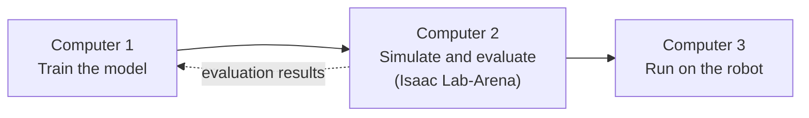

- Training a robot policy is only half the job. 
- The other half is answering one question: **how good is this policy, really?**

| Question | Why it is hard? |
|----------|----------------|
| Does the policy work on one task? | Easy to check once, on one setup |
| Does it work on hundreds of tasks, many scenes and different robot bodies? | The number of combinations explodes |
| Why did it fail, and what should we fix? | A single success rate does not tell us |

- Checking this on a real robot is slow and expensive, so the work moves into simulation. 
- But simulation alone is not enough if every team writes its own tasks and its own evaluation scripts. 
- This is the gap that **Isaac Lab-Arena** is built for.
- **Isaac Lab-Arena** is an *open-source framework for scalable task curation and policy evaluation in simulation*
- That one sentence is the whole topic. The rest of the deck explains it piece by piece.

## Breaking Down the One Sentence

| Phrase | Meaning |
|--------|---------------|
| **Open-source framework** | The code is public. Developers can use it, share it and contribute. NVIDIA documents the code as released under Apache 2.0 |
| **Task curation** | Creating, organizing and varying the tasks a robot is tested on, such as swapping objects, backgrounds or the robot itself |
| **Policy evaluation** | Measuring how well a trained robot policy performs on those tasks, and learning why it succeeds or fails |
| **Scalable** | Running many variations in parallel on GPUs instead of one test at a time |
| **In simulation** | Everything runs in a virtual world, so it is fast, safe and repeatable |

Two ideas to hold on to:

1. **Arena is about testing, not training.** It extends Isaac Lab, which is the robot learning framework. Arena adds the evaluation side.
2. **Arena is a framework plus a community.** NVIDIA describes it as both a way to build benchmarks and a growing library of ready-to-use community benchmark content.

## Where Arena Sits in the Stack?

```
   COMMUNITY BENCHMARKS      (built on top of Arena)
            |
     ISAAC LAB-ARENA         (task curation + policy evaluation)
            |
        ISAAC LAB            (simulation and robot learning platform)
            |
   PhysX  /  Newton          (physics backends)
```

> **Why it matters:** Arena does not replace Isaac Lab. It sits on top of it, so anything authored in Arena can also be used inside Isaac Lab for data collection or policy learning.

## How It Connects to the Three Computer Idea?

- In NVIDIA's three computer strategy, Arena belongs to the **second computer**, the one used for simulation.



- The dotted arrow is the reason Arena exists. 
- Evaluation results flow back so the policy can be improved before it ever touches a real robot.

## What We Will Cover Next?

- The rest of the deck follows a clear story. Each topic below becomes its own note.

| Order | Topic | Question it answers? |
|-------|-------|---------------------|
| 1 | **The Challenge** | Why do generalist robot policies need evaluation at scale? |
| 2 | **The Gap** | Why is evaluation still fragmented and manual today? |
| 3 | **The Solution** | How does Isaac Lab-Arena close the gap? |
| 4 | **The Benefit** | What do developers gain? |
| 5 | **Simplified and Scalable Task Authoring** | How are tasks composed, varied and chained? |
| 6 | **Systematic and Actionable Failure Diagnosis** | How do we learn *why* a policy fails? |
| 7 | **Large Scale Parallel Evaluation** | How fast can evaluation run on GPUs? |
| 8 | **Community Benchmarks on Unified Core** | How do benchmarks share one foundation? |
| 9 | **End-to-end Workflow** | How does Arena connect to data capture, training and improvement? |

## Summary

1. Isaac Lab-Arena is an open-source framework for **scalable task curation and policy evaluation in simulation**.
2. It extends **Isaac Lab**, adding the evaluation layer on top of the simulation and learning platform.
3. It targets a real problem: robot policies must be tested across many tasks, scenes and embodiments, and that testing is slow and fragmented today.
4. It belongs to the simulation stage of NVIDIA's three computer loop, feeding results back to improve the policy.
5. The next topic, **The Challenge**, explains why evaluation at scale is needed in the first place.

## References

1. [NVIDIA Developer, "NVIDIA Isaac Lab-Arena"](https://developer.nvidia.com/isaac/lab-arena)
2. [Isaac Lab-Arena documentation, "Welcome to Isaac Lab-Arena!"](https://isaac-sim.github.io/IsaacLab-Arena/release/0.3.0/index.html)
3. [NVIDIA Technical Blog, "Simplify Generalist Robot Policy Evaluation in Simulation with NVIDIA Isaac Lab-Arena"](https://developer.nvidia.com/blog/simplify-generalist-robot-policy-evaluation-in-simulation-with-nvidia-isaac-lab-arena)
4. [Isaac Lab-Arena on GitHub](https://github.com/isaac-sim/IsaacLab-Arena)
5. [Isaac Lab: A GPU-Accelerated Simulation Framework for Multi-Modal Robot Learning (NVIDIA, section on Isaac Lab-Arena)](https://arxiv.org/pdf/2511.04831)
6. [NVIDIA Isaac Lab perspectives, "Which open-source framework is strongest for scalable robot learning research"](https://perspectives.nvidia.com/isaac-lab/open-source-framework-scalable-robot-learning-research-industrial-academic/)
