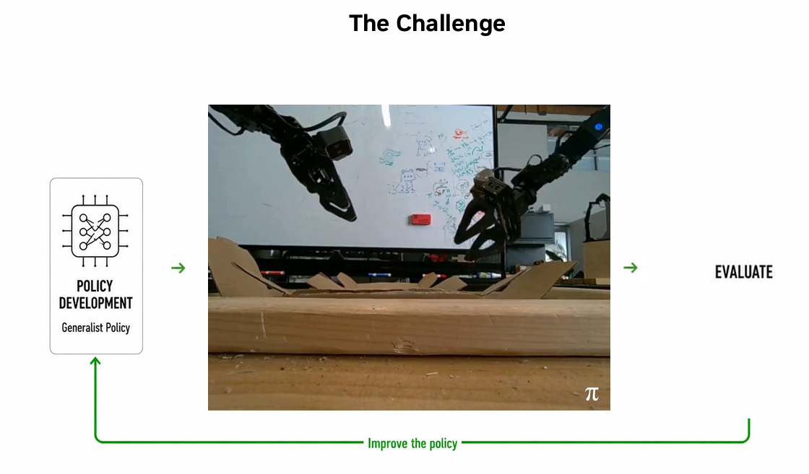
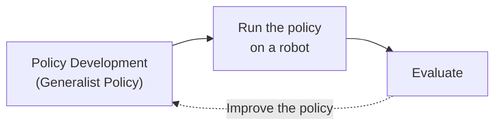

- A robot policy is the "brain" that turns what the robot sees into actions. 
- Building one is not a single step. 
- Every policy goes through the same cycle: build it, test it, find out what is wrong, and build it again.

| Stage | The question | Why it is hard? |
|-------|--------------|----------------|
| Develop | How do we build a policy that can do many tasks? | A generalist policy must handle many tasks, robots and places, not just one |
| Evaluate | How do we know it actually works? | Testing a robot in the real world is slow, and a policy can look good on one demo and fail elsewhere |
| Improve | What should we change? | We need results that point to a cause, not just a score |

- This topic shows the first half of the problem: the loop exists, but **evaluation is the stage that holds it back**.

|  | What it means? |
|-------------------|---------------|
| **Policy Development** (Generalist Policy) | A team builds a policy meant to work across many tasks, not only one |
| **Photo of a robot at work** | The policy running on a real robot, here a pair of robot arms working on a table |
| **Evaluate** | Measuring how well the policy performs |
| **Improve the policy** (arrow looping back) | Evaluation results feed the next round of development |

## Key Terms

| Term | Meaning |
|------|---------------|
| **Policy** | The model that decides the robot's actions from what it senses |
| **Generalist policy** | A policy designed to work across many tasks, robot bodies (embodiments) and environments |
| **Specialist policy** | A policy tuned for one narrow job |
| **Evaluation** | Running the policy and measuring results such as success rate |

Two ideas to hold on to:

1. **The loop is only as good as its evaluation step.** If evaluation is slow or shallow, the "Improve the policy" arrow carries weak feedback, and the next version improves slowly.
2. **Generalists raise the bar.** NVIDIA's technical blog states that generalist policies must operate across diverse tasks, embodiments and environments, which means evaluation must be scalable and repeatable.

> **Why it matters:** One robot, one task and one setting can be tested by hand. A generalist policy cannot. The number of situations it should handle grows quickly, so testing has to scale with it.

## Why Real World Testing Alone Is Not Enough?

- Real-world testing is valuable, but on its own it struggles to cover a generalist policy.

| Limit of real world testing | Effect on the loop |
|-----------------------------|--------------------|
| Each trial takes real time on real hardware | Few trials per day, so slow feedback |
| Setups must be rebuilt by hand for each variation | Hard to repeat the same test exactly |
| Trying risky behavior can damage hardware or people | Some failures are too costly to explore |

- This is the same reasoning behind NVIDIA's three computer strategy, where the simulation computer exists so that practice is "cheap and safe".
- Isaac Lab-Arena applies that idea to the **evaluation** step.

## Summary

1. Robot policy development is a loop: **develop, evaluate, improve**.
2. The goal is increasingly a **generalist policy** that works across many tasks, robots and environments.
3. Evaluation is the step that decides how fast the loop turns, because it produces the feedback for improvement.
4. Evaluating only on real robots is slow, hard to repeat and sometimes unsafe, so evaluation needs to move into scalable simulation.

## References

1. [NVIDIA Technical Blog, "Simplify Generalist Robot Policy Evaluation in Simulation with NVIDIA Isaac Lab-Arena"](https://developer.nvidia.com/blog/simplify-generalist-robot-policy-evaluation-in-simulation-with-nvidia-isaac-lab-arena)
2. [NVIDIA Developer, "NVIDIA Isaac Lab-Arena"](https://developer.nvidia.com/isaac/lab-arena)
3. [Isaac Lab-Arena documentation, "Welcome to Isaac Lab-Arena!"](https://isaac-sim.github.io/IsaacLab-Arena/release/0.3.0/index.html)
4. [Isaac Lab: A GPU-Accelerated Simulation Framework for Multi-Modal Robot Learning (NVIDIA, section on Isaac Lab-Arena)](https://arxiv.org/pdf/2511.04831)
5. [NVIDIA Blog, "What Is NVIDIA's Three-Computer Solution for Robotics?"](https://blogs.nvidia.com/blog/three-computers-robotics/)
