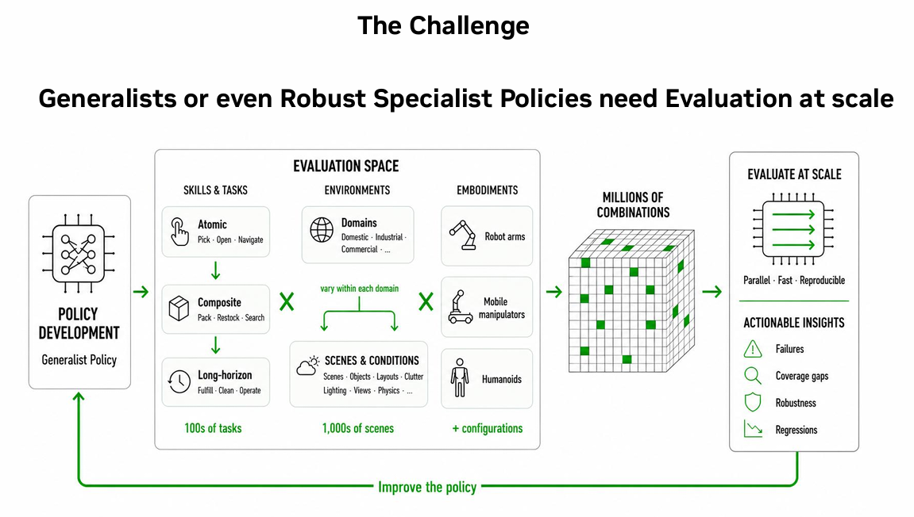

## Introduction

- The previous topic showed the loop: develop a policy, evaluate it, improve it. 
- This topic zooms into the **Evaluate** step and asks a harder question: **evaluate on what?**
- It is: *Generalists or even Robust Specialist Policies need Evaluation at scale.*

| Policy type | What it is expected to do? | Why evaluation gets big? |
|-------------|---------------------------|-------------------------|
| **Generalist policy** | Work across many tasks, robots and places | Every new task, scene or robot adds to what must be tested |
| **Robust specialist policy** | Do one job reliably under changing conditions | Even one job faces many lighting, layout and object variations |

- Generalist policies must operate across diverse tasks, embodiments and environments, so evaluation has to be scalable and repeatable.

- A policy goes in, passes through the **Evaluation Space**, becomes **millions of combinations**, and comes out as **actionable insights**.

## Three Axes of the Evaluation Space

- The evaluation space has three independent axes. A single test is one choice from each.

| Axis | What varies? | Examples | Scale |
|------|-------------|-----------------------|--------------------|
| **Skills and tasks** | What the robot is asked to do? | Atomic: pick, open, navigate. Composite: pack, restock, search. Long-horizon: fulfill, clean, operate | **100s of tasks** |
| **Environments** | Where the task happens? | Domains: domestic, industrial, commercial. Scenes and conditions: objects, layouts, clutter, lighting, camera views, physics | **1,000s of scenes** |
| **Embodiments** | Which robot body does it? | Robot arms, mobile manipulators, humanoids | **+ configurations** |

Notes on the skills axis:

1. **Atomic** skills are single actions, such as picking an object.
2. **Composite** skills combine several atomic skills, such as packing.
3. **Long-horizon** tasks chain many steps over a long time, such as cleaning a room.

Notes on the environments axis:

1. **Domain** is the broad setting, such as a home or a factory.
2. **Within each domain**, the scene can still vary a lot: which objects are present, how they are laid out, how cluttered the table is, how bright the light is, and where the camera sits.

## Why the Numbers Explode?

- The axes are **multiplied**, not added. The diagram shows this with the "X" signs between the three boxes.

| Illustration | Count |
|--------------|-------|
| Tasks | 100 |
| Scenes | 1,000 |
| Robot configurations | 10 |
| **Combinations** | 100 x 1,000 x 10 = **1,000,000** |

- These numbers are only an illustration of the multiplication, using the diagrams "100s" and "1,000s" as a guide. 
- **Millions of combinations**, and shows them as a 3D grid where only a few cells are highlighted. 
- Those highlighted cells stand for the small part a team can realistically test by hand.

> **Why it matters:** Testing a few cells of the grid gives a success rate, but it says little about the rest of the grid. A policy can score well on the cells tested and still fail in cells nobody looked at.

## What "Evaluate at Scale" Must Deliver?

- what a good large-scale evaluation should provide.

| Property | Meaning |
|----------|---------|
| **Parallel** | Many tests run at the same time, instead of one after another |
| **Fast** | Results arrive quickly enough to keep the loop turning |
| **Reproducible** | The same test can be repeated and compared fairly |

- And the output should be **actionable insights**, not only a score.

| Insight | What it tells the team? |
|---------|------------------------|
| **Failures** | Which cases the policy gets wrong? |
| **Coverage gaps** | Which parts of the space were never tested? |
| **Robustness** | How well the policy holds up when conditions change? |
| **Regressions** | Whether a new version got worse at something the old one did well? |

- **Improve the policy**, which brings these insights back to policy development. That is the same loop as the previous topic, now with a clear picture of what feeds it.

## Summary

1. Both **generalist** and **robust specialist** policies need evaluation at scale.
2. The evaluation space has three axes: **skills and tasks, environments, embodiments**.
3. These axes multiply, so the space reaches **millions of combinations**.
4. A good evaluation must be **parallel, fast and reproducible**.
5. Its output should be **actionable insights**: failures, coverage gaps, robustness and regressions.
6. The next topic, **The Gap**, shows why today's evaluation tooling does not reach this goal.

## References

1. [NVIDIA Technical Blog, "Simplify Generalist Robot Policy Evaluation in Simulation with NVIDIA Isaac Lab-Arena"](https://developer.nvidia.com/blog/simplify-generalist-robot-policy-evaluation-in-simulation-with-nvidia-isaac-lab-arena)
2. [NVIDIA Developer, "NVIDIA Isaac Lab-Arena"](https://developer.nvidia.com/isaac/lab-arena)
3. [Isaac Lab-Arena documentation, "Welcome to Isaac Lab-Arena!"](https://isaac-sim.github.io/IsaacLab-Arena/release/0.3.0/index.html)
4. [Isaac Lab: A GPU-Accelerated Simulation Framework for Multi-Modal Robot Learning (NVIDIA, section on Isaac Lab-Arena)](https://arxiv.org/pdf/2511.04831)
