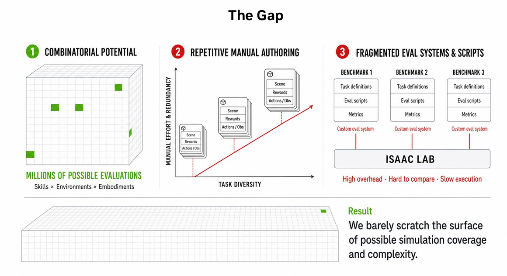
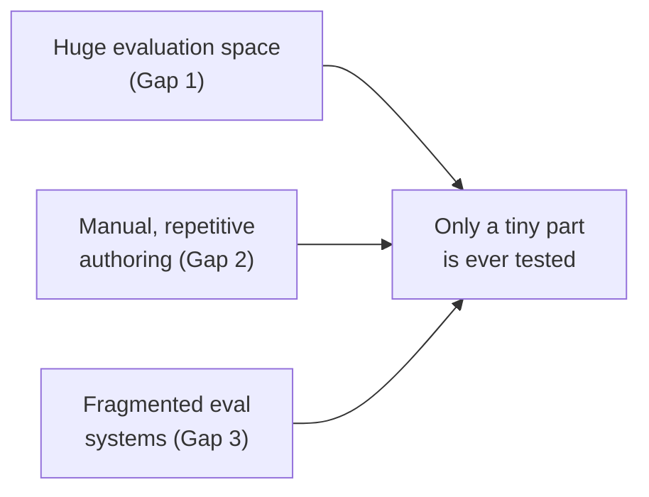

- The last topic showed what we *want*: evaluating policies across a space of millions of combinations. 
- This topic shows why that is **not** what teams get today.

- NVIDIA's technical blog describes the situation in one sentence: setting up large-scale policy evaluations is tedious and manual, and without a systematic approach developers must build high overhead custom infrastructure, while task libraries stay limited in complexity and diversity.

- The topic breaks that sentence into **three gaps** and one **result**.

| Gap | Short name | The problem in one line |
|-----|-----------|-------------------------|
| 1 | **Combinatorial potential** | The space of possible evaluations is huge |
| 2 | **Repetitive manual authoring** | Every new task is built by hand, again and again |
| 3 | **Fragmented eval systems and scripts** | Each benchmark has its own custom tooling |
| Result | **Barely scratching the surface** | Only a tiny part of the space ever gets tested |



## Gap 1: Combinatorial Potential

|  | Meaning |
|------|---------|
| The cube | The full evaluation space: **Skills x Environments x Embodiments** |
| Highlighted cells | The few evaluations that actually get run |
| Label | **Millions of possible evaluations** |

> **Why it matters:** The opportunity is large, but potential alone does nothing. The next two gaps explain why teams cannot reach most of it.

## Gap 2: Repetitive Manual Authoring

- The diagram plots **manual effort and redundancy** (vertical) against **task diversity** (horizontal). 
- The line goes up and to the right.

| What the chart shows? | What it means? |
|----------------------|---------------|
| Each task is a stack of cards: **Scene, Rewards, Actions/Obs** | Every task needs its own scene, reward logic, and action and observation setup |
| More stacks as diversity grows | More tasks means more hand-written pieces |
| The red line rises | Effort grows with every new task, and a lot of it repeats |

- This matches how Isaac Lab's **manager-based workflow** works. 
- An environment is defined by a configuration that bundles a scene together with its actions, observations and rewards. 
- That design is powerful and flexible, but each new task normally means writing a new configuration. 
- NVIDIA's Isaac Lab paper makes the same point: Isaac Lab's manager-based workflow offers strong configuration capabilities, yet reaching full end-to-end evaluation, from asset preparation to environment setup to large-scale policy evaluation, often takes significant manual effort.

- Two ideas to hold on to:

1. **Redundancy is the real cost.** A "pick up the banana" task and a "pick up the drill" task are almost the same, yet in a hand authored setup both can end up as separate, nearly duplicate files.
2. **Effort scales with diversity.** The more varied the benchmark, the more the cost grows, which discourages teams from building diverse ones.

## Gap 3: Fragmented Eval Systems and Scripts

- The diagram shows three benchmarks side by side.

- Each one connects down to **Isaac Lab** through a **custom eval system**.
- Isaac Lab is the shared simulation base, but everything above it is rebuilt per benchmark.

```
 BENCHMARK 1          BENCHMARK 2          BENCHMARK 3
 task defs            task defs            task defs
 eval scripts         eval scripts         eval scripts
 metrics              metrics              metrics
     |                    |                    |
 custom eval          custom eval          custom eval
   system               system               system
     |                    |                    |
     +--------------------+--------------------+
                          |
                      ISAAC LAB
```

The diagram names three consequences:

| Consequence | Meaning |
|-------------|---------------|
| **High overhead** | Each team spends time on infrastructure instead of on policies |
| **Hard to compare** | Different scripts and metrics make results from two benchmarks difficult to line up |
| **Slow execution** | Custom systems are often not built to run many evaluations in parallel |

> **Why it matters:** Fragmentation means no shared foundation. Good ideas, such as a better metric or a better scene, stay locked inside one benchmark instead of being reused by others.

## The Result

- The bottom of the diagram shows a long flat grid with a single highlighted cell, next to the statement: **we barely scratch the surface of possible simulation coverage and complexity.**



## Summary

1. The evaluation space is huge: **millions of possible evaluations** across skills, environments and embodiments.
2. **Manual authoring** makes each new task costly, and much of that work repeats.
3. **Fragmented systems** mean each benchmark has its own tasks, scripts and metrics, so results are hard to compare and slow to run.
4. The result is that teams cover only a very small part of the possible space.
5. The next topic, **The Solution**, introduces Isaac Lab-Arena as the shared layer that closes these gaps.

## References

1. [NVIDIA Technical Blog, "Simplify Generalist Robot Policy Evaluation in Simulation with NVIDIA Isaac Lab-Arena"](https://developer.nvidia.com/blog/simplify-generalist-robot-policy-evaluation-in-simulation-with-nvidia-isaac-lab-arena)
2. [Isaac Lab: A GPU-Accelerated Simulation Framework for Multi-Modal Robot Learning (NVIDIA, section on Isaac Lab-Arena)](https://arxiv.org/pdf/2511.04831)
3. [Isaac Lab documentation, "Creating a Manager-Based RL Environment"](https://isaac-sim.github.io/IsaacLab/release/3.0.0/source/how-to/create_manager_rl_env.html)
4. [Isaac Lab-Arena documentation, "Environment Builder"](https://isaac-sim.github.io/IsaacLab-Arena/main/pages/concepts/environment/env_builder.html)
5. [NVIDIA Developer, "NVIDIA Isaac Lab-Arena"](https://developer.nvidia.com/isaac/lab-arena)
