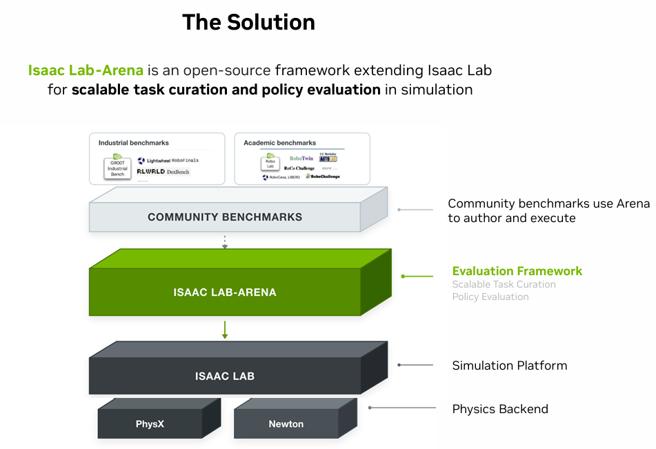
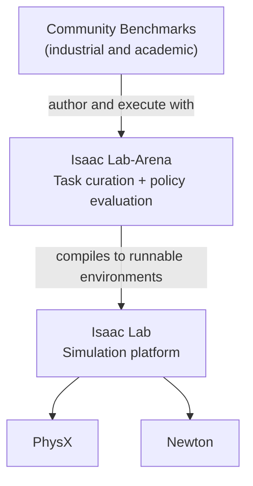

## Introduction

- The previous topic ended with three gaps: a huge evaluation space, repetitive manual authoring, and fragmented evaluation systems. - Fixing them needs one shared layer that every benchmark can build on, instead of each team rebuilding its own.

| Gap | What a fix must provide? |
|-----------------------------|-------------------------|
| Huge evaluation space | A way to create many task variations quickly |
| Repetitive manual authoring | Reusable building blocks instead of hand-written duplicates |
| Fragmented eval systems | One common framework for authoring and running evaluations |

- The solution is **Isaac Lab-Arena which is an open-source framework extending Isaac Lab for scalable task curation and policy evaluation in simulation.**

- NVIDIA's documentation describes the same idea: Arena extends Isaac Lab with reusable APIs to author robot policy evaluations, run them at scale, and analyze the results for actionable feedback.

## Four-Layer Stack



- Each layer builds on the one below it.

| Layer | Role | What it does? |
|-------|------|--------------|
| **Community Benchmarks** | Content | Industrial and academic benchmarks built using Arena |
| **Isaac Lab-Arena** | Evaluation framework | Scalable task curation and policy evaluation |
| **Isaac Lab** | Simulation platform | GPU-accelerated robot learning framework that runs the environments |
| **PhysX and Newton** | Physics backend | The engines that calculate how things move and collide |

Two ideas to hold on to:

1. **Arena is the middle layer.** Benchmarks above it reuse it. It reuses Isaac Lab below it. Nothing is rebuilt.
2. **The arrows go one way.** Benchmarks use Arena, and Arena uses Isaac Lab.

## Layer by Layer

### Community Benchmarks (top)

| Group | Names  |
|-------|--------------------------|
| **Industrial benchmarks** | GR00T Industrial Bench, Lightwheel RoboFinals, RLWRLD DexBench, and more |
| **Academic benchmarks** | RoboLab, RoboTwin, UC Berkeley AutoLab, RoCo Challenge, RoboCasa, LIBERO, RoboChallenge, and more |

- NVIDIA's public material confirms several of these partners. 
- Lightwheel co-developed Arena and uses it for its RoboCasa and LIBERO task suites and for RoboFinals, an industrial benchmark. RoboTwin is using Arena to build extended versions of RoboTwin 2.0. 
- Arena was also built in collaboration with the authors of RoboLab. 
- The GR00T Industrial Bench, DexBench, AutoLab, RoCo Challenge and RoboChallenge, come from the deck only.

> **Why it matters:** Because these benchmarks share one framework, a task, scene or metric written once can be adapted by others, instead of staying locked inside one benchmark.

### Isaac Lab-Arena (middle)

- The diagram labels this layer **Evaluation Framework**, with two jobs:

| Job | Meaning |
|-----|---------|
| **Scalable Task Curation** | Create and vary tasks from reusable parts, so one task can become many |
| **Policy Evaluation** | Run a policy on those tasks, in parallel, and collect results |

### Isaac Lab (simulation platform)

- Isaac Lab is NVIDIA's GPU-accelerated, open-source framework for robot learning, built on Isaac Sim. 
- Arena turns its Arena-authored environments into runnable Isaac Lab environments, so the same environment can also be used in Isaac Lab for data collection or policy learning.

### PhysX and Newton (physics backend)

- Isaac Lab runs on a physics backend. The diagram shows two.

| Backend | What NVIDIA's Isaac Lab docs say? |
|---------|-----------------------------------|
| **PhysX** | The historical default. Production-ready, broad feature coverage, and the reference for behavior |
| **Newton** | GPU-accelerated, Warp-native and differentiable. It is open source, with contributions from NVIDIA, Google DeepMind and Disney Research, managed through the Linux Foundation |

## How the Pieces Connect?



## Summary

```
   COMMUNITY BENCHMARKS      Community benchmarks use Arena to author and execute
            |
     ISAAC LAB-ARENA         Evaluation Framework
            |                (Scalable Task Curation, Policy Evaluation)
        ISAAC LAB            Simulation Platform
            |
    PhysX  |  Newton         Physics Backend
```

1. Isaac Lab-Arena is an **open-source framework** that extends Isaac Lab for **scalable task curation and policy evaluation**.
2. It forms a **four-layer stack**: community benchmarks, Arena, Isaac Lab, then the physics backends PhysX and Newton.
3. Benchmarks use Arena, and Arena uses Isaac Lab, so no benchmark needs its own custom evaluation system.
4. Several benchmark partners are confirmed publicly.
5. Newton support in Isaac Lab is beta, and backend support depends on the task.
6. The next topic, **The Benefit**, lists what this stack gives developers.

## References

1. [NVIDIA Developer, "NVIDIA Isaac Lab-Arena"](https://developer.nvidia.com/isaac/lab-arena)
2. [Isaac Lab-Arena documentation, "Welcome to Isaac Lab-Arena!"](https://isaac-sim.github.io/IsaacLab-Arena/release/0.3.0/index.html)
3. [NVIDIA Technical Blog, "Simplify Generalist Robot Policy Evaluation in Simulation with NVIDIA Isaac Lab-Arena"](https://developer.nvidia.com/blog/simplify-generalist-robot-policy-evaluation-in-simulation-with-nvidia-isaac-lab-arena)
4. [Isaac Lab-Arena documentation, "Environment Builder"](https://isaac-sim.github.io/IsaacLab-Arena/main/pages/concepts/environment/env_builder.html)
5. [Isaac Lab documentation, "Physics Backends"](https://isaac-sim.github.io/IsaacLab/release/3.0.0/source/concepts/physics_backends.html)
6. [Isaac Lab documentation, "Physics Backends" (overview and Newton backend)](https://isaac-sim.github.io/IsaacLab/develop/source/overview/core-concepts/physical-backends/index.html)
7. [Isaac Lab: A GPU-Accelerated Simulation Framework for Multi-Modal Robot Learning (NVIDIA, section on Isaac Lab-Arena)](https://arxiv.org/pdf/2511.04831)
